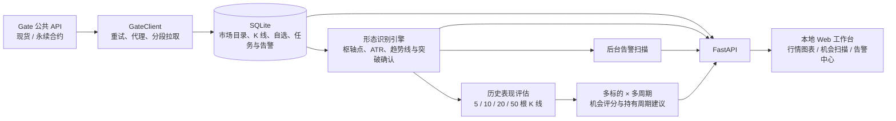
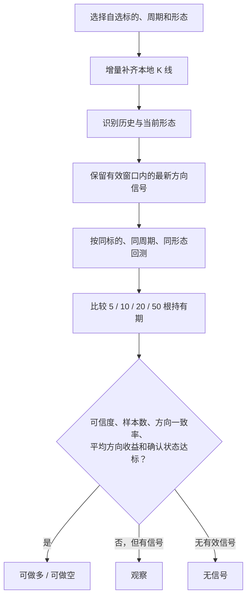
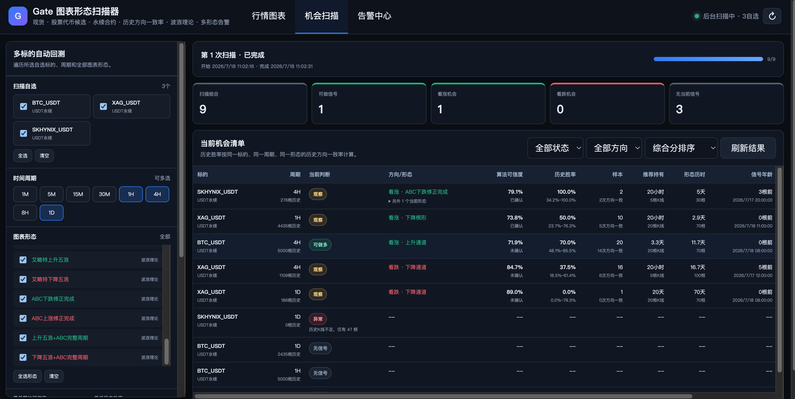
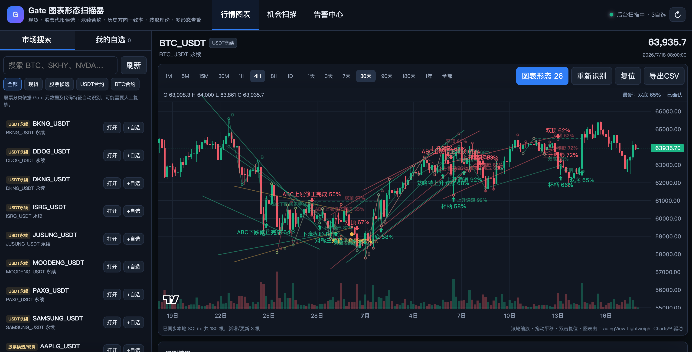
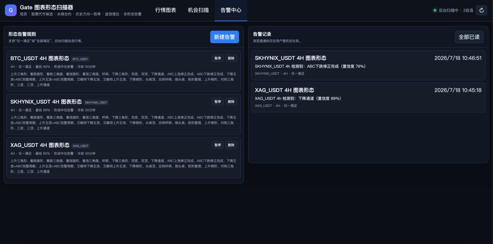
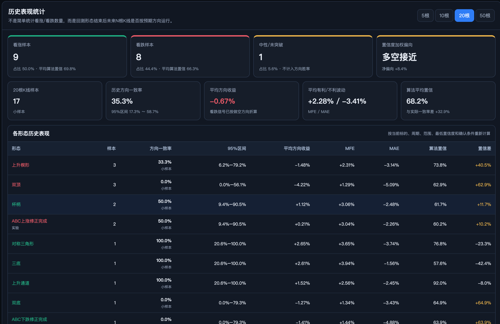

# GateScope

> Gate 市场形态研究与机会扫描工作台

GateScope 包含兼容的本地 SQLite 研究应用，以及正在生产化的 PostgreSQL/Timescale V2。V2 已落地正式账号/MFA/RLS、版本化配置与告警、React 行情工作台、Telegram 通知控制面、面向 Codex 的只读 MCP 研究服务、不可变证据驱动的 PAPER 提案/确认/交易事件账本，以及 Gate TESTNET 凭据接入和受限订单/原生保护演练闭环。

项目只接受 Gate TESTNET 凭据。2026-09-12 按用户要求取消夏普>1.5、回撤<15%、命中率>55%、t>2.0及其关联样本量的四项部署前置限制，改为 `performance-observation-2` 观察指标；不再按这四项淘汰。既有19项独立研究证据校验、有效执行认证、OWNER/MFA、账户安全确认、冻结条款和执行保护仍保留，并不自动开启实盘。认证聚合与不可变落库已实现，但上游 nested walk-forward/bootstrap/DSR/PBO 统计工件生产器尚未实现，所以正常产品路径默认不产生订单。系统不接受 LIVE 账户或 LIVE host。当前改动见 [绩效观察与事件修复](docs/v2/32_EVENT_REPAIRS_AND_PERFORMANCE_OBSERVATION.md)；[原策略筛选报告](docs/v2/23_STRATEGY_DISCOVERY_AND_ADMISSION.md) 保留历史研究结果，不再代表当前四项部署政策。

> [!WARNING]
> 当前版本仍不具备生产实盘资格。`LIVE_TRADING_ENABLED=true` 会使 executor 启动失败；订单 workload 只允许明确的 `TESTNET`。交易所私钥只可通过 Web 提交给 encrypt-only admission，API 仅持有 wrapping 公钥，隔离 validator/executor 才持有私钥；不得放入源码或 API 环境。PostgreSQL 与真实 Gate TESTNET 联调门禁仍须在预发布环境执行。

## 目录

当前部署（2026-09-11）：[新服务器工作台](https://43.108.44.74/markets/chart)。原账号和验证器不变；迁移核对、资源限制、续期与回退信息见 [部署记录](docs/v2/21_SERVER_MIGRATION_20260911.md)。实盘限制仍以本文顶部说明为准。

2026-09-24 容量治理已部署：可用空间约 0.90 → 3.95 GiB，修复目录重复版本增长，保留实时行情和告警，暂停历史批量计算。执行与恢复边界见 [容量回收与实时优先治理](docs/v2/56_CAPACITY_RECOVERY_AND_REALTIME.md)。

最新形态/波浪改进、覆盖数量对照与绘图验收：[V3.1 修正记录](docs/v2/26_STRUCTURE_COVERAGE_AND_GEOMETRY.md)。

- [核心能力](#核心能力)
- [工作原理](#工作原理)
- [支持的市场与形态](#支持的市场与形态)
- [快速开始](#快速开始)
- [使用指南](#使用指南)
- [指标口径](#指标口径)
- [配置说明](#配置说明)
- [Docker 与云端部署](#docker-与云端部署)
- [项目结构](#项目结构)
- [V2 生产化规划](#v2-生产化规划)
- [功能进度（Todo List）](#功能进度todo-list)
- [限制与风险提示](#限制与风险提示)

## 核心能力

- **多市场行情**：搜索 Gate 现货、USDT 永续和 BTC 永续，启发式标记股票代币候选。
- **本地 K 线仓库**：按自选标的和周期增量缓存行情，支持 CSV 导出，数据保存在本地 SQLite。
- **26 种图表形态**：覆盖反转、持续、整理、趋势及实验性的艾略特波浪形态。
- **交互式图表**：基于 TradingView Lightweight Charts™ 展示 K 线与成交量，并用 SVG 叠加形态关键点和趋势线。
- **历史方向验证**：按未来 5、10、20、50 根 K 线评估方向一致率、Wilson 置信区间、方向收益、MFE 和 MAE。
- **机会扫描**：遍历“自选标的 × 时间周期 × 形态”，结合当前信号与同条件历史表现筛选多空观察机会。
- **后台告警**：按置信度、突破状态、形态组合和冷却时间触发浏览器通知与声音。
- **本地优先**：无需前端构建工具，FastAPI、原生 JavaScript 与 SQLite 即可运行；支持 macOS、Windows 和 Docker。

## 工作原理



一次机会扫描的判断链路如下：



机会扫描会跨自选与周期执行形态回测，展示方向、形态、算法可信度、历史方向一致率、样本数、推荐持有周期、信号年龄和综合评分。

<p align="center">
  
</p>

## 支持的市场与形态

### 市场与周期

| 类型 | 范围 |
| --- | --- |
| 市场 | Gate 现货、USDT 结算永续、BTC 结算永续 |
| 股票代币 | 根据 Gate 元数据和代码特征启发式标记，仅作为候选分类 |
| K 线周期 | `1m`、`5m`、`15m`、`30m`、`1h`、`4h`、`8h`、`1d` |
| 图表范围 | 1 天、3 天、7 天、30 天、90 天、180 天、1 年、全部 |

### 图表形态

| 分类 | 形态 |
| --- | --- |
| 反转形态 | 双顶、双底、三顶、三底、头肩顶、倒头肩、杯柄、反转杯柄 |
| 持续形态 | 看涨旗形、看跌旗形、看涨三角旗、看跌三角旗 |
| 整理形态 | 上升三角形、下降三角形、对称三角形、矩形整理 |
| 趋势形态 | 上升楔形、下降楔形、上升通道、下降通道 |
| 波浪理论（实验） | 艾略特上升五浪、艾略特下降五浪、ABC 下跌修正完成、ABC 上涨修正完成、上升五浪 + ABC 完整周期、下降五浪 + ABC 完整周期 |

识别算法综合使用枢轴高低点、线性拟合、ATR、结构比例和突破确认进行启发式评分。它仅识别图表结构，不包含十字星、锤形、吞没、孕线等单根或多根 K 线组合。

### 交互式行情图表

行情工作区展示蜡烛 K 线与成交量，支持鼠标滚轮缩放、拖动平移、双击复位和 CSV 导出。识别到的形态通过 SVG 叠加层绘制，缩放和平移时会同步重绘，也可以点击识别结果定位到对应区间。

<p align="center">
  
</p>

## 快速开始

### 环境要求

- Python 3.10 或更高版本，推荐 Python 3.12
- 可访问 Gate 公共 API；受网络环境限制时可在 `config.json` 中配置 HTTP 或 SOCKS5 代理
- 首次加载图表时需要获取 TradingView Lightweight Charts™；程序会优先将其缓存到 `static/vendor/`

### macOS

在项目目录中执行：

```bash
chmod +x setup.command run.command
./setup.command
```

`setup.command` 会创建 `.venv`、安装依赖并启动服务。以后可直接运行：

```bash
./run.command
```

### Windows

双击 `run.bat`。脚本会在首次运行时创建虚拟环境并安装依赖。

### 通用 Python 方式

```bash
python3 -m venv .venv
source .venv/bin/activate
python -m pip install -e .
gatescope-admin create-owner --username owner
python app.py
```

Windows PowerShell 激活虚拟环境时，将第三行替换为：

```powershell
.venv\Scripts\Activate.ps1
```

默认访问地址：<http://127.0.0.1:8777>

`gatescope-admin` 会在终端中安全读取至少 16 字节的密码，不接受把密码写在命令参数中。无人值守的首次部署可由秘密管理器临时注入 `GATESCOPE_BOOTSTRAP_USERNAME` 与 `GATESCOPE_BOOTSTRAP_PASSWORD`；创建首个 OWNER 后应移除这两个环境变量。

## 使用指南

1. **刷新市场目录**：首次启动会在后台读取 Gate 市场目录；也可在“市场搜索”中手动刷新。
2. **建立自选**：搜索并打开标的，将需要持续跟踪的标的加入“我的自选”。
3. **识别形态**：选择周期、历史范围、目标形态、最低置信度和是否仅看突破确认，然后执行识别。
4. **查看历史表现**：在 5、10、20、50 根 K 线之间切换，比较方向一致率、区间和收益指标。
5. **扫描机会**：在“机会扫描”中选择多个自选和周期，设置样本与阈值后开始遍历回测。
6. **创建告警**：在“告警中心”设置形态组合、置信度、确认条件和冷却时间，并允许浏览器通知。

### 告警中心

每条告警规则可以绑定一个自选标的、一个 K 线周期和一个或多个形态，并支持“任一形态满足”或“所有形态同时满足”。后台线程会增量更新相关 K 线、执行形态扫描并保存告警历史；前端定期读取新事件，满足条件时触发浏览器通知与声音。

<p align="center">
  
</p>

## 指标口径

### 算法置信度

算法置信度表示形态结构与启发式规则的匹配程度，不是未来盈利概率。

### 历史方向一致率

对每个历史形态，以形态结束或突破确认 K 线的收盘价为观察起点：

- 看涨形态在未来第 N 根 K 线收盘价更高，记为方向一致；
- 看跌形态在未来第 N 根 K 线收盘价更低，记为方向一致；
- 未确认方向的中性形态不进入方向一致率；
- 未来数据不足的近期形态不进入对应持有周期样本。

页面同时展示 95% Wilson 置信区间、平均方向收益、最大有利波动（MFE）和最大不利波动（MAE）。样本少于 20 次时会标记为小样本。

<p align="center">
  
</p>

### “可做”状态

默认情况下，当前信号需要同时满足以下条件：

1. 信号仍在设置的有效 K 线窗口内；
2. 算法置信度不低于阈值；
3. 同标的、同周期、同形态的历史样本数达标；
4. 推荐持有周期的历史方向一致率达标；
5. 历史平均方向收益为正；
6. 开启“仅确认”时，形态已经完成突破确认。

综合评分由算法置信度、历史证据质量和突破确认状态共同构成。它是候选信号排序，不是自动下单指令。

## 配置说明

默认配置位于 `config.json`：

```json
{
  "proxy": "http://127.0.0.1:7890",
  "host": "127.0.0.1",
  "port": 8777,
  "open_browser": true,
  "update_seconds": 15,
  "catalog_refresh_seconds": 1800,
  "default_interval": "15m",
  "default_range": "30d",
  "default_watch_refresh_seconds": 15,
  "max_pattern_bars": 5000
}
```

常见代理配置：

```json
{
  "proxy": "http://127.0.0.1:7890"
}
```

```json
{
  "proxy": "socks5h://127.0.0.1:7890"
}
```

不使用代理时设为空字符串：

```json
{
  "proxy": ""
}
```

修改配置后需要重启服务。为保证历史表现样本量，`max_pattern_bars` 在运行时最低按 5000 根使用。

也可以用环境变量覆盖监听设置：

| 环境变量 | 作用 |
| --- | --- |
| `HOST` | 服务监听地址 |
| `PORT` | 服务端口 |
| `NO_BROWSER=1` | 启动后不自动打开浏览器 |
| `GATESCOPE_DB_PATH` | SQLite 路径，默认 `data/gate_patterns.db` |
| `GATESCOPE_PUBLIC_ORIGIN` | 浏览器允许的精确 Origin，例如 `https://research.example.com` |
| `GATESCOPE_COOKIE_SECURE` | HTTPS 部署必须为 `1` |
| `GATESCOPE_START_WORKERS` | Web API 固定为 `false`；行情与研究任务使用独立 worker 进程 |
| `LIVE_TRADING_ENABLED` | 所有阶段必须为 `false`，其他值使 executor 启动失败 |
| `GATESCOPE_EXECUTION_ENVIRONMENT` | API/validator 使用 `PAPER`；受限订单 worker 只接受 `TESTNET` |
| `GATESCOPE_EXECUTOR_WORKLOAD` | `credential-validation` 或显式 `gate-testnet-execution` |

## 本地数据

默认数据库路径为 `data/gate_patterns.db`，保存以下内容：

- Gate 交易标的目录
- 自选列表和 K 线缓存
- 告警规则和告警历史
- 机会扫描设置、运行记录与任务状态
- 当前机会明细和历史回测摘要

删除数据库会清空以上本地数据。使用 `python scripts/backup_sqlite.py` 可执行 SQLite 在线一致性备份、源码/数据库 SHA-256 记录和隔离恢复校验；产物写入被 Git 忽略的 `artifacts/baseline/`。

## Docker 与云端部署

本节只描述带 Phase 0 登录的研究部署，不代表实盘生产就绪。正式互联网入口仍应配合 TLS、受控防火墙/身份代理、秘密管理、备份和监控。

### Docker Compose

```bash
export GATESCOPE_BOOTSTRAP_USERNAME=owner
export GATESCOPE_BOOTSTRAP_PASSWORD='从秘密管理器读取的长随机密码'
docker compose up -d --build
```

Compose 仅发布到宿主机 loopback。镜像使用显式文件白名单和非 root UID，排除 `.git`、`.env`、`data/`、测试、文档与 private executor；Compose 同时启用只读根文件系统、`no-new-privileges`、删除 Linux capabilities，并只把 `./data` 挂为持久可写目录。首个 OWNER 创建后，从部署环境移除 bootstrap 密码。

> Docker 容器内的 `127.0.0.1:7890` 指向容器自身。macOS / Windows Docker Desktop 可尝试 `http://host.docker.internal:7890`；云端部署通常应清空本地代理设置。

### Render 或其他容器平台

`render.yaml` 要求在平台秘密管理中填写 `GATESCOPE_BOOTSTRAP_PASSWORD`，启用安全 Cookie，并以 `/health/ready` 为就绪探针。它仍仅用于研究工作负载。云端运行还应注意：

- GitHub Pages 只能托管静态文件，不能运行 FastAPI 和 SQLite；
- SQLite 需要持久磁盘，否则重启或重新部署可能丢失数据；
- 多实例部署不适合直接共享单个 SQLite 文件，需改用外部数据库或保持单实例；
- 对外必须使用 HTTPS；`GATESCOPE_PUBLIC_ORIGIN` 必须与浏览器访问源精确一致；
- 容器启动后检查 `/health/ready`，未初始化 OWNER 时该端点返回 `503`；
- SQLite 阶段只运行一个应用实例，多实例与正式租户隔离留到 Phase 1 PostgreSQL/RLS。

## 项目结构

```text
gate_scanner/
├── app.py                  # FastAPI 接口、静态站点入口和进程启动
├── gate_client.py          # Gate 公共 API、代理、重试与分段拉取
├── database.py             # SQLite 表结构与数据访问层
├── pattern_engine.py       # 图表形态识别与历史表现统计
├── scanner.py              # 自选行情更新与形态告警后台线程
├── opportunity_scanner.py  # 多标的、多周期扫描与持有期评估
├── static/
│   ├── index.html          # 工作台页面
│   ├── app.js              # 交互、图表和接口调用
│   ├── styles.css          # 页面样式
│   └── vendor/             # 本地缓存的 Lightweight Charts
├── data/                   # SQLite 数据文件
├── src/gatescope/          # Phase 0 领域模式、配置、认证、安全与可观测性
├── migrations/             # Alembic 迁移
├── contracts/              # OpenAPI、事件、WS、MCP 与外部脱敏 fixture
├── tests/                  # 单元、黄金、契约、集成与安全测试
├── deploy/                 # 独立镜像和默认拒绝网络策略骨架
├── config.json             # 本地运行配置
├── pyproject.toml / uv.lock# 工程定义与锁定依赖
├── setup.command           # macOS 首次安装与启动
├── run.command             # macOS 日常启动
├── run.bat                 # Windows 安装与启动
├── Dockerfile
├── docker-compose.yml
└── render.yaml
```

## 技术栈

- **后端**：Python、FastAPI、Uvicorn
- **数据与计算**：SQLite、Pandas、NumPy
- **行情来源**：Gate API v4 公共市场接口
- **前端**：HTML、CSS、原生 JavaScript
- **图表**：TradingView Lightweight Charts™ 5.2.0

第三方组件说明见 [THIRD_PARTY_NOTICES.md](./THIRD_PARTY_NOTICES.md)。

## V2 生产化规划

面向登录鉴权、Telegram、Coinglass/LSR、MCP、概率决策、可靠下单、交易所侧止盈止损和不可变交易证据的实施规格，见 [docs/v2/README.md](./docs/v2/README.md)。

当前单机 PostgreSQL/Timescale 正式栈的入口、systemd 服务、自选实时更新和 Secret 配置方式见 [正式单机部署 Runbook](./docs/runbooks/FORMAL_SINGLE_HOST.md)。

本轮同源长历史回测、通知影子账本、冻结净结果及滚动对照的实现与边界见 [同源研究与影子账本](./docs/v2/35_SAME_ENGINE_RESEARCH_AND_SHADOW_LEDGER.md)。以下原型进度不替代该正式实施记录。

该规划明确区分当前启发式形态分、经过样本外校准的障碍结果概率、独立净盈利概率与净期望。完成无前视回测、成本/滑点、风险、幂等、保护单、对账、影子盘和模拟盘门禁前，不应把当前“可做”结果接入实盘。

## 功能进度（Todo List）

### 已完成

- [x] Gate 现货、USDT 永续和 BTC 永续市场目录搜索
- [x] 多周期 K 线获取、SQLite 增量缓存与 CSV 导出
- [x] TradingView 风格 K 线、成交量和图表形态叠加展示
- [x] 26 种反转、持续、整理、趋势和实验性波浪形态识别
- [x] 算法置信度、突破确认和历史形态定位
- [x] 未来 5、10、20、50 根 K 线方向一致率统计
- [x] Wilson 置信区间、平均方向收益、MFE 和 MAE 评估
- [x] 多标的、多周期机会扫描与候选信号排序
- [x] 推荐观察周期、信号年龄和综合评分
- [x] 自选行情后台更新与图表形态告警
- [x] 浏览器通知、声音提醒和告警历史
- [x] macOS、Windows、Docker 和 Render 单实例研究运行支持
- [x] V2 Phase 0：临时单 OWNER 登录、Argon2id、哈希会话、CSRF、锁定/限流、安全头与审计
- [x] V2 Phase 0：Alembic、锁定依赖、CI/契约/黄金测试、备份恢复与非 root 镜像基线
- [x] Gate TESTNET 凭据 Web 接入：RSA/AES envelope、公私钥工作负载隔离、版本轮换、停用和只读连接验证
- [x] Gate TESTNET 机械执行内核：MFA 解锁、冻结条款、IOC 价格保护、原生 reduce-only SL/TP、UNKNOWN 对账、失败降险与持续保护监控（受 LIVE_ELIGIBLE 认证硬门禁锁定）
- [x] 量化验证基础：事件唯一性、残余设计效应、循环 block bootstrap、Holm、EV 功效、purged/embargo walk-forward、论文公式 DSR/CSCV-PBO 与 23 项 LIVE eligibility 聚合/不可变落库；研究报告新增日净值 HAC 夏普/t 与严格筛选（完整统计工件生产器仍待实现）

### 待办

下面是当前原型的摘要清单，不是 V2 的完整实施顺序；安全依赖、阶段门禁和逐项验收以 [V2 实施 Backlog](./docs/v2/04_DATA_API_IMPLEMENTATION.md#7-分阶段实施任务) 为准。

- [x] **正式身份与租户（后端）**：PostgreSQL FORCE RLS、users/memberships、RBAC、MFA、恢复码和会话管理已落地；OWNER 管理页面与真实 PostgreSQL 门禁仍待完善/执行。
- [x] **正式运行与数据源状态**：PostgreSQL/Timescale、按工作负载拆分的 Secret、systemd 自启、OWNER 数据源状态页、自选订阅和最近 K 线轮询已落地；普通偏好统一设置页仍待补齐。
- [ ] **完整回测系统**：在现有形态方向统计之外，支持策略规则、进出场条件、手续费、滑点、资金费率、权益曲线和回测报告。
- [ ] **接口开仓机制**：受限 Gate TESTNET 机械代码闭环、19 项独立证据校验和不可变认证落库已完成；四项绩效门槛已撤销。持续对账、部分减仓处理与共享保护预算已补齐；上游统计工件生产器、真实权限证明、真实 Gate TESTNET 联调、WebSocket 成交流、长期故障注入和 shadow/soak 验收仍待执行。认证为空时 Web 禁止提交，LIVE 不存在允许路径。
- [x] **Telegram 通知控制面**：可视化私聊绑定、MFA 确认、路由配置、测试推送与可靠 delivery worker 已落地；交易确认、完整静默/digest/三级限流、查询与急停仍依赖 PAPER OMS。
- [ ] **Coinglass/LSR 与 GOD**：point-in-time 数据接入、概率校准、成本后净期望、样本外验证和组合风险门禁。
- [x] **MCP/Codex 只读面**：Streamable HTTP、hash-only scoped token、Web OWNER/MFA 管理、行情/K 线/指标/告警读取与不可变摘要审计已落地；proposal 建议等待 PAPER Risk/OMS。
- [ ] **交易证据与事件图**：冻结当时 K 线/指标/版本，追加订单与后续走势，支持 Web、TG 和 MCP 查询。

## 限制与风险提示

1. Gate 对过早的细周期历史 K 线有限制；程序会保留本地缓存并持续积累新数据，但无法凭空恢复 API 不再提供的数据。
2. 股票代币候选是启发式分类，可能存在误判或遗漏。
3. 形态识别和波浪划分具有主观性，实验性波浪算法尤其需要人工复核。
4. 样本内回测存在过拟合、样本重叠和市场状态变化风险，历史方向一致率不能外推为未来胜率。
5. 实盘还会受到流动性、手续费、滑点、资金费率、延迟和风险控制影响，本项目未模拟全部因素。
6. 项目包含默认关闭的 Gate TESTNET 私有订单演练，不包含 LIVE 账户或真实资金操作；当前开发机没有执行真实 PostgreSQL/Gate TESTNET 集成门禁，不能把单元测试等同为交易所验收。
