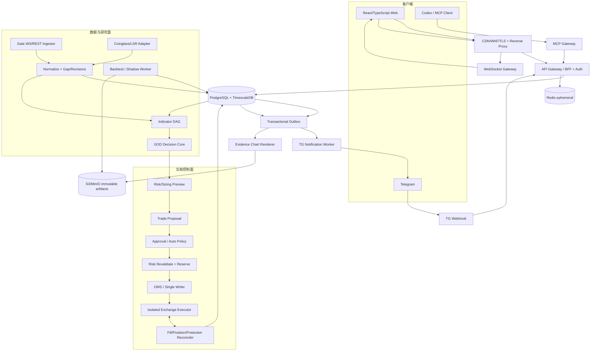

# GateScope V2 产品与目标架构

## 1. 目标与范围

GateScope V2 是“市场研究 + 可审计策略决策 + 受控交易执行”平台。目标是获得接近 TradingView 的图表、指标、布局、告警和实时交互体验，同时增加 TradingView 图表产品通常不负责的执行安全、概率验证、Telegram 控制和 MCP 分析能力。

架构目标是具备水平扩展路径，而不是首日复制某个外部产品的全球基础设施。所有容量数字都是本项目的验收目标，不代表 TradingView 的公开或内部规模。

### 1.1 首轮范围

- Gate 现货/永续公共行情，首个私有交易适配器仅实现 Gate；
- Coinglass 和 LSR 中转站只读数据；
- 1m、5m、15m、30m、1h、4h、8h、1d 周期；
- 现有 26 类形态迁移为版本化 indicator/signal 插件；
- 常用技术指标、指标模板、多窗格图表、实时更新和历史回放；
- 策略版本、回测、影子盘、模拟盘、人工确认与受控自动化；
- Web 登录、Telegram、MCP、不可变证据与审计；
- 单租户优先，但所有租户私有业务表从第一天携带 `tenant_id`；可跨租户复用的公共行情表不伪造归属，改由显式来源、许可与访问策略约束。

### 1.2 明确不做

- 不承诺收益或固定胜率；
- 不在第一阶段支持任意用户 Python/Pine 代码；
- 浏览器只可在一次性 TLS 提交流程中输入交易所秘密；API 的专用 admission route 只有 KMS `Encrypt` 权限且不得记录、持久化明文或回显，TG/MCP/研究服务永不接收秘密，只有隔离 executor 拥有 `Decrypt` 权限；
- 不以 Redis、消息队列或日志作为订单事实源；
- 不在统计门禁完成前接生产交易权限；
- 不为了“微服务外观”过早拆成几十个独立部署单元。

## 2. 当前系统审计

### 2.1 可保留资产

| 资产 | 当前位置 | V2 用法 |
| --- | --- | --- |
| Gate 市场/K 线归一化与分块回补 | `gate_client.py:37-320` | 抽成 `PublicMarketDataAdapter`，增加 WS、缺口对账与最终 K 线语义 |
| 26 类形态几何输出 | `pattern_engine.py:21-1071` | 迁移为版本化形态插件；保留 points/lines/region 图层 |
| ATR、pivot、线性拟合 | `pattern_engine.py:69-183` | 放入指标注册表；修复可用时间和增量一致性 |
| 告警 any/all、冷却与事件指纹 | `scanner.py:140-205` | 升级为规则引擎 + transactional outbox |
| 机会 run/task/result | `database.py:132-207` | 升级为通用 job/backtest/read-model，不作为订单事实 |
| Lightweight Charts 与 SVG overlay | `static/app.js:123-194,665-736` | 迁移成 React/TS 图表组件和可版本化图层 |
| 多标的/周期/形态设置 UX | `static/index.html:138-220` | 作为策略范围设置原型 |

### 2.2 阻止实盘的现状

| 严重度 | 问题 | 证据/影响 |
| --- | --- | --- |
| P0 | 无鉴权、RBAC、租户隔离 | `app.py:290-589` 的业务 API 全部公开 |
| P0 | 容器会复制整个目录 | `Dockerfile:5` 会把当前数据库以及未来误放的秘密写进镜像层 |
| P0 | 历史 pivot 依赖未来窗口 | `pattern_engine.py:166-182`；回测却按较早的 `end_time` 收盘入场 |
| P0 | “可做”是同样本启发式筛选 | `opportunity_scanner.py:262-293,346-365`，不是校准概率或成本后 EV |
| P0 | 历史可被间接删除/重绘 | 删除规则级联事件；机会“看图”重新请求当前行情并重算 |
| P0 | 无订单、成交、仓位、风险与对账模型 | 无法实现幂等、保护单或重启恢复 |
| P1 | SQLite + Web 进程内 daemon thread | 多副本会重复扫描，单实例无法水平扩展 |
| P1 | 无 closed-bar、source sequence、revision、水位线 | 陈旧/未闭合数据可能参与信号 |
| P1 | 前端单文件 1,271 行 IIFE | 难以扩展指标窗格、设置、交易和无障碍交互 |
| P1 | 无测试、迁移、CI、依赖锁和观测 | 无法证明交易正确性或安全回归 |

因此原 `confidence` 必须在 API/UI 中迁移为 `shape_confidence`，原 `actionable` 迁移为 `research_candidate`。旧字段可在一个兼容版本内保留但标为 deprecated，绝不直接连接执行服务。

## 3. 产品信息架构

### 3.1 顶层导航

顶栏主导航只承载高频交易工作：**行情图表、概率告警、PAPER/交易中心**；消息收件箱使用始终可见的铃铛快捷入口。市场雷达、策略实验室、活动订单/仓位和事件账本扩展时也按“交易工作”归入主导航，不把接入配置混进来。

右上角用户名下拉承载低频个人与管理入口，并保持独立二级 URL：

1. **个人**：账号与验证器、活动会话、Telegram 与通知。
2. **接入与管理**（有权角色可见）：交易所账户、Codex MCP、数据源与运行状态，后续增加用户/审计管理。

配置页面直达或刷新必须保持当前模块，不能依赖仅在根路径运行的 JS 内部状态。无权访问的角色既不显示入口，服务端也必须拒绝直接 URL/API 请求。

移动端优先支持“查看、确认、暂停、急停和查询”；复杂图表布局和策略编辑以桌面端为主。

### 3.2 图表工作台

图表目标不是简单地多画几条线，而是一个版本化工作区：

- 主图 + 可调整高度的多个副图；
- 十字线在所有窗格同步，数据窗口显示同一时点值；
- 指标搜索、参数编辑、可见性、颜色/线型和 pane 移动；
- 保存个人布局、指标模板、自选和默认周期；
- 实时 bar 增量更新、断线标识、历史缺口提示和恢复；
- 信号/订单/成交/TP/SL/强平安全线图层；
- “开单时视图”和“后续走势”明确切换，不能混淆；
- 大量形态重叠时提供聚合、按层隐藏和当前信号聚焦，解决现有图面拥挤；
- 所有时间显示用户时区，同时 API/数据库统一 UTC。

### 3.3 配置页

配置按职责拆分，禁止把秘密和普通偏好混在一张 JSON 表：

| 页面 | 可配置项 | 安全行为 |
| --- | --- | --- |
| 通知/TG | 工作区 Bot 状态、个人 chat 绑定、推送类型、静默时段、去重窗口、测试消息 | OWNER 以当前密码 + MFA 加密写入共享 Token且页面永不回显；成员绑定/通道/路由按用户隔离 |
| 数据源 | Base URL（管理员）、状态、TTL、配额策略、代理、刷新频率 | 域名 allowlist；Key 只显示末四位指纹 |
| 交易所 | 子账户别名、环境、权限探测、IP 白名单状态、默认账户 | 密钥加密；保存后不可读取明文；提现权限直接拒绝 |
| 策略 | 版本、草稿/发布生命周期、币种/周期、指标参数、TP/SL、数据依赖 | 已发布版本不可改，只能复制新版本；交易四轴不存入策略 DSL |
| 自动交易 | 有效期、白名单、单笔/日/组合限额、允许时段 | Web MFA 才能启用；TG 可暂停，但只能恢复 PAPER；LIVE 恢复仅允许 Web OWNER 在 MFA、recent-auth 与完整对账通过后执行 |
| MCP | 首版 service token、工具 scope、TTL、调用限额；完整 OAuth client 后续交付 | 默认只读；token 一次显示，可撤销；不能把 bearer 冒充 OAuth |
| 安全 | 密码、MFA、活动会话、恢复码、审计导出 | 高风险操作需 recent-auth |

## 4. 逻辑架构



### 4.1 信任边界

- **互联网边界**：WAF/TLS、请求大小限制、速率限制、Bot webhook secret、OAuth/MFA。
- **研究面**：只读市场数据；可以失败或降级，但不能持有私有交易 Key。
- **凭据入口**：API 仅有一条隔离、禁 body/APM/crash logging 的 encrypt-only admission route；它可短暂接收 TLS 请求明文，但无 KMS `Decrypt` 权限，只持久化 ciphertext 和不可逆指纹。
- **交易面**：只有执行器可按需解密指定账户秘密；除凭据入口外，API/GOD/TG/MCP 只能提交经过 schema 校验的意图或凭据 ID。
- **事实存储**：订单、成交、审批、风险决定和审计在 PostgreSQL；Redis 丢失不得改变事实。
- **不可变制品**：原始数据快照、证据包、PNG/JSON/Parquet 存对象存储，启用 versioning/object lock（生产）。

## 5. 模块与部署策略

### 5.1 第一阶段：生产级模块化单体

先共享一个代码库和 PostgreSQL，但进程至少分为：

- `api`：鉴权、REST、WebSocket read model，以及隔离的 encrypt-only credential admission；无 KMS `Decrypt` 权限；
- `market-worker`：行情/Coinglass 获取和缺口修复；
- `strategy-worker`：指标、信号、回测与快照；
- `notification-worker`：TG/outbox；只有 Bot 权限；
- `chart-worker`：隔离图表渲染；无 Bot 或交易凭据；
- `executor`：唯一有私有交易权限的隔离进程；
- `mcp-server`：独立 scope 和审计入口。

模块之间以明确 application service、repository 接口和 outbox event 通信。禁止从任意模块直接 import 执行器内部适配器，也禁止 controller 中编写交易规则。

### 5.2 何时拆服务

只有观察到下列任一条件，才把对应模块拆成独立服务/数据库或引入 Kafka/Redpanda：

- 行情扇出持续超过 PostgreSQL outbox/worker 的容量预算；
- 指标计算使 API p95 超标且独立扩 worker 仍不能隔离；
- 多交易所下执行器需要账户/区域分区；
- 回测 IO 明显影响在线查询；
- 单 Timescale 节点无法满足保留期或压缩目标；
- 团队边界和部署频率已真实独立。

长历史分析可迁 ClickHouse，原始快照/回测中间结果保留在对象存储。订单事实仍留强一致 PostgreSQL，不能迁到最终一致分析库。

## 6. 行情数据契约

统一 `Bar`：

```text
venue, market, instrument_id, timeframe
open_time, close_time
open, high, low, close, volume, quote_volume
is_final, source_sequence, revision
event_time, available_at, ingested_at
source, quality_flags[], payload_hash
```

不变量：

- 价格/数量用 Decimal 或交易所整数刻度，订单链路禁止 binary float；
- 同 `(venue,instrument,timeframe,open_time,revision)` 唯一；
- 实时未闭合 bar 可用于 UI，但默认不能用于收盘策略；
- WS 断线后由 REST 根据水位线回补，检查连续性后才恢复 `HEALTHY`；
- 修订以新 revision 追加，不能覆盖已经参与历史交易快照的原值；
- 任何聚合周期都由确定的 session/timezone/calendar 规则生成；crypto 使用 UTC 连续市场。

## 7. 指标与策略框架

### 7.1 指标定义

```text
IndicatorDefinition
  id: string
  version: semver
  input_schema: JSON Schema
  output_series: [{name, type, pane, format, style_schema}]
  warmup_bars: integer
  dependencies: [indicator ref]
  batch_compute(bars, params) -> series
  stream_init(history, params) -> state
  stream_update(state, final_bar) -> delta
  determinism_hash: string
```

指标引擎构造 DAG，检测循环、共享公共依赖，并以
`dataset_hash + indicator_version + params_hash + code_build` 缓存。必须用 golden/property 测试证明 batch 与逐 bar 增量结果在容差内相同。

第一批内建：

- SMA/EMA/WMA、VWAP；
- RSI、MACD；
- Bollinger Bands；
- ATR、ADX/DMI、Stochastic；
- OBV、成交量 z-score；
- 现有 pivot/形态 26 类；
- Coinglass/LSR 时序特征（只在数据源可用后注册）。

形态输出除数值 series 外，还可返回 points/lines/regions；这保留当前 SVG 叠加能力。原 `confidence` 只命名为 `shape_confidence`。

### 7.2 策略定义

首版采用受限、可验证的 JSON DSL：

```json
{
  "strategy_id": "trend-confirm-v1",
  "version": 3,
  "universe": {"symbols": ["BTC_USDT"], "timeframes": ["1h"]},
  "required_features": ["ema@1", "atr@1", "pattern.double_bottom@2", "lsr@1"],
  "decision_model": "model-registry://trend-confirm/7",
  "barriers": {"sl_atr": 1.5, "reward_risk": 1.5, "time_bars": 20},
  "risk_policy": "risk-policy://conservative/2"
}
```

草稿可编辑；发布生成不可变 `strategy_version` 和 canonical hash。任何参数、特征、止盈止损或模型变化都产生新版本。运行环境和授权方式不属于策略 DSL，由引用该版本的部署/授权配置单独保存。后续若支持用户脚本，必须在无网络、无文件系统、CPU/内存/时间受限的沙箱运行，输出仍需通过相同 schema 和风险门禁。

### 7.3 决策、证据、环境与授权必须正交

下列四个轴不能压成一个 `mode/action/status` 字段：

| 轴 | 规范枚举 | 含义 |
| --- | --- | --- |
| `decision` | `ABSTAIN / REJECT / ELIGIBLE` | Risk/Sizing 把账户无关证据与账户运行时门禁合并后的最终结论，存于 `execution_decision_snapshot` |
| `evidence_tier` | `RESEARCH / SHADOW / PAPER / LIVE_ELIGIBLE` | 当前策略版本已经通过的最高证据等级 |
| `environment` | `PAPER / TESTNET / LIVE` | 副作用实际落到模拟、测试网还是真实账户；纯研究由 `evidence_tier=RESEARCH` 且无执行环境表达 |
| `authorization_mode` | `NONE / MANUAL / AUTO` | 合格 proposal 由谁授权；不代表证据等级，也不能改变环境 |

GOD 在账户无关的 `signal_evidence_snapshot` 中固化概率、单位经济性、gate results 和最高 `evidence_tier`，不写账户相关 `decision`。`WATCH` 只作为 UI/提案生命周期的展示状态，不是概率模型结论。`MANUAL` 也不能把 `PAPER` 证据提升为 `LIVE_ELIGIBLE`，`AUTO` 更不能绕过相同的 LIVE 数据、统计、账户、保护和风险硬门禁。API、数据库、TG 和 MCP 均使用上述字段名；任何派生展示状态必须能映射回四轴事实。

## 8. 实时与读模型

- 外部采集采用 WS 优先、REST 对账；内部事件按 instrument/timeframe 分区保证单分区顺序。
- API 不把每个浏览器直接扇到交易所。`WebSocket Gateway` 聚合订阅、引用计数并广播规范化 delta。
- 前端初次加载/强制 resync 才调用 `series.setData`，实时最后一根更新/新增使用 `series.update`，避免全量替换；这与 [Lightweight Charts 官方实时更新建议](https://tradingview.github.io/lightweight-charts/docs)一致。
- 订阅键至少包含 venue、instrument、resolution、currency/settle 和 chart type；相同键复用上游订阅、不同 listener 独立管理生命周期。这与 [TradingView Advanced Charts 的 datafeed subscription 模型](https://www.tradingview.com/charting-library-docs/latest/connecting_data/datafeed-api/datafeed-subscriptions/)对齐，但服务端实现保持自有协议。
- 慢客户端有有界缓冲；溢出时发送 `resync_required`，客户端通过快照 + 水位线恢复，禁止无限堆积。
- 图表历史使用 cursor/time-range，不用 offset；热点区缓存，压缩旧 chunk。
- 订单/仓位 UI 来自物化 read model，但点击详情必须能回到订单事实和事件时间线。
- 每个响应含 `server_time`、`data_watermark`、`staleness_ms`、`quality_flags` 和 `trace_id`。

## 9. 技术选型

| 层 | 首选 | 理由 |
| --- | --- | --- |
| Web | React + TypeScript + Vite + TanStack Query；Lightweight Charts | 组件/类型边界，复用现有图表资产 |
| API/领域 | Python 3.12、FastAPI、Pydantic、SQLAlchemy 2 | 与现有计算栈连续，适合快速严谨实现 |
| 迁移 | Alembic | 可审查、可回滚 schema 演进 |
| 事务库 | PostgreSQL 16 | 强一致订单事实、RLS、锁和成熟运维 |
| 时序 | TimescaleDB（同 PG 集群起步） | K 线/指标分区、压缩与连续聚合 |
| 缓存/租约 | Redis | 临时缓存、限流、租约；不保存交易事实 |
| 异步 | PostgreSQL outbox + worker 起步 | 避免 DB/消息双写；规模到阈值再换 durable bus |
| 制品 | S3/MinIO | 数据/证据/图表/回测的内容寻址存储 |
| 密钥 | 云 Secret Manager + KMS envelope encryption | 凭据不落源码、镜像或明文库 |
| 观测 | OpenTelemetry + Prometheus + Grafana + 集中日志 | trace、SLO、告警与审计分离 |
| 边缘 | Caddy/Traefik 或云 LB/WAF | TLS、header、请求/速率控制 |

不要一开始引入第二种后端语言。只有 profile 表明 Python 无法满足 feed/indicator 性能后，再把热点内核迁 Rust/Go，并保留跨实现 golden fixtures。

## 10. 容量等级与 SLO

### 10.1 规划容量

| 级别 | 使用场景 | 目标容量 |
| --- | --- | --- |
| Pilot | 单租户小额验证 | 5 用户、200 标的、1,000 活跃 symbol-timeframe、100 WS 会话、50 活跃策略 |
| Production S1 | 小团队正式使用 | 100 用户、2,000 标的、10,000 活跃订阅、1,000 WS 会话、1,000 活跃策略 |
| Scale S2 | 水平扩展验证 | 10,000 WS 会话、100,000 聚合订阅、策略 worker 可线性扩容；交易按账户分区单写 |

容量数字只有在同一版本的下列参考合同下才可比较。基准机型 `REF-2026-09` 固定为 x86-64 AMD EPYC 7R13 2.65 GHz、每 vCPU 一个 SMT hardware thread、Ubuntu 24.04、容器无 CPU overcommit；数据库盘按本表容量使用本地 NVMe，并预检持续随机读写至少 `20k/10k IOPS`、吞吐至少 `500 MiB/s`。测试报告必须固定云实例/CPU 型号、镜像 digest、内核、数据库参数、数据集 hash 和副本数，测试中不得临时扩容。若无法获得该机型，候选硬件必须先跑随仓库版本化的 CPU/内存/磁盘校准基准，报告相对系数，并同时保留原始结果；不得仅按 vCPU 数换算。

| 负载合同 | Pilot | Production S1 |
| --- | --- | --- |
| 参考计算拓扑 | API `1×8 vCPU/16 GiB`；策略 worker `2×8 vCPU/16 GiB`；隔离 executor `1×2 vCPU/4 GiB` | API `3×8 vCPU/16 GiB`；策略 worker `4×16 vCPU/32 GiB`；隔离 executor `2×4 vCPU/8 GiB`（单账户仍单 leader） |
| 参考状态层 | PostgreSQL/Timescale `1×8 vCPU/32 GiB/1 TiB NVMe`；Redis `1×2 vCPU/4 GiB` | PostgreSQL/Timescale `2×16 vCPU/64 GiB/2 TiB NVMe` 同步主备；Redis `3×4 vCPU/8 GiB`；节点间至少 `10 Gbit/s` |
| 行情输入 | 稳态 `1,980 tick/update events/s + 20 finalized bars/s` | 稳态 `19,800 tick/update events/s + 200 finalized bars/s`；使用相同比例和版本化乱序/重复 fixture |
| 策略计算 | `5,000 instrument-strategy evaluations/s` | `50,000 instrument-strategy evaluations/s` |
| 单次策略复杂度 fixture | 最多 20 个 `O(1)` 滚动更新、4 个 `O(log W)` 窗口结构（`W≤2,000`）、2 个跨周期 as-of join；禁止每 tick 全窗扫描 | 与 Pilot 相同；更复杂策略必须另立容量等级并重新验收 |
| WS 出站 | 稳态 `2,000 msg/s`，消息 `≤2 KiB` | 稳态 `25,000 msg/s`，消息 `≤2 KiB` |
| 历史查询 | `20 req/s`；交互查询 `10,000 bars`，单次分页上限 `50,000 bars` | `200 req/s`；范围和分页上限同 Pilot |
| 保留与压缩 fixture | 1 分钟及以上 bar：180 天热数据、2 年压缩；raw tick：24 小时热数据、30 天对象归档（须满足源许可） | 1 分钟及以上 bar：365 天热数据、5 年压缩；raw tick：7 天热数据、90 天对象归档（须满足源许可） |
| 突发与持续时间 | `3×` 稳态持续 5 分钟；预热 2 小时后稳态 8 小时，期间至少 3 次突发 | `3×` 稳态持续 5 分钟；预热 2 小时后稳态 24 小时，期间至少 6 次突发 |

每级都必须通过合成行情、断线重连、慢客户端、突发告警和订单故障压测，并报告永久事件缺失、重同步次数、队列水位、CPU、内存、磁盘 IO 与网络占用。永久行情事件缺失在源可回补时必须为 `0`；无法回补的源缺口必须显式标记，不能伪造成连续数据。S2 必须先补齐同等详细的硬件与工作负载合同后才能验收；它是架构验证目标，不等于已承诺生产容量。

### 10.2 可靠性目标

| 指标 | Pilot/S1 目标或安全门禁 |
| --- | --- |
| 缓存命中 REST p95 / p99 | `<300ms / <800ms` |
| 最终 K 线从源到 UI p95 | `<1s`（受源延迟约束并显示） |
| K 线闭合到信号事件 p95 | `<5s` |
| outbox 到 TG 成功投递 p95 | `<5s`，Telegram 可用时 |
| 正常网络下 intent 到 exchange ack p95 | `<2s`，按交易所分别度量 |
| 首次成交到保护单已验证 p95 | `<3s`；另由 adapter 定义更严格的硬 deadline，越界立即 fail-closed |
| 重复开仓安全不变量 | 通过资格测试的 adapter 在重试/重放/重启故障集上，重复逻辑开仓数必须为 `0`；不把网络请求称为 exactly-once |
| UNKNOWN 处理覆盖 | 每个 UNKNOWN `100%` 持久化为对账 case 并冻结相关新开仓；不承诺上游永久失效时一定能自动判定结果 |
| 非零仓位保护门禁 | 稳态未保护数量为 `0`；瞬态缺口只能存在于有硬 deadline 的降险状态，越界即冻结并告警 |
| 已提交订单/成交/审计事实 RPO | 生产目标 `0`，仅在同步多可用区复制和故障演练证明后宣称；单节点 Pilot 明示实际非零 RPO |
| 应用 RTO | 生产目标 `<15min`；执行器启动先对账再开新仓，并以演练报告证明 |
| 服务可用性 | 研究面 99.5%，鉴权/交易控制面 99.9% 目标 |

市场跳空、无流动性、交易所自身失效，或交易所无法提供足够历史证据时，系统无法保证止损成交价格或自动消解每个歧义订单；SLO 衡量的是系统可控制的指令驻留、确认、持久化、冻结、对账和降险行为。

生产 SLO 报告统一使用滚动 28 天窗口，并按 venue、environment 和关键接口分别统计；延迟指标每个分组至少需要 10,000 个合格样本，不足时只能标记“证据不足”，不能宣称达标。10.1 的 8/24 小时固定负载测试使用相同延迟阈值，只能称为“容量资格结果”，不能代替 28 天生产 SLO。交易控制面 `99.9%` 的 28 天不可用错误预算为 `40m19s`，研究面 `99.5%` 为 `3h21m36s`；计划维护只有在窗口开始前登记且用户流量有可用替代路径时才可排除。重复逻辑开仓、越过硬 deadline 的未保护仓位、未持久化 UNKNOWN 和审计事实丢失属于安全不变量，错误预算均为 `0`。每份报告须给出指标查询、原始观测来源、缺失数据、排除事件和预算消耗，不能用单次演示宣称达标。

## 11. 生产部署

### 11.1 最小安全拓扑

- 公网只暴露 443；PostgreSQL、Redis、worker 和 executor 位于私网；
- TLS 由云 LB/反向代理终止，内部敏感服务使用 mTLS/工作负载身份；
- executor 使用固定出口 IP，交易所 Key 绑定该 IP；
- Web/API 多副本，worker 使用租约；executor 对每账户/市场分区只有一个 leader；
- PostgreSQL 使用连续 WAL 归档/PITR；生产实盘若宣称 RPO=0，必须在首次 LIVE canary 前启用同步多可用区副本并完成故障切换演练，不能把该依赖推迟到后续容量扩展；对象存储启用 versioning/object lock；
- 自动恢复校验可每日运行，完整 PITR、区域故障与人工 runbook 演练按预注册周期执行并留报告，不能只写“可恢复”；
- 生产、预发布、测试使用完全不同账号、数据库、Bot 和 API Key；
- 镜像使用非 root、只读根文件系统、固定 digest、SBOM 和漏洞扫描；
- `.dockerignore` 排除 `.git`、`data/`、`.env*`、日志、缓存、截图临时文件和 `__MACOSX/`。

当前 Render 单容器 + SQLite 只能保留为研究 demo，不能承载实盘执行。

### 11.2 健康检查

- `/health/live`：进程事件循环可用，不检查外部依赖；
- `/health/ready`：迁移完成、DB 可写、关键 worker/租约状态；
- `/health/dependencies`：Gate、Coinglass、TG、Redis、对象存储、时钟、配额等详细降级状态，仅管理员可见；
- 执行器另有 `trading_ready=false/true`，只有完成账户/订单/仓位/保护单启动对账后才为 true。

## 12. 关键架构决策

| ADR | 决策 | 后果 |
| --- | --- | --- |
| ADR-001 | 产品体验对标 TradingView，初期不承诺其全球容量 | 先设本项目可测容量和扩展触发器 |
| ADR-002 | 模块化单体 + 隔离 executor 起步 | 减少运维复杂度，同时守住交易信任边界 |
| ADR-003 | PostgreSQL 为订单事实源，Timescale 存时序 | 替换 SQLite；需迁移与备份体系 |
| ADR-004 | PostgreSQL transactional outbox 起步 | 保证状态与事件一致；达到阈值再换流平台 |
| ADR-005 | 指标/策略/模型全部不可变版本化 | 历史可复现，修改需要发布新版本 |
| ADR-006 | 客户端只能请求 proposal/approval 或受限降险命令；MCP v1 只创建 proposal | `order_intent` 只由服务端事务创建，风险和执行规则集中且确定性 |
| ADR-007 | 交易所侧原生保护优先 | 网络中断后仍可触发，但价格仍受流动性影响 |
| ADR-008 | 自动化 fail-closed | 数据/账户/保护状态未知时禁新仓，退出仍开放 |
| ADR-009 | 首版使用受限 DSL | 避免任意代码破坏数据和交易边界 |
| ADR-010 | 所有历史视图来自快照，不现场重算旧事件 | 存储增加，换取可审计与不重绘 |

## 13. 架构验收

- 在 Pilot 基准以及 S1 API 两副本、worker 重启和重复事件条件下，每个已闭合 bar/信号只产生一个逻辑事实；
- 断开 WS 后能用 REST 补齐缺口，水位线连续后才解除 stale；
- batch/stream 指标在 golden 数据上结果一致；
- 发布新策略/指标后，旧信号摘要和图完全不变；
- 任意客户端无权直接访问 executor 或读取凭据；
- 删除用户可编辑规则不会删除已产生的 signal/trade/audit 事实；
- 慢 WebSocket 客户端不会拖垮行情 ingest；
- Pilot 与 S1 固定负载下达到本章延迟与安全阈值并形成容量资格报告；生产可用性仍须由完整 28 天窗口证明。
