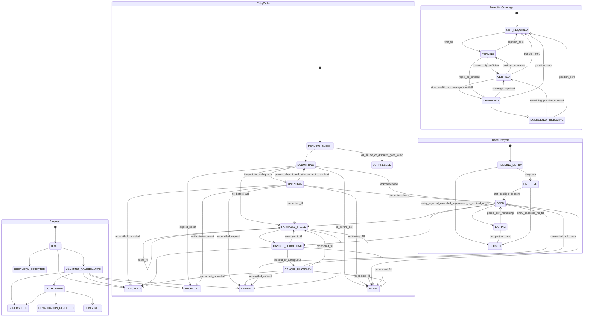

# 云端安全、可靠执行、Telegram 与 MCP 规格

## 1. 安全与可靠性总则

这部分不是附加功能，而是实盘的前置条件。系统必须在网络超时、重复请求、乱序成交、进程重启、第三方限流和恶意客户端输入下保持以下不变量：

- 秘密不离开其最小信任边界；
- 未授权用户看不到业务和账户数据；
- 一个逻辑意图不会因重试产生重复开仓；
- 非零仓位具有交易所侧已确认保护，或正处于限时 fail-closed 降险；
- 不确定状态禁止新开仓，但平仓、降险、查询和急停仍可用；
- 原始交易理由、参数和图表不可被未来走势或新算法改写。

## 2. 威胁模型

### 2.1 主要资产

- 登录凭据、会话、MFA 和恢复码；
- Gate/未来交易所 API Key/Secret；
- Telegram Bot Token、chat/user 绑定；
- Coinglass API Key；
- MCP OAuth/token；
- 策略、模型、仓位、订单、成交、净值和审计数据；
- 能启用自动交易、扩大限额或关闭止损的控制权限。

### 2.2 主要威胁

- 公网未鉴权读取或修改业务；
- 密钥进入 Git、Docker layer、日志、异常、TG、MCP 或前端；
- session theft、CSRF、密码撞库、Telegram callback 重放；
- SSRF/重定向把认证头带到攻击者域名；
- 超时后盲重试造成重复订单；
- WS 丢消息、乱序 fill、部分成交使数据库与交易所不一致；
- API/TG/MCP 绕过风险限额；
- LLM prompt injection 或幻觉变成交易指令；
- 管理员或程序修改失败交易的历史证据；
- 依赖/CDN/容器供应链污染。

### 2.3 权限角色

| 角色 | 权限 |
| --- | --- |
| `OWNER` | 安全设置、凭据、策略发布、实盘启用、审计导出 |
| `OPERATOR` | 查看、人工确认既定限额内订单、暂停/急停、处理对账 |
| `RESEARCHER` | 数据、图表、指标、回测和 proposal；不能成交 |
| `VIEWER` | 只读图表/事件/脱敏状态 |
| `SERVICE_*` | 单一服务 scope；无交互登录 |

所有业务资源带 `tenant_id`，PostgreSQL RLS + application authorization 双层检查。默认拒绝；高风险操作需 `OWNER`、MFA 和 recent-auth。

### 2.4 当前源码审计结论（inside / code-inspected）

| 严重度 | 已确认现状 | 修复落点 |
| --- | --- | --- |
| Critical | 所有业务 API 无认证/授权，云端暴露后任何访问者可读写/删除 | 上线前鉴权中间件、逐资源 tenant/role 校验、RLS |
| High | `docker-compose.yml`/Render 公开监听，Dockerfile 无 `USER` 且 `COPY . .` 会包含数据库 | 非 root/只读镜像、`.dockerignore`、私网服务、边缘 TLS/WAF |
| High | `GateError` 可能包含代理字符串和上游正文，route 又把异常文本返回客户端 | 错误码映射；上游正文仅脱敏受限日志，代理凭据永不格式化 |
| High | 无登录/高成本接口限流；多副本后若使用内存计数会被放大 | Redis/共享限流，账号 + 可信客户端地址 + endpoint cost 多维 budget |
| Medium | FastAPI 默认 `/docs`/`/openapi.json` 和状态信息未按环境收敛 | 生产关闭公开 docs，管理员鉴权后查看；health 最小披露 |
| Medium | 启动/前端可从 CDN 运行时下载脚本 | 构建期锁版本/hash/vendor，CSP 禁止任意脚本源，生产不回退动态 CDN |
| Medium | 前端大量 `innerHTML` 模板，当前多数文本手工 escape，但维护中易产生漏点 | React 默认转义；禁 raw HTML；CSP + Trusted Types（浏览器支持时） |
| Medium | 无依赖锁、CI 漏密/漏洞扫描、Git 历史 | 锁文件、SBOM、secret/dependency/image scan、正式版本库 |

未发现当前代码接受用户 URL、上传/解压文件或执行 shell/eval；数据库动态列名来自内部 allowlist 且值使用参数绑定。它们当前不是已验证漏洞，但未来数据源 URL、webhook、图表制品功能必须继续按 SSRF/路径/内容类型边界设计。

## 3. 云端账号密码与会话

### 3.1 首次部署

- 禁止默认用户名/密码，也禁止把密码写入镜像、Compose、环境变量或启动日志；
- 首个 OWNER 通过一次性管理命令创建，密码从 TTY/stdin 或云 secret file 读取；
- 未创建 OWNER 时，公网业务路由返回 `SETUP_REQUIRED`，只能从受控管理通道执行 bootstrap；
- 初始化完成后 bootstrap capability 永久关闭并写审计；
- 若生产缺少 `SESSION_SIGNING_KEY`、KMS、数据库 TLS 等关键配置，fail startup。

建议命令契约：

```text
gatescope admin bootstrap --username <name>
# 随后无回显读取密码与 MFA 初始化，不允许 --password 参数
```

### 3.2 密码与 MFA

- Argon2id，参数在部署硬件上校准到约 250–500ms，并设最小 memory/time/parallelism 安全下限；
- 密码长度 12–128，允许密码管理器和空格，不做破坏熵的复杂度花样；
- 登录/重置/恢复严格限流，错误响应不泄露用户是否存在；
- OWNER/OPERATOR 强制 TOTP 或 WebAuthn，恢复码只显示一次并以 hash 保存；
- 修改交易凭据、启用 AUTO、提高限额、生成高权 MCP token 需要 5 分钟内 recent-auth；
- 连续失败、异常地区/设备、新会话和 MFA 变更发安全通知。

### 3.3 会话

- 256-bit 随机 session token，数据库仅存 hash；
- cookie：`HttpOnly; Secure; SameSite=Strict; Path=/`，短 access + 可撤销 rotating session；
- 状态修改接口使用 CSRF token/同源校验；WebSocket 在握手时认证并定期检查撤销；
- 会话页展示设备、创建/最后活动时间和 IP 粗略信息，可单个/全部撤销；
- 登录后固定 session ID 防 fixation，权限/MFA 改变后撤销旧 session；
- API 错误不返回绝对路径、堆栈、SQL、上游正文或秘密。

### 3.4 限流与可信代理

- 限流状态使用 Redis/共享存储，不能是每进程 memory store；
- 只有来自明确 LB/WAF 网段的 `Forwarded`/`X-Forwarded-For` 才可信，应用先剥离用户自带链；IPv6 按合理前缀聚合；
- 登录同时按账号和客户端地址限制，防喷洒也避免单一全局桶造成全员拒绝服务；MFA/恢复码另有更小尝试上限；
- backtest、chart render、导出、MCP、Coinglass test 等成本型接口按 tenant/user/concurrency/日配额限制；
- WebSocket 限制每用户/tenant/IP 的并发与新建速率；
- 返回标准 `429` 和 `Retry-After`，但不披露账号是否存在或内部配额细节。

### 3.5 SSRF、浏览器与供应链

- 数据源 base URL 仅管理员可选预注册 provider，解析后校验 scheme、hostname、port 和 DNS/IP；拒绝 loopback、RFC1918、link-local、metadata 地址；
- 带认证头的请求禁止重定向，且每次连接都校验最终目标；代理配置是部署级秘密，不接受普通用户 URL；
- 图表/头像/webhook 若未来支持 URL，采用固定 provider adapter 或隔离 fetch proxy，不把正文直接回传；
- 生产 CSP 至少限制 `default-src 'self'`、`script-src` 为构建制品，启用 HSTS、frame-ancestors、nosniff、referrer policy；
- 禁止运行时下载未知 JS。依赖锁定版本和完整性，镜像 pin digest 并生成 SBOM。

## 4. 秘密管理

### 4.1 分层

| 秘密 | 存储 | 谁可解密 |
| --- | --- | --- |
| App session/signing key | 云 Secret Manager | API/Auth |
| Telegram Bot Token | 云 Secret Manager | notification worker |
| Coinglass Key | 云 Secret Manager | coinglass adapter |
| 交易所 Key/Secret | PostgreSQL ciphertext + KMS envelope key | 仅 isolated executor 有解密权；admission API 只有加密权 |
| MCP client secret/token | OAuth server/hashed token store | MCP gateway/auth |

交易所凭据采用冻结的 admission 流程：浏览器经 TLS 向专用 credential admission route 提交一次；该 route 禁止 body/access trace，仅以拥有 KMS `Encrypt`、没有 `Decrypt` 的 service identity 立即加密，并保存 ciphertext、encryption context、KMS key version 和不可逆凭据指纹。随后只向 executor 投递 `credential_id`；executor 才能解密并向交易所验证权限，返回脱敏 capability/status。API 响应只含 alias、fingerprint 后四位和状态，任何 GET、outbox、异常与审计 payload 都不得含明文/ciphertext。

实现不得虚构一个未部署的“secrets service”。首版明确由 API 内的隔离 composition root 承担 encrypt-only admission；若以后拆 credential broker，必须有独立镜像、mTLS、service account、网络策略和同样的契约测试。route 关闭 request-body logging、APM body capture 和 crash dump；失败时不持久化请求，内存缓冲尽可能原地清零。由于高级语言不能证明进程内存彻底清零，该进程不得与 debug shell/不可信插件共处。

### 4.2 交易所 Key 验证

- 只允许交易权限，发现提现/转账权限直接拒绝；
- 推荐专用子账户、最小余额、固定 executor 出口 IP allowlist；
- sandbox/testnet 与 production 使用不同账户和 KMS key；
- 定期权限探测、轮换、撤销；解密失败或权限变化立即 `trading_ready=false`；
- 日志 filter 对 header、query、JSON key 名和已知指纹做结构化脱敏，CI 运行 secret scanner；
- 禁止将秘密放进 `config.json`、`.env` 镜像层、TG、MCP 参数、trace baggage 或崩溃 dump。

本次连通性验证所用凭据不得复用到生产；正式部署前必须轮换，新 Key 只通过部署平台 Secret Manager 注入。

## 5. 交易提案与审批

### 5.1 链路

```mermaid
sequenceDiagram
    participant G as GOD
    participant P as Proposal Service
    participant R as Risk Engine
    participant U as Web/TG or Auto Policy
    participant O as OMS
    participant E as Executor/Exchange

    G->>P: immutable signal_evidence_snapshot
    P->>R: account-specific execution decision preview
    R-->>P: PASS/FAIL + versioned reasons
    P-->>U: expiring proposal card
    U->>P: approve/reject (one-time nonce)
    P->>R: revalidate latest price/account/portfolio
    alt price drift or risk fail
      R-->>U: expired/rejected; require new proposal
    else pass
      R->>O: commit order_intent + outbox atomically
      O->>E: submit deterministic client_order_id
      E-->>O: ack/fills/protection
    end
```

账户无关的 `signal_evidence_snapshot` 冻结市场、特征、模型概率和单位数量经济性；账户相关的 `execution_decision_snapshot` 冻结账户/净值/仓位水位、候选数量、rounding、成本和 runtime risk，再生成 proposal。这样同一信号可针对不同账户生成不同但各自不可变的决策，不能把账户水位回写进 signal。

审批只批准精确内容：账户、symbol、side、order type、最大 quantity/notional、价格容差、TP/SL、time stop、有效期、策略/风险版本。即使用户只要求**下调数量**，也要由 deterministic Risk/Sizing 生成新的 `execution_decision_snapshot`、superseding proposal 和 nonce，不能修改旧 proposal；它通常可继续引用同一 signal evidence。价格、order type、TP、SL、time stop、方向或增量数量改变时还必须重新运行 GOD/Risk，必要时发布匹配新标签定义的策略/模型版本。旧 proposal 一律追加 `SUPERSEDED` 事实。

### 5.2 四轴枚举

全系统只使用以下四个正交轴，禁止再造一个混合 `mode`：

- `decision = ABSTAIN | REJECT | ELIGIBLE`：Risk/Sizing 引用账户无关证据并结合账户运行时门禁后的最终结论；
- `evidence_tier = RESEARCH | SHADOW | PAPER | LIVE_ELIGIBLE`：GOD 为冻结策略/模型固化的证据等级；
- `environment = PAPER | TESTNET | LIVE`：订单去向；
- `authorization_mode = NONE | MANUAL | AUTO`：谁授权本次 intent。

合法组合至少满足：`RESEARCH/SHADOW` evidence 不能产生交易所 intent，authorization 必须为 `NONE`；`PAPER` evidence 只可进入 `environment=PAPER`；`TESTNET/LIVE` 必须 `decision=ELIGIBLE` 且版本为 `LIVE_ELIGIBLE`，并通过各自 execution/operation gates，authorization 才可为 `MANUAL/AUTO`。`MANUAL` 只改变授权主体，绝不放宽 LIVE 的数据、统计、成本、保护或风险门禁。策略 worker 的 started/paused/draining 是运行生命周期状态，不是第五个交易模式。

AUTO policy 必含：策略版本、账户、币种/周期白名单、最大单笔/日/组合风险、允许时间、最大并发、开始/到期、创建者/MFA 审计。只能在 Web OWNER recent-auth + MFA 后启用、恢复、扩大或续期。TG 可以立即暂停或执行安全急停；不得恢复 LIVE AUTO、扩大风险或续期。PAPER policy 可由有权用户在 TG 恢复，但仍要服务端校验原范围与有效期。

### 5.3 批准事务

`POST /proposals/{id}/approve` 的幂等作用域固定为 `(tenant_id, actor_id, HTTP_method, route_template, Idempotency-Key)`，并保存 canonical request hash；key 至少含 128-bit 随机熵。同 key/同 hash 返回第一次的相同 status/body/resource；同 key/不同 hash 返回 `409 IDEMPOTENCY_KEY_REUSED`。Web approval nonce/TG callback token 同样至少 128-bit、只存 hash且单次消费。审批/交易控制记录至少保存 30 天，order intent 与 client-order 映射永久随交易事实保存。

一次批准按以下顺序执行：验证 recent-auth/角色 → 锁 idempotency row 与精确 proposal/version → 校验未过期、未消费且 nonce/user/channel 匹配 → 在账户/资产风险 scope 上加锁并读取满足 freshness 的价格、净值、仓位和 portfolio version → 重新运行确定性 Risk/rounding/drift，并写不可变 `approval_revalidation_snapshot`（price/portfolio/account/capability/kill-switch 水位、risk/version、全部 gate、结果与 digest）→ 在**同一数据库事务**消费 nonce、追加 approval、占用 risk reservation、创建 `trade + order_intent`、把 proposal 标为 consumed，并写 outbox/idempotent response → commit 后 executor 才可提交。approval 与 order intent 都引用该 revalidation snapshot。

任一步失败都不能留下可 dispatch intent；外部刷新不得放在持锁事务中，快照过旧时先失败/刷新再由客户端重试。若重验证要求改变 quantity、entry、price tolerance、TP/SL/time stop 或其他精确条款，旧 proposal 只能 expired/rejected/superseded，必须生成新的 execution decision/proposal；禁止把“最新风险”当理由静默改价或缩量后成交。

## 6. OMS 与执行状态机

### 6.1 状态

Proposal、每条 exchange order、净仓位生命周期和保护覆盖是四个正交聚合，不能塞进一个互斥枚举。尤其是 entry 已部分成交时，剩余 entry 仍可能工作，同时已成交仓位必须已被保护。数据库分别保存以下状态，UI 的综合状态只是投影：



`order_intent` 保存不可变目标；dispatch/reconciliation、每个 entry/exit order 和 position protection 是独立聚合投影。每个交易所 order 有独立 `exchange_order.state`；`trade_lifecycle` 由订单/成交/净仓事实推导；`protection_status` 由实际仓位与有效保护数量推导。综合 UI 可以显示“ENTERING · 已成交 40% · 保护已验证”，但这个字符串不能成为恢复事实源。

Pilot 对单向净仓交易所强制 `(exchange_account_id, instrument_id, position_side)` 同时最多一个 active `trade`；`public_trade_id` 在授权生成 intent 时一并创建，未成交前也可查询。所有 STOP/TP 覆盖属于上述 **position aggregate**，不属于某个 intent，避免多 intent 各自对同一净仓重复下止损而反手。未来若放开多策略共享净仓，必须先交付 virtual-lot/netting allocator、fill/fee/funding 归因账本和 position-level protection manager；不能仅删除唯一约束。

订单、审批、成交、保护、风险和审计的 **fact/event 表 append-only**；带 `state/version` 的 `*_current` 只是 reducer 生成的 CAS 可变投影，可从事件重建。只有对应 aggregate owner service 能更新其投影，普通 API/TG/MCP role 无事实表 UPDATE/DELETE 权限。

每个聚合的状态转换采用 compare-and-swap/version column；非法转换直接拒绝并产生安全告警。交易所原始事件可乱序到达，先按 source event id/sequence 去重存入 inbox；reducer 按交易所序列（可用时）和冻结规则重建各正交投影。若顺序无法确定，进入 reconciliation case，不按到达顺序猜测。cancel/amend 命令本身也有 `PENDING/SUBMITTING/UNKNOWN/CONFIRMED/REJECTED` 事实；结果不明时不能假设原单已撤或已改。

### 6.2 幂等

- `intent_id` 为 UUIDv7；每条 leg 的 `client_order_id` 由 tenant/account/intent/leg 的 HMAC 截断生成，稳定且符合交易所字符长度。创建 leg 时必须把 `algorithm`、`key_version`、输入 canonical digest 和最终 `value` 一起持久化；密钥轮换后从数据库读原值，绝不重新计算；
- 创建 intent、占用风险预算和写 outbox 在同一 PostgreSQL 事务；
- order intent 冻结 `submit_not_after`、`max_price_drift_bps`、`instrument_revision_id` 和允许的交易所侧价格保护；executor 获取满足 TTL 的可执行 quote 后，在把 `PENDING_SUBMIT` CAS 为 `SUBMITTING` 的同一 claim 事务内，再校验时间、quote drift/staleness、instrument revision、当前 kill/pause epoch、policy/revalidation 引用、risk reservation、account `trading_ready` 和自己的 leader epoch；任一不符追加 `SUPPRESSED` 事实，不能发网络请求。不能提供所需 exchange-side price guard 的 entry 类型不得用于对应 LIVE policy；
- executor 以 `client_order_id` 唯一约束 + inbox 去重；
- HTTP timeout 不是失败，对应 exchange order 进入 `UNKNOWN`、intent 进入 `RECONCILIATION_REQUIRED`；先按 client ID 查询，再查 open/history/fills/conditional orders。只有 adapter 提供权威“不存在”证据、已越过其文档化结算/索引一致性窗口及 clock-skew buffer、原风险预留仍有效，而且交易所保证同一 client ID 在该 dedupe scope 内安全重放时，才允许同一 ID 的受控重提；
- 若任一条件不成立，UNKNOWN 保持冻结并由人工/持续对账处理；adapter 缺少足够查询一致性或 client-ID 生命周期语义时禁止 LIVE。cancel/amend UNKNOWN 同理，禁止在旧结果不明时用新 ID 猜测性替换；
- TG 重复点击、浏览器重试、worker 重放、进程重启不会产生第二个逻辑 intent；
- 禁止对 POST/下单使用通用网络库的自动重试。

“Exactly once 网络请求”不可实现；目标是 at-least-once 投递 + 本地幂等副作用 + 交易所事实对账。只有 adapter 的去重与权威查询语义通过 contract/testnet 故障测试时，才把“一个 intent 至多一个有效 entry”作为 LIVE 可验收性质；否则保持 PAPER，而不是用“逻辑 exactly-once”口号代替证明。

SAFE_KILL 与 dispatch 竞态的线性化点就是上述 CAS/epoch 校验。若 kill 到达时请求已经进入 `SUBMITTING`，不能宣称它已被取消：先标 UNKNOWN/对账；若发现 ack/fill，立即按 SAFE_KILL 撤剩余 entry，同时对已成交净仓先保护，再依预设 profile 保留或 reduce-only 降险。

### 6.3 单写者与优先级

- 每个 `(exchange_account, market)` 只有一个 executor leader。数据库保存单调递增 `leader_epoch`，command claim 使用行锁/CAS；executor 失去租约立即停止领取和提交；
- 为防 split-brain，账号私有请求只能经过单写 egress dispatcher，dispatcher 校验当前 epoch 并按账号串行 mutation。接管者必须等待大于旧请求最大 timeout 的 fencing grace，完成 open/history/fills/position/conditional 全量对账后才能提交新 mutation；旧 leader 的 in-flight 结果一律按 UNKNOWN 吸收，不能由新 leader 盲重发；
- 同账户/symbol 上的 position mutation 串行化；
- 请求优先级：紧急平仓 > 补保护单 > 撤单 > 对账 > 新开仓 > 历史查询；
- 独立 token bucket 遵守交易所 endpoint 权重，保留退出配额；
- Decimal + instrument metadata 做数量/价格向安全方向取整，提交前再次校验 min size/notional/leverage。

### 6.4 ExchangeAdapter 契约

实现 Gate 私有接口前先冻结与交易所无关的 port：

```text
discover_capabilities(account) -> ExchangeCapabilities
get_server_time() -> timestamp
validate_credentials() -> permissions/status (never secret)
get_instruments() -> tick/lot/min-notional/trigger rules
get_balances() / get_positions()
list_open_orders() / list_conditional_orders()
get_order_by_client_id(client_order_id)
list_fills(cursor/time range)
submit_entry(normalized_request) -> ack or ambiguous result
submit_protection(normalized_request) -> ack or ambiguous result
submit_reduce_only_exit(normalized_exit_or_close_position) -> ack or ambiguous result
amend_order(...) / cancel_order(...)
stream_private_events(resume_cursor)
```

`ExchangeCapabilities` 至少声明：

```text
client_order_id + query_by_client_id
native_bracket / OCO
stop_market / trigger_price_sources
entry market-price protection / IOC semantics
reduce_only / close_position
conditional_order_query/cancel/amend
partial_fill semantics
private stream sequence/resume
testnet availability
rate-limit weights
max client id length/charset
client id uniqueness/dedupe scope and retention
open/history/fill query consistency window and authoritative-absence semantics
cancel/amend ambiguity semantics
```

`submit_reduce_only_exit` 是独立风险降低 port：domain 在调用前和 adapter 在签名前都校验方向与数量不会增加/反转净仓；全平优先使用经 capability 验证的 `close_position`。它不能复用 `submit_entry` 的权限路径，也不能因 Risk/行情/Coinglass degraded 被关闭；ack timeout 同样返回 ambiguous 并按订单/成交/仓位对账。

能力来自实施时官方文档 + testnet probe，并保存版本/探测时间、证据 URI/hash；不能按交易所名称写死“肯定支持”。若策略需要的保护、查询一致性或去重能力不存在，Risk 必须拒绝 LIVE。查询 GET 可在明确幂等时由协调层有界重试，mutation 方法本身不隐藏重试；所有 ambiguous result 都交 OMS 对账。

## 7. 止盈止损与网络故障

### 7.1 可承诺的行为

系统无法保证在跳空、无流动性、交易所宕机或触发机制失效时按指定价格成交。系统能且必须保证：

1. 优先使用交易所驻留的原生 bracket/OCO/conditional order；
2. 安全止损优先使用 stop-market/close-position/reduce-only 能力，而不是可能不成交的 stop-limit；
3. 网络断开后，已经确认的保护指令仍驻留交易所；
4. 请求结果不明时先对账，不重复开仓；
5. 无法在 deadline 内确认保护覆盖时，撤销未成交 entry、reduce-only 市价降低未保护仓位、冻结账户新开仓并升级告警；
6. 重启先对账全部 open orders、fills、positions、conditional orders，再把 `trading_ready` 置 true。

### 7.2 保护覆盖不变量

对 position aggregate 定义交易所事实中的实际可平净仓量 $Q_{open}$，以及去重后有效止损覆盖 $Q_{\mathrm{valid\ stop}}$：

$$
Q_{\mathrm{uncovered}}=\max(0,Q_{open}-Q_{\mathrm{valid\ stop}})
$$

“有效止损”必须同时满足：同账户/instrument/position side；交易所已确认且可由权威查询看到；未 canceled/rejected/expired/triggered；触发方向与价格源正确；具备 `reduce_only` 或 `close_position` 且即使重复触发也不会反手；剩余覆盖量可执行。OCO 中互斥腿和重复条件单不能重复计数，`Q_valid_stop` 最大只计到当前 `Q_open`。

正常不变量是 `Q_uncovered = 0`。唯一例外是 `0 < Q_uncovered < min_reducible_qty` 的交易所不可交易尘埃；此时立即冻结新仓、记录 `DUST_UNCOVERED`，并在下一次可合法 reduce 时优先清零，不能把一个完整 `lot_step` 当作允许裸露。

每一笔 fill 的新增未保护量都有不可滚动 deadline：正常 SLO 为 3 秒，hard deadline 为交易所 `fill_event_time + 5s`（加入已测 clock offset，不因后续 fill/重试而顺延）。若事件到达本地时已超过 hard deadline，立即计为 protection breach 并进入 `EMERGENCY_REDUCING`；否则在剩余时间内补保护。任何可交易 `Q_uncovered > 0` 达 hard deadline，同样撤销未成交 entry、reduce-only 降险、冻结账户新仓并 page 告警。

首选能力顺序：

1. 交易所原子 bracket/OCO；
2. 支持 `close_position` 的独立交易所侧 TP/SL；
3. 按已成交量维护 reduce-only 条件单；
4. 交易所不支持可靠驻留保护时，该 adapter 最多只允许 PAPER；人工确认也不能把不安全能力变成 LIVE。

修改止损只允许收紧。若交易所不支持原子 replace，尽量先创建新 reduce-only stop 并确认，再取消旧 stop；适配器必须测试“双止损同时触发也绝不反手”。

### 7.3 对账

- 私有 WS 处理低延迟 order/fill/position；REST 周期对账与启动恢复；
- 对每个账户比较本地订单、交易所 open/history、fills、position 和保护单；
- 发现外部手工仓位标记 `EXTERNAL_POSITION`，冻结自动化，允许人工 adopt 或 reduce-only close；
- 发现 orphan order 先隔离/告警，不未经策略直接取消可能属于人工的订单；
- ledger 与交易所差异进入 append-only reconciliation case，不能静默改库；
- NTP/交易所时钟偏差超过 500ms 禁新仓。

### 7.4 故障矩阵

| 故障 | 必须行为 |
| --- | --- |
| submit 前 DB 失败 | 无 outbox、无订单；安全重试创建 intent |
| submit 后响应超时 | UNKNOWN；按 client ID/成交对账，禁止盲重发 |
| entry 部分成交后断网 | 已有交易所侧保护优先；恢复后补覆盖；超 deadline 降险 |
| protection 被拒 | 撤未成交 entry，reduce-only 未保护仓位，冻结并告警 |
| WS 丢/乱序 | inbox 去重，REST 水位对账后恢复 ready |
| executor 重启 | 不接新仓，先完整启动对账 |
| 风险服务不可用 | 禁新仓；已有退出路径继续 |
| DB 不可用 | 交易所保护继续；executor 禁新仓，仅按预授权紧急规则降险 |
| Telegram 不可用 | 自动策略按既定 policy；manual proposal 超时，不擅自成交 |
| Coinglass stale/429 | 依赖它的策略 abstain；持仓保护与退出不受影响 |

## 8. Telegram 产品与安全规格

### 8.1 连接和设置

Web“通知与 Telegram”页提供：

- 状态、绑定账号/chat、最后测试、延迟、失败数；
- 推送类型：研究信号、人工确认、成交、TP/SL、风险、系统故障；
- 单/多币种、策略、账户和严重度路由；
- 静默时段、摘要模式、每分钟上限、重复抑制；
- “发送测试消息”、解绑、撤销所有 callback；
- 私聊默认，群组默认禁用。

绑定流程：Web 生成至少 128-bit 熵的一次性 opaque deep-link token（5 分钟有效，数据库只存 hash）→ 已登录成员在 Bot 私聊打开 `/start <token>` → 服务校验 token 对应的 tenant/user/创建 session 与目标 Bot tenant → Web MFA 确认 → 建立绑定。token 最多一次成功、严格限制失败尝试并记录 `consumed_at`；首版不提供可枚举的纯 6–8 位短码。成员自助绑定不依赖租户级静态 Telegram ID allowlist，避免新增成员必须等待 OWNER；未绑定的普通消息仍可由可选预授权 ID 名单静默过滤。Bot Token 是工作区共享 secret，只由 OWNER 在 Web 以当前密码 + MFA 加密配置一次，不由普通用户在页面或 TG 输入。

多用户隔离不变量：`telegram_connections.user_id`、`notification_channels.owner_user_id` 和 `notification_routes.owner_user_id` 必须等于当前会话主体；查询和写入均在 tenant RLS 内再次按用户过滤。Webhook `/start` 只能把 Telegram chat 绑定到一次性 token 原本所属的 Web 用户，激活前还必须由同一用户完成 Web MFA。已激活命令从 `(telegram_user_id, telegram_chat_id)` 解析唯一主体，不能使用客户端提交的 user/tenant。

生产采用 webhook，验证 Telegram secret header、来源速率和 update_id 去重。Webhook 快速入 inbox 后立即返回，业务由 worker 异步处理。

### 8.2 人性化消息

一条交易候选卡按固定顺序：

```text
BTC_USDT · 1h · 做多候选 · 尚未下单
数据截止 12:00 UTC（新鲜 2s） · 策略 trend-confirm v3

校准障碍结果概率：TP 58% / SL 31% / 到期 11%（不是获利承诺）
保守 EV：+0.18% · 压力 EV：+0.05%
计划：提交前价格漂移上限 12bp；实际成交滑点不保证，止损 1.5 ATR，止盈 1.5R
风险：净值 0.25%，组合占用后 1.10%
依据：形态确认、趋势同向、OI 确认、未拥挤
事件：01J...

[确认] [调整草案] [拒绝]
[原始图] [详细证据] [暂停策略]
```

要求：

- 概率、EV、数量、止盈止损来自服务端 snapshot，不由 LLM 生成；`p(TP)` 只能称障碍结果概率，若展示“净盈利概率”必须来自独立的 $P(R_{net}>0)$ 模型；
- 显示数据截止/过期、环境（PAPER/TESTNET/LIVE）、账户别名和风险；
- 同一事件编辑原消息展示状态，避免连续刷屏；重要成交/风险另发不可错过消息；
- callback_data 只放短随机 opaque token，不放价格、数量、Key 或可篡改参数；
- token 单次使用、默认 120 秒过期，并绑定 user/chat/proposal/version；
- 点击确认后重新校验行情漂移、数据、账户、组合和熔断。超容差显示“价格已变化，请查看新草案”，不能偷换内容成交；
- “调整草案”只允许用户请求减少 quantity，但服务端仍生成新的 execution snapshot/proposal/nonce 并使旧按钮失效；修改 entry/order type/TP/SL/time stop/side 不作临时覆盖，必须回到策略/GOD 流程并生成相应新版本与草案；
- proposal 被成功消费并创建 `trade` 后，事务 outbox 自动请求冻结“开单时视图”，随后编辑原 TG 卡或回复一张 K 线图：包含当时 bars、指标/形态、计划 entry/TP/SL、数据截止时间和 trade ID；首个 fill 后可追加实际成交图层。渲染失败显示明确状态和“重试图表/在 Web 查看”按钮，但图表任务不得阻塞 entry、保护单或紧急退出；
- 所有按钮有处理中、成功、已过期、已被其他端处理等明确反馈；
- 中文为默认，金额/百分比/时区遵从用户设置。

### 8.3 命令与操作

```text
/start              安全说明和绑定帮助
/status             数据源、交易、策略和风险状态
/signals [symbol]   活跃候选
/proposal <id>      未成交候选详情、原始证据与当前有效性
/positions          当前仓位与保护覆盖
/trade <trade_id>   交易时间线、原始图、最新走势；未成交候选用 /proposal
/pause [strategy]   立即暂停新开仓
/resume [strategy]  仅 PAPER；LIVE 恢复必须回 Web
/kill               SAFE_KILL：禁新仓、撤 entry，保留保护/退出（二次确认）
/help               情境化帮助
```

Bot 消息不是端到端加密秘密存储。永不发送 Key、完整账户号、session、内部异常或可用于重放的授权材料。

控制语义冻结如下，前端/Bot 不得自行解释：

- `SOFT_PAUSE`：阻止新 signal 变成 proposal/intent；已有 entry、保护、退出和对账继续管理；
- `SAFE_KILL`：持久化全局开仓阻断，取消 working entry/add-position orders，**保留** reduce-only STOP/TP/退出，不默认平掉仓位；
- `FLATTEN`：与 kill 分离的高风险降险命令；先阻断/撤 entry，再对每个净仓发 reduce-only market close，确认 position=0 后才撤冗余保护。Web OWNER 必须 recent-auth + MFA；TG 仅在 OWNER 预先启用 `telegram_emergency_flatten_allowed` 时可用，且使用第二个一次性确认 token；
- `RESUME_LIVE`：仅 Web OWNER recent-auth + MFA，可在完整账户/订单/成交/仓位/保护对账、数据/风控健康且 policy 未到期后执行。TG 永远不能恢复 LIVE。

数据源、模型或 Risk degraded 时仍必须开放 pause、SAFE_KILL、reduce-only close 和收紧止损；这些风险降低命令不能依赖生成新 alpha signal。

### 8.4 投递可靠性

- signal/trade 事务与 `notification_outbox` 同时提交；
- delivery worker 以 `(channel,event_id,template_version)` 去重；
- 429 严格按 `retry_after` 延迟，有界指数退避 + jitter；
- 永久失败进入 dead-letter 并在 Web 告警；
- 保存 message_id 以便编辑；编辑失败再降级发新消息；
- TG 故障绝不阻塞保护单/退出，只影响人工 proposal 的成交资格（到期即拒绝）。

## 9. MCP / Codex 接入

OpenAI 官方文档说明 Codex 可连接本地 STDIO 或 Streamable HTTP MCP server，HTTP 支持 bearer/OAuth，并可配置工具 allow/deny list 与逐工具 approval mode。首版生产契约明确选择**独立 Streamable HTTP gateway + hashed opaque bearer token**；token 由 Web recent-auth 后签发，具有 tenant、subject、逐工具 scope、audience、绝对到期和撤销状态，明文只显示一次。本地开发才提供 loopback STDIO。完整 OAuth（issuer metadata、audience、authorization-code + PKCE、client registration 等）是后续独立版本，不能把 bearer 示例宣称为已实现 OAuth。参见 [OpenAI Codex MCP 官方文档](https://developers.openai.com/codex/mcp/)。

### 9.1 工具清单

| Tool | Scope | 副作用 |
| --- | --- | --- |
| `market_get_snapshot` | `market:read` | 无 |
| `market_get_candles` | `market:read` | 无 |
| `indicator_get_snapshot` | `analysis:read` | 无 |
| `signal_list` / `signal_explain` | `analysis:read` | 无 |
| `trade_get_status` / `trade_get_timeline` | `trade:read` | 无 |
| `trade_render_chart` | `trade:read` | 仅创建可缓存图片任务 |
| `coinglass_get_normalized` | `analysis:read` | 无，返回规范化/脱敏字段 |
| `backtest_start` / `backtest_get_status` | `analysis:write` | 仅消耗内部研究资源 |
| `proposal_create` | `proposal:write` | 只创建草案，不成交 |
| `proposal_cancel` | `proposal:write` | 只能取消未授权草案 |

首版故意不提供 `place_order`、`change_risk_limit`、`enable_auto`、`set_exchange_secret`。Codex 客户端的 `enabled_tools` 和 approval mode 只是用户侧 UX，不是安全边界；服务端对每次调用重新校验 token hash/status/expiry/audience、tenant、subject、具体 tool scope 和资源授权。即使未来新增高权 tool，也必须是独立 scope、每次显式 approval，且服务端仍不能绕过统一 risk/authorization/OMS。

### 9.2 输出约束

每个工具结果必须含：

```text
as_of, server_time, data_watermark, staleness_ms
source/provenance, quality_flags, snapshot_id
strategy/model/indicator versions, trace_id
cursor/truncated（大数据）
```

- 数值使用 JSON number（分析）或 decimal string（订单）；
- 外部文本当作不可信数据，不拼入 server instructions；
- tool 输入有严格 JSON Schema、枚举、时间范围、最大 bars/输出大小；
- 原始供应商 payload、Key、账户秘密和内部路径不返回；
- 每次调用写 `mcp_audit_event`，记录主体、tool、scope、参数摘要、snapshot、结果码和 trace，不记录 token；
- `proposal_create` 只接受 `signal_evidence_snapshot_id` 和有限长度的 `advice`；账户/执行 profile 从 token 绑定的服务端默认值解析，存在歧义就拒绝并要求到 Web 选择。LLM 不得提交 side、quantity、entry、TP、SL、time stop、授权模式或 AUTO policy。服务端校验 evidence ID/digest，再运行确定性 Risk/Sizing，仅能生成 PAPER 或待人工批准的 MANUAL proposal；LLM 理由单独保存为不可信 `ADVICE`。

### 9.3 推荐 Codex 配置示例

```toml
[mcp_servers.gatescope]
url = "https://gatescope.example.com/mcp"
bearer_token_env_var = "GATESCOPE_MCP_TOKEN"
enabled_tools = [
  "market_get_snapshot",
  "market_get_candles",
  "indicator_get_snapshot",
  "signal_list",
  "signal_explain",
  "trade_get_status",
  "trade_get_timeline",
  "trade_render_chart",
  "proposal_create"
]
default_tools_approval_mode = "prompt"
tool_timeout_sec = 60
```

真实 token 只存在 Codex 运行环境变量/受支持的凭据存储，不写项目 `.codex/config.toml`。MCP `instructions` 前 512 字符先声明：数据时效、默认只读、不得索取/输出秘密、proposal 不等于订单、所有建议需 Risk/授权。

## 10. Coinglass / LSR 接入

真实连通性结果与生产约束见 [COINGLASS_CONNECTIVITY.md](./COINGLASS_CONNECTIVITY.md)。生产模块：

```text
CoinglassClient
  - validate_base_url()
  - get_account_capabilities()
  - get_coins_markets(page/per_page)
  - get_lsr_signal(symbol, mode)
  - request_with_business_code_and_retry_after()

QuotaCoordinator
  - separate coinglass/lsr buckets
  - interactive > scheduled > backfill priority
  - account capability TTL and circuit breaker

Normalizer
  - schema version + field mapping
  - event/source/available/received timestamps
  - missing/stale/quality flags
  - canonical payload hash and point-in-time persistence
```

认证头只在 URL 最终 host 已验证为 `vip2.coinglass.site` 后注入；关闭带认证头重定向。200 继续检查业务码/schema；429 遵从 `Retry-After`，最多 2 次请求尝试，长等待转延迟队列。普通日志只记 endpoint 模板、状态、业务码、延迟、脱敏 quota bucket 分类和 trace，不记录账户级套餐、精确余额或到期值。

本次两个 GET 成功只证明对应端点当时可连接，不证明 OI、funding、liquidation、各类 LSR 的历史字段、单位、许可或 point-in-time 可用于模型。Phase 2 前必须冻结 `feature → endpoint → entitlement → field/unit → source/calculated/published/available time → TTL → pagination/quota → sanitized fixture` 矩阵。未确认历史 point-in-time 数据、回测留存权和派生/转发许可的 feature 只能用于 SHADOW，不能通过 PAPER/LIVE evidence gate。

策略退出不依赖 Coinglass。若其不可用，依赖该特征的 GOD 模型必须 abstain 或使用已经独立验证的降级模型。

## 11. 不可变交易证据与 K 线图

### 11.1 信号快照

每个候选无论后续是否交易，都先保存账户无关 `signal_evidence_snapshot`；进入账户评估、重验证、proposal 或 trade 后，再分别追加相应对象。下面是对外“关联证据包”的总清单，**不是一张表或一个快照的字段列表**；未进入后续阶段的 ID 为 `null`：

```text
signal_evidence_snapshot_id / optional execution_decision_snapshot_id
optional approval_revalidation_snapshot_id / proposal_id / public_trade_id
event_time / available_at / decision_at
venue / instrument / timeframe / side
candle_snapshot_id + bar revision list + hash
external_snapshot_ids + source/calculated/received times
feature schema/version + exact feature vector
indicator/pattern versions + parameters + output geometry
strategy/model/calibrator/cost/risk/config versions
code build + trial_registry_id
p_fill/p_no_fill + barrier outcome probabilities + p_net_profit（若模型提供）及 bounds
带 currency/denominator/unit 的 joint cost p50/p95 + EV/EV_LCB/stress EV
entry/TP/SL/time-stop/size + every gate outcome
reason codes + canonical SHA-256 digest
```

权威字段只保存一次：signal evidence 拥有账户无关市场/特征/概率/单位经济性与 `evidence_tier`；execution decision 拥有 account/portfolio/capability、最终 `decision/environment/authorization_mode`、数量和 runtime risk；approval revalidation 拥有批准瞬间水位与 gate；proposal/trade/order 只引用相应 ID + digest。证据包 API 可以 join 展开，但不得把展开结果复制回任一事实表或纳入另一个对象的 digest。

审批、订单、成交、保护、退出、对账、更正全部是追加事件。禁止 update 原快照；业务“删除”是 tombstone/隐藏，不级联清除审计事实。`proposal_id` 在成交前查询候选；授权时创建 `public_trade_id` 并贯穿 intent/order/fill/position timeline，不能把任意 `event_id` 当交易 ID。

留存与 GC 契约：任何进入 proposal、PAPER/TESTNET/LIVE trade 或审批审计链的 signal evidence、bar revision manifest、external/feature references、execution/revalidation snapshot、chart spec 和 timeline 均为 `COMMITTED_REFERENCED`，产品默认至少保留 7 年且只能由经法律/业务确认的 tenant retention policy 延长或执行受审计处置；普通 GC 永不删除。对象以 content hash 去重，不为每次渲染复制 raw bars。未进入 proposal 的 ABSTAIN/REJECT 至少保留 compact features/gates/versions/digest，PNG 可按需渲染；原始第三方 payload 的留存服从许可。GC 只可清除超时且数据库零引用的 `STAGED`/临时渲染对象，并须两阶段标记、引用扫描和审计。若供应商许可不允许保存足以复现决策的输入，该 feature 不得进入 LIVE 模型。

### 11.2 两层图

- **开单时视图（冻结）**：只使用当时 `available_at≤decision_at` 的 bars、指标值、Coinglass/LSR 摘要和当时的 shape geometry；永久引用原版本。
- **后续走势（追加）**：从决策点起追加当前 K 线、实际 entry/fill、原 TP/SL/time stop、状态事件和当前价格；不重算或移动原形态/指标。
- 若要展示新算法观点，放在单独“当前分析”区，标注新版本，不能覆盖“开单理由”。
- 上游更正以 correction 图层显示原值/更正值；原 digest 仍可验证。

Chart renderer 从 snapshot 读数据，输出 PNG + machine-readable chart spec，保存对象 URI、SHA-256、renderer/font/version。Web/TG `/trade` 使用同一个 `public_trade_id`；TG 可点“刷新走势”，但每次只增加 observation，不修改原图。

`chart-worker` 在无公网、无交易所/Bot/KMS 权限、只读根文件系统的隔离容器运行；只接受版本化 typed chart spec，不接受 URL、HTML、脚本、任意字体或文件路径。字体/renderer 固定在镜像内，bars/panes/series/pixels、CPU、内存、并发和 wall timeout 都有硬上限；PNG 写出前清除非必要 metadata。超限/渲染失败只产生安全错误与可重试任务，绝不回显内部路径，也不影响交易/保护链路。

### 11.3 状态查询

对外状态至少包括：

```text
PROPOSED / REJECTED / EXPIRED
ENTRY_WORKING / PARTIALLY_FILLED
OPEN_PROTECTING / OPEN_PROTECTED
ENTRY_NOT_FILLED / TP_HIT / SL_HIT / TIME_STOP / MANUAL_CLOSE / STRATEGY_EXIT
EXCHANGE_FORCED_EXIT / EXTERNAL_EXIT / CLOSE_REASON_UNKNOWN
CLOSED / CANCELED / RECONCILIATION_REQUIRED
```

同时展示：交易所事实更新时间、当前/已实现 PnL、费用/资金、保护覆盖、距 TP/SL、最大有利/不利走势。`TP_HIT/SL_HIT` 必须来自成交/订单事实，不能只根据 K 线碰线猜测；研究事件可另标 `price_crossed`。强平/ADL 归为 `EXCHANGE_FORCED_EXIT`，账户外手工平仓归为 `EXTERNAL_EXIT`；仓位归零但原因尚不可证明时先记 `CLOSE_REASON_UNKNOWN`，后续只能以追加 correction 事实补充，不能回写一个好看的止盈/止损理由。

## 12. 审计与观测

- 审计表 append-only：先从对象中排除 `digest` 字段，按 RFC 8785/JCS canonicalize 包含 `prev_digest` 的完整 event，再计算 `digest = SHA256(canonical_bytes)`；每租户/分区以单调 sequence 形成哈希链；
- 生产周期性把链头签名/锚定到独立对象存储；DB 管理员也不能无痕改历史；
- 业务日志结构化并脱敏，审计日志与 debug 日志分开权限/留存；
- 核心指标：登录失败、secret access、data freshness、quota、outbox lag、TG latency、proposal expiry、order ack、unknown reconciliation、protection gap、position mismatch、kill switch；
- 每个 signal → proposal → approval → intent → exchange order → fill → close 共用 trace/correlation IDs；
- 任何保护缺失、重复订单约束冲突或审计 hash 失败为 page 级告警。

## 13. 本文档验收场景

- 未登录、跨 tenant、过期 session、CSRF、低角色和已撤销 MCP token 均无法读取/修改数据；
- secret scanner 能拦截 fixture/log/image 中的凭据，API GET 永不回显秘密；
- Telegram callback 重放/篡改/越权/过期不产生 intent；
- Codex 只能创建 proposal，不能调用不存在的直接下单工具；
- submit 响应丢失、重复 outbox、乱序 fill、部分成交、重启都不重复开仓；
- 网络断开后已确认交易所止损仍存在；保护被拒时在 deadline 内撤 entry/降险并冻结；
- 删除规则/策略/用户界面对象不影响历史证据；
- 亏损交易与盈利交易均可从 snapshot 重放原图，追加未来数据后 digest 不变；
- Coinglass Key 只发送到 allowlist host，3xx 不跟随，HTTP 200 非零业务码失败，429 有界等待；
- SAFE_KILL 在 Web 和 TG 都可触发；LIVE 恢复仅允许 Web OWNER recent-auth + MFA，并在完整对账和既有有效 policy 范围内执行。
