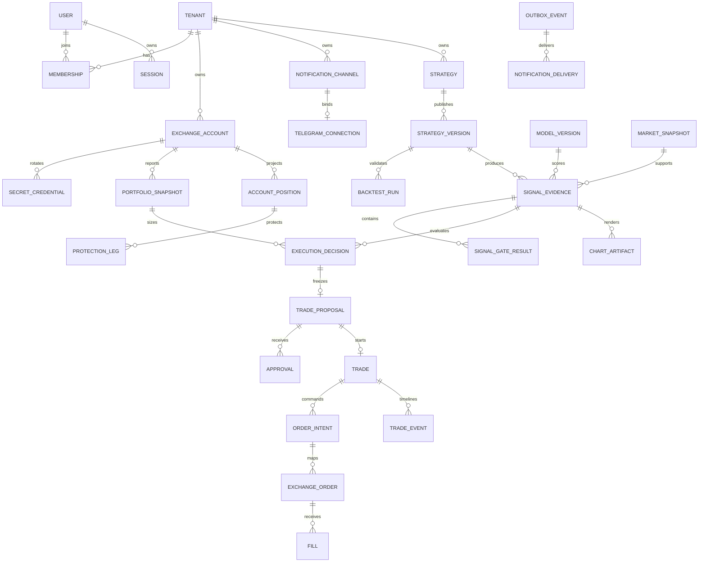
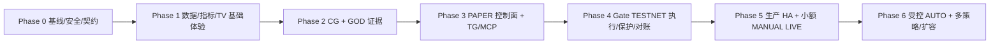

# 数据模型、接口契约与实施 Backlog

## 1. 给实现者的执行规则

后续 Sol 5.6 应按本文档阶段顺序实现。一次只交付一个可验收纵向切片；不得直接从当前 `research_score` 接交易所。

每个切片遵循：

1. 先补 ADR/schema/OpenAPI/状态转换，再写实现；
2. schema 变化必须使用 Alembic migration；
3. 外部系统先写 adapter contract 和 emulator/fixture；
4. 业务规则放 domain/application，不放 route、Bot handler 或前端；
5. 所有副作用带 idempotency key、上限明确的超时/重试和审计；
6. 默认 feature flag 关闭，测试和运行手册完成后才开启；
7. 不把真实 API Key、Token、Cookie、账户详情写入任何文件；
8. 不破坏或删除当前 SQLite，先做一致性备份和只读迁移；
9. 遇到交易所能力不确定时停在 PAPER，依据实施时最新官方文档和 testnet 验证，不猜 endpoint/参数；
10. 任一阶段退出门不满足，就保留上一安全模式，不通过降低门槛推进。

## 2. 目标目录

```text
crypto_gate_trade/
├── pyproject.toml              # 根工程、分组依赖和命令入口
├── uv.lock                    # 唯一锁定文件；CI/镜像不得漂移
├── apps/
│   ├── api/                 # FastAPI REST/WS/BFF，不持有交易所 secret
│   ├── market_worker/       # Gate public + Coinglass/LSR ingest/gap repair
│   ├── strategy_worker/     # indicator DAG, GOD, backtest/shadow
│   ├── notification_worker/ # outbox + Telegram，只有 Bot 权限
│   ├── chart_worker/        # 无 Bot/交易凭据的隔离渲染进程
│   ├── executor/            # isolated OMS/exchange private adapter
│   └── mcp_server/          # authenticated streamable HTTP/stdio dev
├── src/gatescope/
│   ├── domain/              # 无框架、无 I/O 的 entities/value objects/invariants
│   ├── application/         # commands, queries, use cases
│   ├── indicators/          # registry/DAG/built-ins/current pattern plugins
│   ├── strategies/          # DSL, versions, model/calibration interfaces
│   ├── risk/                # deterministic pre/post-trade risk
│   ├── execution/           # OMS state reducer, idempotency, reconciliation
│   ├── ports/               # repositories/exchange/data/notify abstractions
│   └── adapters/            # postgres/public gate/coinglass/telegram/object store
├── src/gatescope_executor/       # 仅 executor 镜像包含
│   └── adapters/            # Gate private/KMS decrypt，不进入其他 wheel/镜像
├── web/                     # React/TypeScript/Vite
├── migrations/              # Alembic
├── contracts/
│   ├── openapi/              # REST/WS 规范与生成客户端
│   ├── events/               # 每个 event payload JSON Schema
│   ├── mcp/                  # 每个 tool input/output schema
│   └── external/             # Gate/Coinglass/TG 脱敏 contract fixtures
├── tests/
│   ├── unit/
│   ├── property/
│   ├── golden/
│   ├── contract/
│   ├── integration/
│   ├── e2e/
│   ├── chaos/
│   ├── security/
│   └── performance/
├── deploy/                  # 独立 image/IAM/network manifests，不含 secret
├── docs/adr/
├── docs/runbooks/
└── legacy/                  # 临时兼容层，迁移完成后再移除
```

初期不需要把每个目录做成独立仓库，但必须是独立可执行入口、镜像和工作负载身份。`pyproject.toml` 固定 `gatescope-api`/`market-worker`/`strategy-worker`/`notification-worker`/`chart-worker`/`executor`/`mcp-server` 命令与 dependency groups；每个镜像只安装必要 group。

依赖 DAG 是强制契约：`domain <- application <- composition root/adapters`；`domain` 不依赖 FastAPI/SQLAlchemy/http client，API/TG/MCP 不依赖 `gatescope_executor`。CI 同时检查 import graph 和镜像文件清单。仅 executor 的 IAM 允许 KMS `Decrypt` 与访问交易所私有网络出口；“没有 import”不能代替镜像、IAM 和网络隔离。

### 2.1 现有文件迁移

| 当前文件 | 目标 |
| --- | --- |
| `app.py` | `/api/v1` 兼容 facade + 新 `apps/api` composition root |
| `database.py` | 拆 repository ports/Postgres adapters；SQLite 只读 importer |
| `gate_client.py` | `adapters/market/gate_public.py`，补 WS/gap/capability |
| `pattern_engine.py` | `indicators/patterns/v1`，增加 availability 和 golden fixture |
| `scanner.py` | alert evaluator + outbox worker，移除 Web 进程 daemon |
| `opportunity_scanner.py` | legacy research adapter；新 GOD 不复用其门禁分数 |
| `static/*` | 逐页迁到 `web/`，旧页面在迁移期只读可用 |

## 3. 核心数据模型

### 3.1 聚合与 ID 关系



`signal_evidence_snapshot_id` 是账户无关的研究证据 ID（`/signals/{id}` 中的 `id` 即此 ID）；`execution_decision_snapshot_id` 是账户、资产组合水位和数量已确定的决策 ID；`proposal_id` 是待授权条款；`public_trade_id` 在 proposal 被原子消费时创建，是 Web/TG/MCP 统一的做单事件 ID；`intent_id` 是该 trade 下某个 ENTRY/CANCEL/REDUCE/CLOSE/TIGHTEN_STOP 命令。API、事件和表外键必须使用这些全名，禁止缩写或互换。

### 3.2 基础类型、单位与租户

- 内部 ID 使用 UUIDv7；外部可显示 UUIDv7 或额外 128-bit 随机 opaque ID，但仍必须逐资源授权；
- 所有时间在 PostgreSQL 使用 `timestamptz`，API 使用 RFC 3339 UTC `...Z`；持有期/超时另用带单位的整数毫秒；
- 价格、数量、费用、PnL 用 `numeric(38,18)`/交易所整数刻度，API 为 decimal string，交易链路禁止 binary float；
- 比率统一为 `[0,1]` decimal string，例如 0.25% 存 `"0.0025"`；基点字段后缀 `_bps`，100 bp = 1%；禁止没有规定语义的 `*_pct` 字段；
- Money 必须是 `{amount: decimal string, currency: asset_id}`；quantity 必须同时绑定 `instrument_id` 和 `quantity_unit=BASE|QUOTE|CONTRACT`；
- 配置 JSON 必须有 `schema_version` 并由 JSON Schema 校验；canonical JSON 使用 RFC 8785/JCS，计算 digest 时排除 `digest` 字段本身；
- 租户私有表必须有 `tenant_id, created_at`并启用 RLS。`instruments/bars` 等全局公开市场表不伪造 `tenant_id`，只对 ingest role 可写；租户凭据获取的 external/account 数据仍是租户私有；
- 敏感 ciphertext 与普通 JSON 分列，普通 repository/DTO 不映射 ciphertext。

### 3.3 交易语义使用四个正交轴

| 轴 | 枚举 | 语义 |
| --- | --- | --- |
| `decision` | `ABSTAIN/REJECT/ELIGIBLE` | 本次输入是数据/适用域不足、明确拒绝，还是通过本 tier 决策门 |
| `evidence_tier` | `RESEARCH/SHADOW/PAPER/LIVE_ELIGIBLE` | 该策略/模型经审批的最高证据级别 |
| `environment` | `PAPER/TESTNET/LIVE` | 订单最终去模拟器、测试网还是生产账户 |
| `authorization_mode` | `NONE/MANUAL/AUTO` | 不允许授权、每笔人工批准或由限时 policy 授权 |

`AUTO` 不是 GOD 直接下单指令。合法组合至少满足：`RESEARCH/SHADOW` evidence 不产生交易 intent 且 `authorization_mode=NONE`；`PAPER` evidence 只可进入 `environment=PAPER`；`TESTNET/LIVE` 必须引用 `evidence_tier=LIVE_ELIGIBLE`、由 execution decision 给出 `decision=ELIGIBLE` 并通过各自执行/运维门禁，authorization 才能是 `MANUAL|AUTO`；AUTO 还须命中未过期 policy。`ABSTAIN/REJECT` 始终配 `authorization_mode=NONE`。GOD 只将账户无关数值和 `evidence_tier` 固化在 signal evidence；Risk/Sizing 将 `decision/environment/authorization_mode`、账户风险和数量固化在 execution decision。兼容 API 可组合展示四轴，但不得在任一层复制另一层的权威字段或改写原证据。

`DEV/STAGING/PRODUCTION` 是基础设施部署配置，worker 的 `started/paused/draining` 是运行生命周期；两者都不得混入上述四轴或改变其门禁。

### 3.4 身份、连接与产品配置

| 表 | 关键字段/约束 |
| --- | --- |
| `tenants` | id, name, status；不可物理删除有交易事实的 tenant |
| `users` | id, normalized_username unique, password_hash, status, mfa_required, password_changed_at |
| `memberships` | tenant_id, user_id, role；复合唯一 |
| `sessions` | token_hash unique, user_id, expires_at, revoked_at, device metadata |
| `mfa_methods` | user_id, type, encrypted_seed/public credential, recovery hash |
| `exchange_accounts` | tenant, venue, alias, environment, settle_asset, position_mode, margin_mode, active_credential_id, capability_revision_id, status/trading_ready；账户别名复合唯一 |
| `secret_credentials` | account/provider/version, ciphertext, wrapped_dek, kms_version, fingerprint, permission snapshot, status, validated/revoked times；轮换新增版本不覆盖 |
| `notification_channels` | tenant, type, alias, status, connection id；不含 Bot token |
| `telegram_connections` | tenant/user/chat numeric ids, verified_at, status；`(tenant,user_id,chat_id)` unique |
| `telegram_link_tokens` | user/session binding, token_hash, expires/attempts/consumed_at；只存 hash |
| `telegram_callback_tokens` | user/chat/proposal/version/action binding, token_hash, expires/consumed_at；原子单次消费 |
| `notification_routes` | event types, strategy/account/symbol filters, quiet hours, rate policy, channel_id, ETag |
| `mcp_clients` / `mcp_tokens` | auth profile, subject/tenant, token_hash or OAuth client, audience, scopes, expires/revoked/last-used |
| `execution_profiles` | tenant/account、order/risk/rounding policy version refs、environment、status/ETag；不含 credential，也不授予 AUTO |
| `chart_layouts` / `indicator_templates` | owner, name, version/ETag, layout/spec JSON |
| `watchlists` / `watchlist_items` | owner, order, instrument, default timeframe, ETag |
| `alert_rules` / `alert_rule_versions` | editable identity + immutable condition/routing version |
| `system_settings` | 非秘密配置、schema_version、ETag；tenant/global scope 明确 |

`mcp_tokens` 的可选默认绑定是服务端字段 `default_exchange_account_id/default_execution_profile_id`；两者必须属于同一 tenant 且 profile 必须绑定该 account。客户端看不到或覆盖这些外键，撤销/改变默认绑定产生新 token/version，不能静默改变已发 token 的权限含义。

### 3.5 交易凭据 onboarding 契约

1. 浏览器只通过 TLS 向专用 credential create route 提交一次；该 route 禁用 body/access log、trace body 和 error echo，请求有严格大小上限；
2. API 工作负载只有 KMS `Encrypt`/数据密钥封装权，没有 `Decrypt`；明文只在请求内存中短暂存在，完成后丢弃，不进 outbox/job payload；
3. API 写入 `PENDING_VALIDATION` credential version 和只包含 credential ID 的 validation command；executor 以工作负载身份解密、调用权限探测，只返回脱敏 capability/permission result；
4. 发现提现/转账权限、环境不匹配或验证失败时标记 `REJECTED`，不激活账户；轮换时新版本先验证，再以 CAS 切换 active credential；
5. 普通 GET/DTO/repository 只返回 id/alias/provider/environment/fingerprint/permissions/status；凭据创建、验证、切换和撤销全部审计但不记录秘密摘要以外的内容。

### 3.6 市场与特征数据

| 表/存储 | 用途 |
| --- | --- |
| `instruments` / `instrument_revisions` | venue symbol、base/quote/settle、contract multiplier、tick/lot/min notional、trigger rules、状态 |
| `bars` hypertable | canonical Bar、is_final、source sequence、revision、available_at、quality flags |
| `market_ticks/orderbook_snapshots` | 有许可时保存回测/成本所需精度，按保留策略压缩 |
| `external_snapshots` | tenant/provider/endpoint/params hash、source/calculated/available/received times、schema/quality、raw object URI/hash |
| `indicator_runs` | dataset/indicator/params/build hash、watermark、status、artifact URI |
| `indicator_values` | 在线热点值；长历史可存压缩 artifact/ClickHouse |
| `feature_vectors` | exact feature schema/version/vector、available_at、digest |
| `market_snapshots` | bar revision manifest、external snapshot IDs、orderbook watermark 和总 hash；不含账户数据 |

`bars` 唯一键是 `(venue, market, instrument_id, timeframe, open_time, revision)`。相同 payload hash 重放不新增 revision；值发生变化才追加 revision。“当前 revision”是可重建视图，`signal_evidence` 必须引用具体 manifest，不跟随视图漂移。

### 3.7 研究证据与账户执行决策

| 表 | 关键字段/约束 |
| --- | --- |
| `indicator_definitions` | id, semver, input/output schema, build hash, status |
| `strategies` | 可编辑身份/归属，soft delete |
| `strategy_versions` | immutable DSL、依赖/参数、risk policy、canonical hash、published_by/at |
| `strategy_certifications` | immutable strategy_version_id/evidence_tier、approval_epoch、approved_at/review_expires_at、冻结统计/校准/分箱/监控方法版本 |
| `strategy_certification_events/current` | issued/suspended/expired/renewed 追加事件 + ACTIVE/SUSPENDED/EXPIRED CAS 投影；renew 产生新 epoch |
| `trial_registry` | 每次 universe/features/barriers/threshold/model 尝试，包含失败实验 |
| `model_versions` / `calibrator_versions` | immutable training/calibration inputs, artifacts, metrics；审批状态用追加 event |
| `backtest_runs` | frozen inputs、folds、cost/execution version、metrics、artifacts、status |
| `signal_evidence_snapshots` | 账户无关；market/feature/indicator/model versions、probabilities/bounds、单位经济性、barriers、`evidence_tier/strategy_certification_id`、digest；不得保存 `decision/environment/authorization_mode` |
| `signal_gate_results` | signal_evidence_snapshot_id, gate_code, PASS/FAIL/NOT_APPLICABLE/INSUFFICIENT, typed threshold/value/unit/reason/version |
| `execution_decisions` | signal_evidence_snapshot_id+digest、account、portfolio snapshot、capability/instrument revision、`decision/environment/authorization_mode`、exact rounded terms/quantity、runtime gates、expires、digest；不得复制 `evidence_tier` |
| `execution_gate_results` | execution_decision_snapshot_id, data/account/portfolio/liquidity/execution/kill gate result；append-only |
| `signal_observations` | signal_evidence_snapshot_id，后续价格/研究结果追加记录，不改 signal evidence |
| `authorization_policies` | immutable authorization scope/risk/validity，状态由 `authorization_policy_events` 投影 |

旧 signal evidence 的 `evidence_tier/strategy_certification_id` 永不随 current projection 改写。每次创建 TESTNET/LIVE execution decision 都必须重新确认所引 certification 当前为 `ACTIVE` 且未过 `review_expires_at`；过期或漂移 suspension 追加 certification event 并使新 decision `ABSTAIN/REJECT + authorization_mode=NONE`，已有仓位继续保护/退出。

对象存储中的原始 snapshot/artifact 必须先上传到 content-addressed key 并校验 hash，然后才能在 DB 事务中将 signal 标记 `READY`并写 outbox。不可重现的快照不得发出 proposal。

### 3.8 账户、风险与交易事实

| 表 | 关键字段/约束 |
| --- | --- |
| `account_balance_snapshots` | account, asset balances/equity/margin, exchange event/received time, valuation watermark；append-only |
| `portfolio_snapshots` | account/base currency, positions, open orders/reservations, adjusted equity, valuation prices/times/digest；append-only |
| `cash_flow_events` / `fee_funding_ledger` | deposit/withdraw/transfer/fee/funding/realized PnL 事实；append-only |
| `account_position_snapshots` | exchange truth，account/instrument/position_side/qty/entry/liquidation/margin/times；append-only |
| `account_positions_current` | 从 position/fill/reconcile facts 重建的 CAS 投影，不代替 ledger |
| `trade_proposals` | immutable execution_decision_snapshot_id/exact terms/expires/price tolerance/digest |
| `proposal_status_current` | DRAFT/PRECHECK_REJECTED/AWAITING_CONFIRMATION/REJECTED/CANCELED/EXPIRED/SUPERSEDED/AUTHORIZED/REVALIDATION_REJECTED/CONSUMED + version 投影 |
| `approval_revalidation_snapshots` | proposal/version + original execution decision、latest price/market/account-balance/equity/portfolio/position/order/capability/instrument/kill watermarks、risk version/gates、exact-terms digest、PASS/FAIL、created_at/digest；append-only |
| `approvals` | proposal/version, approval_revalidation_snapshot_id, actor/channel, nonce/idempotency hash, approval_outcome=APPROVE/REJECT, decided_at；append-only，不复用四轴 `decision` 字段名 |
| `trades` | public_trade_id, proposal_id/exchange_account_id/instrument_id/position_side, created_at；不可物理删除 |
| `trade_state_current` | PENDING_ENTRY/ENTERING/OPEN/EXITING/CLOSED 及 version；另存可证明的 close_reason=`ENTRY_NOT_FILLED/TP_HIT/SL_HIT/TIME_STOP/MANUAL_CLOSE/STRATEGY_EXIT/EXCHANGE_FORCED_EXIT/EXTERNAL_EXIT/CLOSE_REASON_UNKNOWN` 与其证据事件 ID |
| `order_intents` | immutable public_trade_id/approval_revalidation_snapshot_id/command type/exact normalized terms、submit_not_after、approved price reference/max_price_drift_bps、instrument revision、risk reservation/client intent digest |
| `order_intent_current` | PENDING_DISPATCH/CLAIMED/SUPPRESSED/DISPATCHED/RECONCILIATION_REQUIRED/COMPLETED + version；可重建投影 |
| `exchange_orders` | immutable account/intent/leg/client_order_id/algorithm+key version/exchange_order_id identity |
| `exchange_order_events` / `exchange_orders_current` | append-only exchange facts + CAS state projection；entry order 可表达 PENDING_SUBMIT/SUPPRESSED/SUBMITTING/UNKNOWN/OPEN/PARTIALLY_FILLED/FILLED/CANCEL_SUBMITTING/CANCEL_UNKNOWN/CANCELED/EXPIRED/REJECTED，含 PARTIALLY_FILLED 或 CANCEL_UNKNOWN 经权威对账转 EXPIRED |
| `fills` | account-scoped exchange fill id, order, price/qty/fee asset, event/received times；append-only |
| `protection_legs` | account-position aggregate, STOP/TP, trigger source/type, covered qty, reduce-only/close-position, order id；immutable terms |
| `protection_events` / `protection_current` | submit/ack/reject/cancel/trigger/coverage observations + 可重建投影 |
| `trade_events` | public_trade_id + trade sequence unique, type/payload, occurred/recorded, causation/correlation, digest；append-only |
| `reconciliation_cases/events` | mismatch snapshot + append-only resolution events/current projection |
| `risk_reservations/events/current` | execution_decision_snapshot_id/intent_id, base-currency risk amount, expiry/release + append-only facts/CAS projection |
| `kill_switch_events/current` | scope/reason/actor/state transition + 追加事实/投影 |

运行风险以 `portfolio_snapshot` 的 base currency 为准。`current_equity` 包含已实现/未实现 PnL、fee/funding；日内损失以 policy 冻结的 UTC 日界线和 start-of-day equity 计算，deposit/withdraw/transfer 作现金流调整而不伪装成盈亏。价值换算过期、账户水位过期或账本不平时不得新增仓位风险。

Pilot 对每个 `(exchange_account_id,instrument_id,position_side)` 只允许一个未关闭 trade，用 advisory/row lock + partial unique constraint 保护。这使 protection 安全归属于账户净仓位。取消此限制前必须实现策略 virtual lots、净额化/成交归因、相反意图解决和 position-level protection manager，不允许每个 intent 各自对净仓位挂满额止损。

有效止损覆盖 `Q_valid_stop` 必须来自同 account/instrument/position_side、方向反向、交易所已确认 ACTIVE、触发源/触发价有效且具有 `reduce_only` 或 `close_position` 保证的条件单。定义 `uncovered=max(0,Q_open-Q_valid_stop)`：可交易仓位要求 `uncovered=0`；只有交易所元数据判定为无法减仓的 dust 才允许 `0 < uncovered < min_reducible_qty`并立即告警。默认 hard deadline 是 `fill_event_time + 5,000 ms`，`fill_event_time` 先按已测量的交易所时钟偏差校正到系统 UTC，再映射为 monotonic timer；SLO 目标为 3,000 ms。fill 若晚到且收到时已过 deadline，立即记录 protection breach 并进入降险，不从 received_at 重新获得 5 秒。达到 hard deadline 时不等待 TG/Coinglass/LLM，执行撤剩余 entry、降险和冻结新开仓。

首次交易所 mutation 前，executor 必须在一个 DB transaction/CAS claim 中同时锁 intent、账户 assignment 和 kill/reservation current，并验证 `now≤submit_not_after`、quote freshness/相对 approved reference 的 drift、instrument revision、账户 trading_ready、policy/certification、approval revalidation、risk reservation、pause/kill epoch 与当前 leader fencing epoch。任一失效就追加 `order.intent.suppressed.v1`，intent/entry 投影为 SUPPRESSED、释放预留且 **零交易所调用**。若请求已进入 SUBMITTING 才发生 pause/SAFE_KILL，不能假定取消成功：先进入 UNKNOWN/对账，发现 fill 时立即保护并按 kill profile 撤余量/降险。

entry 在 `REJECTED/CANCELED/SUPPRESSED/EXPIRED` 终态且累计 fill 为 0 时，trade reducer 必须由 PENDING_ENTRY/ENTERING 转 CLOSED，追加 `trade.entry_not_filled.v1` 并使用 close_reason `ENTRY_NOT_FILLED`；只要有任意 fill 就不得走该分支，而应按真实净仓进入保护/退出流程。

### 3.9 消息、制品与审计

| 表 | 作用 |
| --- | --- |
| `outbox_events` | 与业务事务同提交，event_id unique，lease/attempt/next_at/dead-letter |
| `inbox_events` | 上游/交易所/TG update 去重，tenant/source/external_id unique |
| `operations_current` | tenant/actor/type/resource/state/progress/result link/safe error/times/expiry；异步任务可变投影，不是交易事实 |
| `notification_deliveries` | channel/event/template unique、attempt/status/message id/error code |
| `chart_artifacts` | signal_evidence_snapshot_id/public_trade_id, view type, object URI/hash, spec/renderer/font/container versions, created_at |
| `mcp_audit_events` | subject/tool/scope/param digest/snapshot/result/trace；append-only |
| `audit_events` | actor/action/resource/before-after digests/prev digest；append-only |

对象存储 key 用 tenant + content hash，不把 symbol/用户名/账户号直接放公共 URL。下载使用短时签名 URL 或 API 鉴权代理；制品上传、DB reference 和 GC 使用 staged/committed 状态，不得因跨存储双写留下已发布但不可读快照。

任何进入 proposal、PAPER/TESTNET/LIVE trade 或 approval/audit chain 的 signal evidence、bar revision manifest、external/feature references、execution/revalidation snapshot、chart spec 和 timeline 标为 `COMMITTED_REFERENCED`，默认至少保留 7 年；tenant retention policy 只能延长，缩短/处置须经法律与业务确认、legal hold 检查和追加审计，普通 GC 永不删除。未进入 proposal 的 ABSTAIN/REJECT 至少保留 compact features/gates/versions/digest，PNG 可按需重渲染；第三方 raw payload 是否保留严格服从 `license_class`，若许可不允许保存足以复现的输入，该 feature 不得用于 LIVE。

GC 只处理超过 staged TTL 且 DB/object reference count 均为 0 的 `STAGED` 或临时渲染对象：第一阶段写 deletion candidate 与快照化引用扫描，经过 grace period 后第二阶段再次查零引用才删除，并追加审计。content hash 去重不得因一个 tenant/resource 解除引用而删除仍被其他授权引用的对象；GC role 不能读交易凭据，也不能改事实表。

### 3.10 append-only 事实与可变投影

- `strategy/model/calibrator/certification/signal evidence/gate/execution decision/proposal/approval revalidation/approval/trade/order intent/exchange order event/fill/position snapshot/protection event/risk event/reconciliation event/kill/audit` 是 append-only facts，业务 role 的 UPDATE/DELETE 由 grant + trigger 双重拒绝；
- `*_current`、session last-used、outbox lease/attempt、job progress 是可变 projection/operational state，使用 `version` CAS，必须能从 facts 重建；
- 审批/暂停/恢复不 UPDATE 不可变版本，而是追加 status event 后更新 projection；
- writer 归属：strategy worker 写 market-derived evidence；proposal/risk service 写 execution decision/approval/reservation；executor 写 order/fill/position/protection/reconcile；notification/chart worker 只写各自 delivery/artifact；API/MCP/TG controller 不直接改交易投影；
- migration owner 只在有审计的 migration transaction 内变更 schema，不被当作平时绕过 immutable trigger 的后门。

RLS 是可测的连接契约：所有 tenant-private 表同时 `ENABLE ROW LEVEL SECURITY` 和 `FORCE ROW LEVEL SECURITY`；API/worker/executor/MCP/TG roles 均为非 table owner 且 `NOBYPASSRLS`。认证完成后，每个 DB transaction 先 `SET LOCAL app.tenant_id` 和 `app.subject_id`，值缺失/非 UUID 时 policy 默认 deny；禁止在连接级使用不会自动回滚的 `SET`。连接池 check-in 执行 rollback/reset，并用“同一物理连接先 tenant A 后 tenant B”集成测试防上下文泄漏。migration/maintenance 使用独立高权 role/连接池，绝不处理服务请求。

### 3.11 关键数据库不变量

- `(exchange_account_id, client_order_id)` unique；client ID 在 intent 创建时将完整值、算法版本和 HMAC key version 一起持久化，密钥轮换后不重算；
- `(exchange_account_id, exchange_fill_id)` unique，并保留 `(order_id, exchange_fill_id)` 辅助约束；
- `(aggregate_type, aggregate_id, sequence)` unique，每个 reducer 用该 sequence CAS；
- proposal version 与 approval 精确匹配；一个 proposal 最多一个 `CONSUMED` approval/一个 trade，用 partial unique index 强制；
- qty/notional/price 等核心约束同时在 JSON Schema、domain value object 和 DB CHECK 表达；
- immutable fact 无 cascade delete；删除界面对象只写 tombstone/hide event；
- RLS 保证 tenant isolation，executor service role 还必须按被分配账户过滤，不使用 table owner/BYPASSRLS 连接处理业务请求。

## 4. 领域事件契约

统一 envelope：

```json
{
  "event_id": "uuidv7",
  "event_type": "signal.evidence.created.v1",
  "schema_version": 1,
  "tenant_id": "uuid",
  "aggregate_id": "uuid",
  "aggregate_version": 7,
  "occurred_at": "UTC timestamp",
  "recorded_at": "UTC timestamp",
  "correlation_id": "uuid",
  "causation_id": "uuid|null",
  "producer": "strategy-worker@build-digest",
  "payload": {},
  "digest_algorithm": "sha256-jcs-v1",
  "digest": "sha256"
}
```

首批事件：

```text
market.bar.finalized.v1
market.bar.corrected.v1
market.gap.detected.v1
datasource.snapshot.received.v1
datasource.stale.v1
indicator.snapshot.ready.v1
signal.evidence.created.v1
signal.evidence.rejected.v1
strategy.certification.issued.v1
strategy.certification.suspended.v1
strategy.certification.expired.v1
strategy.certification.renewed.v1
execution.decision.created.v1
execution.decision.rejected.v1
proposal.created.v1
proposal.rejected.v1
proposal.canceled.v1
proposal.expired.v1
proposal.authorized.v1
approval.revalidation.recorded.v1
proposal.superseded.v1
proposal.consumed.v1
authorization_policy.changed.v1
risk.reserved.v1
risk.reservation.released.v1
trade.created.v1
order.intent.created.v1
order.intent.suppressed.v1
order.dispatch.claimed.v1
order.submit.started.v1
order.submit.unknown.v1
order.acknowledged.v1
order.rejected.v1
order.partially_filled.v1
order.filled.v1
order.cancel.requested.v1
order.cancel.unknown.v1
order.canceled.v1
order.expired.v1
fill.recorded.v1
position.observed.v1
position.external_detected.v1
position.liquidation.observed.v1
position.adl.observed.v1
trade.exit.requested.v1
trade.exit.partially_filled.v1
trade.entry_not_filled.v1
protection.submit.requested.v1
protection.acknowledged.v1
protection.rejected.v1
protection.resized.v1
protection.canceled.v1
protection.triggered.v1
protection.verified.v1
protection.missing.v1
trade.external_exit.observed.v1
trade.close_reason.unknown.v1
trade.close_reason.corrected.v1
trade.closed.v1
reconciliation.mismatch.v1
reconciliation.resolved.v1
kill_switch.changed.v1
notification.requested.v1
chart.render.requested.v1
chart.render.completed.v1
```

上述每个事件都必须在 `contracts/events/` 有独立 payload schema、生产者、聚合类型、合法前置版本和重放期望。`digest` 是排除 digest 字段后的 JCS envelope 摘要；`aggregate_version` 是聚合序列，不是 schema version。消费者先按 event_id inbox 去重，再按 `(aggregate_type,aggregate_id,aggregate_version)` CAS；缺序时暂停该聚合并回补，不按到达顺序猜测。schema 只做向后兼容新增；破坏性变化发 `.v2`，旧事件和读取器保留。payload 禁止秘密和无界原始第三方正文。

`proposal.canceled.v1` 只允许 `DRAFT|AWAITING_CONFIRMATION → CANCELED`，并与 approve/expire 使用同一 proposal version/CAS 锁和 HTTP/MCP 幂等记录；已 `AUTHORIZED|CONSUMED` 不得伪装成取消。entry TTL 到期与 cancel/fill 并发时，order reducer 必须保留 `PARTIALLY_FILLED` 的累计成交事实，并允许 `PARTIALLY_FILLED|CANCEL_UNKNOWN → EXPIRED`；绝不能把“剩余量过期”投影成“零成交取消”。

净仓归零不能仅凭 K 线或预期订单猜 close reason。liquidation/ADL 固化为 `EXCHANGE_FORCED_EXIT`，账户外手工平仓固化为 `EXTERNAL_EXIT`；原因暂不可证明时先追加 `trade.close_reason.unknown.v1`。后续获得权威证据时只追加 `trade.close_reason.corrected.v1` 并重建读模型，不 UPDATE 已有 close/fill/position 事实；`TP_HIT/SL_HIT` 必须引用实际成交或交易所触发事实。

## 5. REST API v2

### 5.1 通用规则

- 前缀 `/api/v2`。`contracts/openapi/v2.yaml` 是生成 TypeScript/Python client 和 contract test 的唯一源；本节是路由清单，不允许用手写 DTO 与 OpenAPI 分叉；
- OpenAPI 对每个 route 必须声明 request/response/error schema、RBAC/recent-auth、限流 cost、最大 body/range/limit 和可能状态码；默认拒绝，资源 ID 不可猜也仍逐资源校验 tenant；
- 有副作用的 `POST` 必须接受 `Idempotency-Key`；配置更新使用 `If-Match`/ETag，不符返回 `412 PRECONDITION_FAILED`；
- list 使用 opaque cursor + 固定 tie-breaker，响应是 `{items,next_cursor,has_more,trace_id}`；cursor 绑定 tenant/filter/sort 并签名，不接受 offset；
- 时间使用 RFC 3339 UTC，价格/数量/Money/ratio 按 3.2 输出；每个字段单位体现在名称和 schema description；
- 长任务返回 `202` + `operation_id` + `Location`，后续查询状态；不用一个 HTTP 请求同步等待回测、渲染或对账；
- 所有响应含 `trace_id`，行情/分析响应另含 `as_of,data_watermark,staleness_ms,quality_flags`；
- 常规创建 `201`，异步命令 `202`，出现状态/ETag/幂等冲突 `409/412`，过期授权 `410`，校验问题 `422`，限流 `429 + Retry-After`；
- 统一错误：

```json
{
  "error": {
    "code": "PROPOSAL_EXPIRED",
    "message": "安全、可展示的本地化文本",
    "retryable": false,
    "details": {},
    "trace_id": "uuid"
  }
}
```

`details` 使用 allowlist 字段，不透传上游 body/URL header/堆栈。

所有通用 `Location` 指向 `GET /api/v2/operations/{operation_id}`；响应状态固定为 `QUEUED|RUNNING|SUCCEEDED|FAILED|CANCELED`，包含 progress、created/started/finished times、可选 result resource link 与安全 error code。operation 绑定 tenant/actor/resource 并按原资源授权，默认 TTL 写入 OpenAPI；交易 mutation 的 operation 不提供通用 cancel，只有各自显式的安全命令可以改变状态。

RBAC deny-by-default；未在下表明确允许的 action 一律 `403`，RLS 通过也不等于 application authorization 通过。`R=逐 tenant 脱敏读取`，`W=在列出的约束内写入`：

| 资源/动作组 | VIEWER | RESEARCHER | OPERATOR | OWNER | SERVICE_* |
| --- | --- | --- | --- | --- | --- |
| market/chart/indicator snapshot | R | R；preview | R | R；全局配置 W | 仅显式 `market:read/analysis:read` |
| strategy/backtest/alert/signal evidence | R | 草稿/回测/alert W；不可 publish | R | W，含 publish | strategy worker 仅其聚合 W；其他按 scope R |
| proposal | R | create、取消未授权草案；不可 approve | create/read/approve/reject/cancel（硬限额内） | W | proposal service W；MCP 仅 `proposal:write` create/cancel，绝不 approve |
| trade/order/position/account 状态 | R（脱敏） | R（脱敏） | R；cancel-entry/reduce/close/tighten-stop | W；同样不得绕过只减仓规则 | executor 仅分配账户 W；其他 service 按 scope R |
| exchange account metadata | R（不含 capability 敏感细节） | R（脱敏） | R（脱敏） | create/disable/validate W | executor 仅分配账户 validate/read |
| credential ciphertext/rotation | 无 | 无 | 无 | write-only onboarding/rotate/revoke；永不读明文 | API 仅 Encrypt；executor 仅分配账户 Decrypt/validate；其余无 |
| authorization policy | R | R | pause；仅显式 `policy:resume:paper` 可恢复原 PAPER 范围；不可 create/扩大/LIVE resume | create/pause/revoke；LIVE resume/扩大须 recent-auth+MFA | policy/risk service 按版本读取；无任意 W |
| reconciliation case | R | R | 按 runbook adopt/close/resolve W | W | executor create/update facts；其他只按 scope R |
| SAFE_KILL / FLATTEN / LIVE resume | 无 | 无 | SAFE_KILL | SAFE_KILL；FLATTEN 与 LIVE resume 按强认证 | executor 只消费已授权 command，不可自授 |
| users/memberships/credential audit | 仅自己的 session | 无 | 无 | W/R，且不能移除最后 OWNER | auth/audit service 最小 scope |

`SERVICE_*` 不是一个可复用的万能角色：每个 workload subject 必须有独立 audience/scope、DB grant、账户 assignment 和网络/IAM policy。OWNER 也不能通过普通 API 读取 ciphertext、绕过 proposal/Risk/OMS 或把 RLS context 指到别的 tenant。OpenAPI 为每个 operation 写 `x-rbac-actions`，CI 将 operation 清单与此矩阵/授权测试生成物比较，新增 route 若未显式分类即失败。

### 5.2 路由清单

身份：

```text
POST   /auth/login
POST   /auth/mfa/verify
POST   /auth/logout
GET    /auth/me
POST   /auth/password:change                 recent-auth
GET    /auth/sessions
DELETE /auth/sessions/{id}
POST   /auth/recent-auth
GET    /auth/mfa-methods
POST   /auth/mfa-methods:enroll              returns pending enrollment, not enabled
POST   /auth/mfa-methods/{id}:confirm
DELETE /auth/mfa-methods/{id}                recent-auth; cannot remove last required method
POST   /auth/recovery-codes:regenerate       recent-auth; show once
POST   /auth/recovery-codes:consume          login recovery flow, strictly rate-limited
GET    /users                                OWNER
POST   /users                                OWNER recent-auth
PATCH  /users/{id}                           OWNER, If-Match
POST   /users/{id}:unlock                    OWNER recent-auth
GET    /memberships                          OWNER
POST   /memberships                          OWNER recent-auth
PATCH  /memberships/{id}                     OWNER recent-auth, If-Match
DELETE /memberships/{id}                     OWNER recent-auth; cannot remove last OWNER
```

异步操作：

```text
GET    /operations/{operation_id}
```

数据与图表：

```text
GET    /instruments
GET    /bars?instrument_id=&timeframe=&from=&to=&cursor=
GET    /market/snapshot?instrument_id=
GET    /indicators/catalog
POST   /indicators/preview
GET    /chart-layouts
POST   /chart-layouts
GET    /chart-layouts/{id}
PATCH  /chart-layouts/{id}                  If-Match
DELETE /chart-layouts/{id}                  soft-delete
GET    /indicator-templates
POST   /indicator-templates
GET    /indicator-templates/{id}
PATCH  /indicator-templates/{id}            If-Match
GET    /watchlists
POST   /watchlists
GET    /watchlists/{id}
PATCH  /watchlists/{id}                     If-Match
POST   /watchlists/{id}/items
DELETE /watchlists/{id}/items/{instrument_id}
GET    /alert-rules
POST   /alert-rules
GET    /alert-rules/{id}
PATCH  /alert-rules/{id}                    If-Match
POST         /alert-rules/{id}/versions
POST         /alert-rules/{id}/pause
GET    /data-sources/health
POST   /data-sources/{provider}/test        OWNER, recent-auth, redacted result
```

策略与研究：

```text
GET               /strategies
POST              /strategies
GET               /strategies/{id}
PATCH             /strategies/{id}          If-Match
POST              /strategies/{id}/versions
POST              /strategy-versions/{id}/validate
POST              /strategy-versions/{id}/publish
GET               /strategy-versions/{id}/certifications
POST              /strategy-versions/{id}/certifications  OWNER recent-auth + MFA
POST              /strategy-certifications/{id}/suspend   OWNER or certification monitor
POST              /strategy-certifications/{id}/renew     OWNER recent-auth + MFA; new approval epoch
POST              /backtests
GET               /backtests/{id}
GET               /backtests/{id}/report
GET               /signals
GET               /signals/{id}
GET               /signals/{id}/gates
GET               /signals/{id}/chart?view=original|progress
POST              /signals/{id}/execution-decisions
GET               /execution-decisions/{id}
GET               /execution-decisions/{id}/gates
```

通知/TG：

```text
GET               /notification-channels
POST              /notification-channels
GET               /notification-channels/{id}
POST              /notification-channels/{id}/test
DELETE            /notification-channels/{id}
POST              /telegram/link-tokens
POST              /telegram/webhook/{opaque-bot-id}  external, secret header
GET               /notification-routes
POST              /notification-routes
GET               /notification-routes/{id}
PATCH             /notification-routes/{id}          If-Match
DELETE            /notification-routes/{id}
GET               /notification-deliveries
```

MCP 管理（实际 MCP transport 端点不在 `/api/v2`）：

```text
GET               /mcp-clients
POST              /mcp-clients                         OWNER, recent-auth
GET               /mcp-clients/{id}
DELETE            /mcp-clients/{id}                    OWNER, recent-auth
POST              /mcp-clients/{id}/tokens            OWNER, token shown once
DELETE            /mcp-clients/{id}/tokens/{token_id}
GET               /mcp-audit-events
```

首版不做邮件自助密码重置。锁定用户由 OWNER 在已 recent-auth 会话中创建一次性恢复 challenge，通过受控管理命令交付；challenge 只存 hash、15 分钟过期、仅用一次，完成后撤销旧 sessions 并强制重建 MFA。初始 bootstrap 账号不能代替这套正式账号管理。

交易所与控制：

```text
GET               /exchange-accounts
POST              /exchange-accounts                 OWNER recent-auth; write-only secret fields
GET               /exchange-accounts/{id}            redacted DTO
POST              /exchange-accounts/{id}/credentials:rotate  OWNER recent-auth
POST              /exchange-accounts/{id}/validate
DELETE            /exchange-accounts/{id}            disable locally; never claims remote revocation
GET               /exchange-accounts/{id}/capabilities
GET               /authorization-policies
POST              /authorization-policies            OWNER recent-auth
GET               /authorization-policies/{id}
POST              /authorization-policies/{id}/pause
POST              /authorization-policies/{id}/resume LIVE: Web OWNER recent-auth+MFA; PAPER: policy:resume:paper Web/TG one-time callback
POST              /authorization-policies/{id}/revoke OWNER recent-auth
POST              /proposals
GET               /proposals/{id}
POST              /proposals/{id}/approve
POST              /proposals/{id}/reject
POST              /proposals/{id}/cancel             DRAFT/AWAITING_CONFIRMATION only; emits proposal.canceled.v1
POST              /proposals/{id}/supersede          lower quantity cap only; creates new decision/proposal
GET               /orders
GET               /orders/{id}
GET               /positions
GET               /trades?exchange_account_id=&strategy_version_id=&instrument_id=&symbol=&state=&from=&to=&cursor=
GET               /trades/{id}
GET               /trades/{id}/timeline
GET               /trades/{id}/chart?view=original|progress
POST              /trades/{id}/commands/cancel-entry
POST              /trades/{id}/commands/reduce
POST              /trades/{id}/commands/close
POST              /trades/{id}/commands/tighten-stop
POST              /trading/pause
POST              /trading/safe-kill-challenges       OWNER/OPERATOR; no recent-auth/MFA
POST              /trading/safe-kill                  OWNER/OPERATOR + channel-bound one-time confirmation
POST              /trading/flatten-challenges         OWNER recent-auth + MFA; Web by default
POST              /trading/flatten                    OWNER + second one-time confirmation
POST              /trading/resume                     OWNER recent-auth + MFA + reconcile; Web-only in LIVE
GET               /reconciliation-cases
GET               /reconciliation-cases/{case_id}
POST              /reconciliation-cases/{case_id}/commands/adopt-external
POST              /reconciliation-cases/{case_id}/commands/close-external
POST              /reconciliation-cases/{case_id}/resolve  OWNER/OPERATOR
```

关键写路由的最小输入也属于 OpenAPI 规范：`POST /signals/{id}/execution-decisions` 仅接受 Web 已授权选择的 `{exchange_account_id,execution_profile_id}`（外加 Idempotency-Key），账户的 environment 必须与 profile 一致，Risk/Sizing 自行生成数量、条款和三项 execution-side 轴；`POST /proposals` 仅接受 `{execution_decision_snapshot_id}`，服务端复制其 exact terms，客户端不得提交 side/quantity/entry/TP/SL/time stop。

`POST /proposals/{id}/supersede` 的 body 只允许 `{proposal_version,max_quantity_cap,quantity_unit}`，且 cap 必须严格低于原数量；服务端重跑 Risk/Sizing，生成新 execution decision/proposal/version 并使旧 proposal `SUPERSEDED`，绝不 UPDATE 原条款。entry/order type/price tolerance 变化必须生成新 signal evidence；TP/SL/持有期变化必须来自新验证的 strategy/model version；行情漂移由服务端重算而非接受客户端报价。其他字段或增量 quantity 一律 422。

`GET /trades` 按 tenant 授权并使用 cursor，可组合 account/strategy/instrument 或 canonical symbol/state/time range，若同时给 instrument 与 symbol 且不一致返回 422。`GET /trades/{id}` 返回 immutable IDs/digests、综合 lifecycle、entry/exit 累计量、费用/资金/PnL、保护覆盖与各自 `as_of`；它是 summary read model，不替代 `/timeline` 的追加事实。原图始终引用开单时 signal evidence/manifest，progress 图另带当前 watermark，历史不因后续走势被回写。

`approve` 只接收 proposal version 和 Web approval nonce/TG callback token，不接收客户端重新提交 quantity/price/TP/SL。数量、刻度、触发源和仓位方向在 execution decision 已归一化，executor 不再“智能改写”已批准条款。若行情漂移或交易所元数据导致条款失效，则过期/拒绝并生成新 proposal。

`cancel-entry/reduce/close/tighten-stop` 都只是创建受审计 OMS command，不是 controller 直接调用交易所。它们在数据或 Risk 服务 degraded 时仍可用，但只能减小风险：`reduce/close` 强制 reduce-only/不反手；`tighten-stop` 对多头只能上移、空头只能下移；安全 close 在净仓归零前不先撤有效止损。

`ExchangeAdapter` 必须提供与 entry 分离的 `submit_reduce_only_exit(normalized_exit_or_close_position)` port，close/reduce 永不复用 `submit_entry`。domain 与 adapter 两层都验证 account/instrument/position_side/capability revision、`reduce_only|close_position`、归一化数量不超过当前净仓，且预期 post-position 绝对值不增、符号不反转；任何不支持或状态过旧都 fail closed。该 port 在 alpha/Coinglass/Risk degraded 时仍可调用；超时/ambiguous 进入 UNKNOWN 并按原 client ID 对账，不以新 entry/ID 重试。

`/trading/pause` 只执行 `BLOCK_NEW_ENTRIES`。`/trading/safe-kill` 的唯一 profile 是 `BLOCK_AND_CANCEL_ENTRIES`：持久化禁新仓、撤 working entry/add-position，保留 STOP/TP/退出；绑定 OWNER/OPERATOR 的 Web 或 TG 可用一次性确认触发，即使 Risk/数据 degraded 也不得要求 recent-auth/MFA。TG `/kill` 只能映射到此 endpoint/profile，不能让客户端提交 profile 名选择更高权限动作。

`BLOCK_CANCEL_AND_REDUCE` 只属于独立 `/trading/flatten`：先执行 SAFE_KILL，再对净仓创建 reduce-only close，确认 position=0 后才撤冗余保护。Web 仅 OWNER recent-auth+MFA 后取得第二个短时、channel/action/scope 绑定的一次性 challenge；TG 只有 OWNER 预先在 Web 以 recent-auth+MFA 开启 `telegram_emergency_flatten_allowed` 后才可请求，仍需第二个一次性确认 token。OPERATOR、普通 SAFE_KILL token、参数篡改或跨 channel 重放必须 `403/409` 且零 position mutation。所有 profile/action 在服务端版本化，不能把“急停”默认解释成全平。

### 5.3 幂等、批准与风险预留事务

`Idempotency-Key` 契约：

- client 生成至少 128-bit 熵的 opaque 值（推荐 UUIDv4/随机 base64url），ASCII 长度 20–128；它不是授权秘密，服务端仍完整鉴权；
- key 作用域为 `(tenant_id,actor_id,HTTP method,route template,key)`，服务端同时保存 JCS request hash；
- 同 key + 同 hash 在处理中返回同一 operation，完成后返回原 status/body/resource ID；同 key + 不同 hash 返回 `409 IDEMPOTENCY_KEY_REUSED`；
- 交易/凭据/急停命令的 key 和 response reference 至少保留 30 天，且不得早于关联 trade 关闭后 7 天；普通配置创建至少 24 小时；
- 这个幂等层不对交易所 mutation 做隐式网络重试；交易所 ambiguous result 仍进 reconciliation。

人工 `approve` 必须在一个 PostgreSQL 事务内按如下顺序完成：

1. 预占 idempotency record，锁定 `proposal_status_current`；TG 请求同时锁定 callback token；
2. 校验 tenant/actor/role/channel/proposal version/nonce 或 callback hash/未消费/未过期；
3. 只读取并锁定已落库且满足 freshness 的最新 price/market/account balance/equity/portfolio/position/order/capability/instrument/kill watermarks 与风险预算；事务内禁止等待外部 HTTP，快照过旧就安全失败；
4. 按冻结 risk version 重算，并无论 PASS/FAIL 都追加带上述输入 ID/digest、全部 gates 和 recomputed exact-terms digest 的 `approval_revalidation_snapshot + approval.revalidation.recorded.v1`；
5. 过期/任一 gate 失败时追加 rejection/expiry fact，不创建 trade；若重算 exact-terms digest 与 proposal 不同，则不得静默批准，而是走 supersede 生成新 execution decision/proposal，旧 proposal 终止且本次无 intent；
6. 只有 revalidation PASS 且 exact terms 完全相同时，才原子追加引用该 revalidation 的 approval，消费 nonce/callback，占用 risk reservation，创建同样引用它的 `trade + ENTRY order_intent + 持久化 client_order_id + outbox`，并把 proposal 投影转为 `CONSUMED`；
7. commit 成功后 executor 才能看到 dispatch event。并发 Web/TG 批准只能有一个获得 partial unique constraint，输家获得原 public_trade_id/“已被处理”结果，不创建第二个 intent。

AUTO 使用同一事务，actor 为可审计的 auto-policy version，且服务端取所有匹配 policy 与 hard limits 的最严交集。无法得到唯一、无冲突的授权范围时拒绝，禁止用列表顺序或“最后一条覆盖”决定。

`reject/cancel/supersede/expire` 与 approve 锁同一 `proposal_status_current` 行并比较 proposal version。尤其 cancel 仅允许 `DRAFT|AWAITING_CONFIRMATION → CANCELED`，在提交 `proposal.canceled.v1`、projection 和幂等 response 前不得释放锁；cancel 与 approve/TTL 同时发生时只能有一个合法终态，所有输家重放相同 key 得到原结果，使用新 key 得到 `409 PROPOSAL_ALREADY_DECIDED`，不得生成 trade/intent。

### 5.4 WebSocket

单端点 `/ws/v2`，认证后使用显式 subscribe/unsubscribe：

```text
market.bar.delta
market.ticker
indicator.delta
signal.created
proposal.changed
order.changed
position.changed
trade.event
system.health
notification.delivery
```

协议 envelope 至少含：

```json
{
  "type": "event|subscribed|resync_required|error|heartbeat",
  "request_id": "client supplied when applicable",
  "stream_key": "tenant/topic/resource canonical key",
  "sequence": 42,
  "watermark": "opaque snapshot watermark",
  "server_time": "RFC3339 UTC",
  "schema_version": 1,
  "payload": {}
}
```

`sequence` 的作用域是 `stream_key`，不是连接全局也不在不同 topic 间比较。market stream key 至少包含 instrument/timeframe，租户事件含 tenant/resource scope。subscribe ack 返回当前 watermark、REST snapshot URL 和允许的 buffer 上限；客户端只能使用该 snapshot + watermark 恢复，不假设服务器永久保留 WS 历史。

每个 subscribe/unsubscribe 有 request ID 和 ack/error；心跳、最大消息、每用户/tenant 订阅数和每连接有界发送队列写入 schema/配置。检测 sequence gap、权限/会话撤销或缓冲溢出时发 `resync_required` 后关闭相关 stream。固定 application close code 为：`4401` 未认证/会话撤销、`4403` topic/resource 禁止、`4409` sequence gap 或 slow-consumer buffer 溢出并要求 REST resync、`4429` 连接/订阅速率限制；close reason 只含稳定 code，不泄露内部信息。所有 payload 在 `contracts/openapi/ws-v2.yaml` 版本化并做服务端授权，不依赖前端隐藏 topic。

## 6. 配置对象

### 6.1 Telegram route

```json
{
  "schema_version": 1,
  "channel_id": "uuid",
  "event_types": ["PROPOSAL", "FILL", "TP_SL", "RISK_CRITICAL"],
  "strategy_ids": [],
  "exchange_account_ids": [],
  "symbols": [],
  "environments": [],
  "minimum_severity": "INFO",
  "quiet_hours": {"timezone": "Asia/Shanghai", "start": "23:00", "end": "07:00"},
  "digest_mode": false,
  "max_per_minute": 10,
  "dedupe_seconds": 60,
  "bypass_quiet_rules": [
    {"event_type": "RISK_CRITICAL", "environments": []},
    {"event_type": "PROPOSAL", "environments": ["LIVE"]}
  ],
  "enabled": true
}
```

route filter 空数组统一表示“全部”，不表示“一个都不发”；`bypass_quiet_rules[].environments=[]` 同样表示该事件所有环境，该语义写入 schema 和 UI。`RISK_CRITICAL` 总是绕过静默/digest；只有 LIVE `PROPOSAL` 默认绕过，PAPER/TESTNET 不绕过，用户只能在页面明确改动并看到“可能错过确认”警告。出站限流同时有 Telegram Bot 全局、chat 和 route 三层 bucket；429 的 retry-after 更新 Bot 全局调度，不让每条 delivery 独立忙重试。

Telegram 深链使用至少 128-bit CSPRNG opaque token，数据库只存 hash，默认 5 分钟、一次性、绑定当前 Web user/session。首版不生成也不接受可枚举的 6–8 位人工短码。callback token 使用独立 128-bit 随机值，默认 120 秒，按 5.3 与 approval 原子消费。

绑定必须完成“已登录 Web 生成 deep link → Bot 私聊 `/start <token>` → 校验 token 对应 tenant/user/session 与 webhook tenant → 回到 Web 以 MFA 确认”全链，token 单独泄露不能把绑定激活。成员自助绑定不依赖管理员维护静态 user/chat allowlist；可选预授权名单只决定未绑定账号是否收到引导回复。Bot token 是工作区共享 secret，仅 OWNER 可用当前密码 + MFA 加密写入且任何页面/TG 都不回显；webhook 还须校验独立 secret header 并以 Telegram update ID 去重。

### 6.2 Authorization policy

```json
{
  "schema_version": 1,
  "environment": "PAPER|TESTNET|LIVE",
  "authorization_mode": "MANUAL|AUTO",
  "strategy_version_ids": ["uuid"],
  "exchange_account_ids": ["uuid"],
  "symbols": ["BTC_USDT"],
  "timeframes": ["1h"],
  "valid_from": "UTC timestamp",
  "expires_at": "UTC timestamp",
  "risk": {
    "max_loss_per_trade_ratio": "0.0025",
    "max_open_risk_ratio": "0.0150",
    "max_daily_loss_ratio": "0.0200",
    "max_gross_leverage": "1.00",
    "max_concurrent_positions": 3
  },
  "allowed_hours_utc": [{"start": "00:00", "end": "23:59:59"}]
}
```

时间字段在真实 schema 中必须是 RFC 3339，上面的 `UTC timestamp` 只是文档占位。服务端硬上限单独版本化，与所有匹配 policy 取最严交集。同一 account/strategy/symbol 出现两条不能确定唯一交集的活跃 policy 时 fail closed 并告警。`max_gross_leverage` 是 dimensionless leverage multiple（如 `"1.50"` 表示 1.5x），不是 `[0,1]` ratio；其他 `*_ratio` 仍按 3.2。`environment` 是四轴规范字段，不能另造别名或用单一 mode 代替。

不提供 `require_healthy_coinglass` 开关。数据源必需/可选性来自冻结 `strategy_version.required_features` 和已单独验证的 fallback model：必需特征 stale 时任何 policy 都不能绕过；策略不依赖 Coinglass 时也不应被其健康状态无谓阻断。LIVE 恢复 policy 只能由 Web OWNER + recent-auth/MFA 完成，并必须先通过账户/订单/仓位/保护对账；TG 只能暂停/急停，可在 PAPER 环境单独允许 resume。

### 6.3 Coinglass/LSR feature-source matrix

在注册任何 Coinglass/LSR feature 前，`contracts/external/coinglass/feature-source-matrix.yaml` 的对应行必须填完：

| 字段 | 必须内容 |
| --- | --- |
| `feature_id/version` | 唯一特征和计算版本 |
| `provider/endpoint/params` | 受控 endpoint 模板、结构化参数、分页和 mode；禁止自由 URL |
| `required_capability_ids` | provider 返回/探测得到的稳定 capability ID 集合；另存脱敏 `capability_snapshot_revision/last_probe_at` |
| `required_fields` | JSON pointer、type、nullable、原始单位、规范化单位、symbol/venue 映射 |
| `time_semantics` | provider event/calculated/published time、received_at、available_at 的确切映射与时区/精度 |
| `cadence_ttl` | 声明发布周期、采集周期、策略 TTL 和最大 forward-fill（0 除非实验预注册） |
| `history_status` | `LIVE_CAPTURE_ONLY` 或经证明的 point-in-time history；前者只能 SHADOW/PAPER |
| `quota_cost/priority` | Coinglass/LSR 独立 bucket 权重和 interactive/scheduled/backfill 级别 |
| `fixture/schema_hash` | 脱敏响应 fixture、业务成功规则、schema 版本/hash |
| `license_class` | 是否允许持久化原文、派生特征、TG 展示、MCP 转发 |

值为 `UNKNOWN`、当前 capability snapshot 不满足 required IDs、无 fixture 或许可未确认的行不得进入自动特征注册表。Standard/Professional 等套餐名只能作为 provider 动态返回的 UI 元数据，不得写入策略/feature 契约或据此硬编码能力。客户端对该 provider 的 origin 固定为 `https://vip2.coinglass.site:443`，禁止 userinfo/自定义 port/重定向，参数由 URL builder 编码，`X-API-Key` 在 origin 验证后才注入。HTTP 200 继续检查业务码/schema；429 一个 job 最多共 2 次 HTTP attempt（首次 + 最多一次重试），`Retry-After` 超过 job deadline 则入延迟队列，不占住 worker 等待。

### 6.4 MCP 认证与工具契约

Remote MCP v1 是 Streamable HTTP，必须要求 `Authorization: Bearer`，不得因客户端未配凭据而降级为匿名。Pilot 固定 `auth_profile=SCOPED_SERVICE_TOKEN_V1`：只存 token hash，绑定 subject/tenant/audience/scopes/expiry，支持即时撤销。若声称支持交互 OAuth，必须作为独立 `OAUTH_CIMD_DCR_V1` 切片，固定 authorization/resource metadata、issuer/audience、PKCE、scope 和 CIMD/DCR 流程，不把一个普通长期 token 称为 OAuth。

Codex 端 `enabled_tools` 和 approval mode 是使用者体验/纵深防御，不是服务端授权边界。MCP server 对每次调用重新校验 token/tenant/tool scope/resource auth，并将读工具标注 read-only、写工具标注 destructive/idempotent 语义。`proposal_create` 输入只允许 `{signal_evidence_snapshot_id, advice, client_request_id}`；`advice` 经 NFC 后最多 2,000 UTF-8 bytes，超限拒绝而非截断，始终作为不可信文本。exchange account 和 execution profile 只能由 token 的服务端默认绑定解析，零个或多个匹配均拒绝并要求用户到 Web 选择。side/quantity/entry/TP/SL/time stop/authorization mode 均不得由 MCP 提交；服务端验证 evidence digest 并重跑确定性 runtime Risk/Sizing，只能生成 PAPER proposal 或等待人工批准的 MANUAL proposal，绝不生成或绑定 AUTO。`proposal_cancel` 只允许取消 DRAFT/AWAITING_CONFIRMATION，并追加 `proposal.canceled.v1`；它与 create 都使用 `client_request_id` 映射到服务端幂等记录，不能直接消费 proposal。每个 tool 在 `contracts/mcp/` 有最大 range/output、cursor、timeout、异步 operation 和安全 error schema。

## 7. 分阶段实施任务

ID 依赖是硬约束，不是建议排序。一个任务只有在所有依赖验收完成后才能开始。总 DAG：



### Phase 0：冻结事实与安全基线

目标：不改变策略行为，先获得可追踪、可测试、不会泄密的工程基线。

| ID | 任务 | 依赖 | 验收 |
| --- | --- | --- | --- |
| FND-001 | 备份 SQLite/WAL/SHM；恢复或初始化 Git；记录源码/DB checksums | 无 | 在隔离目录恢复成功，计数与 hash 报告归档 |
| FND-002 | 增加 `.gitignore`/`.dockerignore`、依赖锁、非 root 镜像、只读 fs 方案 | FND-001 | 镜像不含 data/.git/.env；容器 UID 非 0 |
| FND-003 | 建 pytest/type/lint/JS test/CI 骨架 | FND-001 | 六核心模块、前端 syntax、迁移、secret scan 在 CI |
| FND-004 | 为 Gate client、26 形态、统计、现有 API 建 sanitized golden fixture | FND-003 | 当前输出可重复，fixture 无秘密/账户信息 |
| FND-005 | 实现 3.3 四轴 value objects/合法组合表；`LIVE_TRADING_ENABLED=false` 默认 | FND-003 | 模糊/非法四轴组合启动失败；PAPER 不能构造 LIVE adapter |
| API-000 | 建 OpenAPI/event/WS/MCP schema 目录、生成器和 breaking-change CI | FND-003 | 空契约可生成 client；schema lint/diff 阻断破坏性变更 |
| ARC-000 | 建独立 app entrypoint/image/dependency group/IAM/network-policy 骨架 | FND-002 | API/MCP/TG/chart 镜像不含 private adapter/KMS decrypt SDK；镜像 SBOM 验证 |
| SEC-001 | 修补当前公网暴露：临时单用户登录、session、CSRF、rate limit、安全 header | FND-003 | 未登录所有业务 API 401/403；安全测试通过 |
| OBS-001 | 结构化脱敏日志、trace id、live/ready/dependency health | FND-003 | status 不泄露 DB path；模拟依赖故障正确降级 |

Phase 0 exit：可恢复的版本库/数据库、CI 全绿、镜像无数据/secret、研究部署有登录，LIVE 无法误开。

### Phase 1：PostgreSQL、领域边界与指标内核

| ID | 任务 | 依赖 | 验收 |
| --- | --- | --- | --- |
| DB-001 | PostgreSQL/Timescale + Alembic；identity/config/market/outbox 基础表；`FORCE RLS`/NOBYPASSRLS/transaction-local tenant context | Phase 0 | migration up/down；跨 tenant + 同 pool connection A→B 负向测试；缺 context 全 deny |
| DB-002 | SQLite 只读 importer，legacy quality flag/checksum/count report | DB-001 | 与 FND-001 冻结 manifest 的逐表 count/time range/hash 一致，3,323 instruments/109,135 bars 仅作当前基线提示；源库未改 |
| ARC-001 | 拆 domain/application/ports/public adapters，移除模块级全局和 Web daemon | DB-001, ARC-000 | 架构依赖测试；两 API 副本不重复启动 worker |
| AUTH-001 | 正式 users/memberships/RBAC、password change/lockout、MFA enroll/confirm/remove、recovery code/session revoke；迁移 bootstrap OWNER | DB-001, SEC-001, API-000 | 无用户枚举；最后 OWNER/MFA 不可移除；恢复撤销旧 session；跨 tenant/role/recent-auth 负向 E2E |
| DAT-001 | canonical Bar、closed/revision/available_at、水位线与 gap reconciler | ARC-001 | WS 断线 fixture 补齐无 gap；未闭合不触发策略 |
| IND-001 | indicator registry/DAG/cache/batch-stream API | DAT-001 | cycle/warmup/params 校验；batch-stream golden 一致 |
| IND-002 | SMA/EMA/MACD/RSI/BOLL/ATR/ADX/OBV 等首批插件 | IND-001 | 与独立可信 fixture 在容差内一致 |
| IND-003 | 迁移 26 形态；固定 pivot available_at/order/version | IND-001 | 追加未来数据不改变旧 event；前视测试失败即阻断 |
| API-001 | 市场/指标/layout/template/watchlist/alert REST 与 5.4 WS 协议 | DAT-001, IND-001, API-000 | 生成 client 通过；sequence gap/resync/RBAC/limit contract tests |
| ALERT-001 | 版本化 alert evaluator + outbox，去除 Web 进程 scanner | IND-001, DB-001 | 多副本/重放只产生一个 alert fact |
| WEB-001 | React/TS shell、认证、图表多 pane、指标选择/WS resync | API-001, AUTH-001 | 桌面主流程、移动查看、键盘/ARIA、断线恢复 E2E |
| WEB-002 | layout、indicator template、watchlist、alert 页面 | WEB-001, ALERT-001 | 创建/复制/并发 ETag 冲突/删除不删历史 E2E |
| WEB-AUTH-001 | 密码、MFA、恢复码、会话、OWNER 用户/角色管理页 | AUTH-001, WEB-001 | recent-auth、只显示一次、自我锁死防护、移动/键盘 E2E |

Phase 1 exit：数据时态正确，指标可版本化/增量，旧形态不再前视，Web 多副本与 worker 隔离。

### Phase 2：Coinglass、GOD 与严谨回测

| ID | 任务 | 依赖 | 验收 |
| --- | --- | --- | --- |
| CG-000 | 填完 6.3 feature-source matrix、required capability IDs/snapshot、fixture/schema 与留存/转发许可 | Phase 1 | 无 UNKNOWN 行；套餐名不作能力判断；未获许原文不入库/TG/MCP；LIVE_CAPTURE_ONLY 标记正确 |
| CG-001 | Coinglass client/固定 origin/header injection/business code/共 2 attempts/Retry-After/circuit | CG-000 | redirect/429/200非零/非 JSON/timeout/schema drift contract tests |
| CG-002 | capability/quota coordinator、分布式独立 buckets、point-in-time normalizer | CG-001 | 配额不硬编码；missing/stale 不变 0；优先级和时间映射测试 |
| QNT-001 | feature schema/store、available_at enforcement、regime/OOD | CG-002 | 注入未来特征构建必失败；特征 lineage 完整 |
| QNT-002 | triple-barrier + shared execution/cost simulator | QNT-001 | 双障碍保守、partial fill/fee/funding/latency fixtures |
| QNT-003 | nested walk-forward/purge/embargo/bootstrap/N_eff/trial registry | QNT-002 | 切分无交叉；所有失败实验也留档 |
| QNT-004 | model registry、校准、EV LCB、研究仓位/组合评估 | QNT-003 | 量化文档 property/golden gates 通过；不读生产账户 |
| EVT-000 | content-addressed snapshot/artifact staged→verified→READY 协调 | DB-001, QNT-001 | 对象上传/校验/事务任一处故障不发出不可复现 signal |
| CERT-001 | strategy certification/approval epoch/review expiry + append-only status events/current reducer | QNT-004, EVT-000 | ACTIVE/SUSPENDED/EXPIRED 转换/定时 expiry 可重放；renew 新 epoch；旧 evidence tier 不变 |
| QNT-005 | GOD service + account-independent signal evidence/gate results/evidence tier/digest | QNT-004, EVT-000, CERT-001 | 同一输入产生同一 evidence/digest；不足/失败 gate 也追加事实，不写 canonical decision/environment/authorization |
| QNT-006 | shadow/evidence dashboard、漂移/熔断 | QNT-005, CERT-001 | stale/OOD、`event_ev_robust_lcb≤m_EV` 或 `policy_value_lcb≤0` 触发 abstain/pause 与 certification suspension/expiry event |

Phase 2 exit：能产生可复现、成本后、带概率和 EV 下界的账户无关 signal evidence，certification/expiry/suspension 可审计重放；未实现 proposal/approval，更无交易所下单。

### Phase 3：PAPER 交易控制面、证据图、Telegram 与 MCP

| ID | 任务 | 依赖 | 验收 |
| --- | --- | --- | --- |
| EVT-001 | 实施第 3/4 章 facts/projections、完整 event schemas、hash chain、correction/tombstone | Phase 2 | fact 表 DB grant+trigger 禁 update/delete；projection 可重建；篡改能检测 |
| RET-001 | `COMMITTED_REFERENCED` 7 年默认 retention/legal hold + 零引用 STAGED 两阶段 GC | EVT-001 | 普通 GC 无法删交易证据；引用竞态/跨 tenant 去重/许可/候选重查/审计测试通过 |
| ACCT-001 | PAPER account/balance/equity/cash-flow/position/valuation snapshots 和过期规则 | EVT-001 | deposit 不当盈利；fee/funding/unrealized 进 equity；stale 禁新风险 |
| RISK-001 | 确定性 runtime Risk、execution decision、reservation、policy 交集、kill profiles | ACCT-001, QNT-005 | 并发 decision 不超预算；单位/ratio golden tests；冲突 policy fail closed |
| OMS-001 | proposal/approval/trade/intent 正交状态机 + PAPER exchange emulator + 安全退出命令 | RISK-001 | cancel/approve/expire CAS；零 fill suppressed/expired 以 ENTRY_NOT_FILLED 闭环；partial fill、cancel-unknown→expired 与 protection 可同时表达；model-based tests；仓位不反手 |
| OMS-002 | 5.3 idempotency/approval/revalidation/reservation/nonce/intent/outbox 原子事务 | OMS-001 | Web/TG/cancel 并发只一个终态；approval/intent 引用 immutable revalidation；条款变化 supersede；事务故障注入通过 |
| CHART-001 | deterministic chart spec/isolated renderer/object storage + trade-created outbox consumer | EVT-001, RET-001 | 原图 hash 固定且未来数据不改；no-network/typed spec 禁 URL/HTML/path、固定字体/image digest、资源上限、PNG 清 metadata；恶意 fixture fail closed；trade.created 后异步渲染失败不阻塞执行/保护 |
| TG-001 | Telegram connection/128-bit link/webhook inbox/user-chat binding | EVT-001 | forged/replayed/brute-force/cross-tenant update 无副作用；Token 不回显 |
| TG-002 | route/outbox/global+chat buckets/delivery/edit/dead-letter/quiet-hour | TG-001 | 429/retry_after、编辑失败、死信、critical bypass E2E |
| TG-003 | PAPER proposal card、原子 callback、查询/图/暂停/SAFE_KILL UX | TG-002, OMS-002, CHART-001 | trade.created 后主动投递冻结 candles+指标/形态+entry/TP/SL+watermark 图；render/TG 失败有状态/有界重试且不阻塞执行/保护；`/kill` 不能选 FLATTEN；TG 不能 LIVE resume |
| MCP-001 | Streamable HTTP + `SCOPED_SERVICE_TOKEN_V1`/scopes/tenant auth/audit/cursors | EVT-001, API-000 | 无凭据、撤销、wrong audience/scope/tenant 均拒绝；输出无 secret/内部路径 |
| MCP-002 | read/backtest tools + 只能创建 PAPER 或待人工 MANUAL proposal 的 `proposal_create`/未授权 cancel | MCP-001, OMS-002 | 输入无账户/条款/AUTO；默认绑定歧义拒绝；schema/timeout/size/quality/idempotency contract tests |
| WEB-TG-001 | TG 连接向导/解绑/测试、route filters、quiet/digest/rate、delivery/dead-letter 页 | TG-002, WEB-001 | 桌面/移动/无障碍 E2E；空 filter/静默绕过/429 状态显示正确 |
| WEB-MCP-001 | MCP client/token/scope/audit 页，token 只显示一次 | MCP-002, WEB-001 | 撤销立即生效；页面/剪贴板/错误不泄露 token |
| WEB-TRADE-001 | authorization policy、PAPER 交易中心、历史交易筛选/事件账本/证据图、pause/SAFE_KILL/FLATTEN/安全退出页 | TG-003, OMS-002, CHART-001, WEB-001 | proposal/cancel/confirm/expire/list/close/tighten/pause/kill/查图；FLATTEN 强认证负向 E2E |

Phase 3 exit：TG/Web/Codex 能安全查询、建议、创建和确认 PAPER proposal，历史原图可复现；proposal lifecycle 和 runtime Risk 已存在，但仍无私有交易所调用。

### Phase 4：OMS、交易所沙箱与保护单

| ID | 任务 | 依赖 | 验收 |
| --- | --- | --- | --- |
| CRED-001 | 3.5 KMS Encrypt-only onboarding、executor decrypt validation、rotation/revoke | Phase 3, ARC-000 | API 无 decrypt；secret 不进 log/trace/outbox；权限探测/轮换故障测试 |
| EX-001 | 冻结 `ExchangeAdapter` request/ack/error/ambiguous/capability schemas、独立 reduce-only exit port + deterministic emulator | OMS-002 | domain+adapter 拒绝增仓/反转/复用 entry；degraded exit 与 ambiguous reconcile；ack loss/duplicate/partial/cancel-unknown contract tests |
| EX-002 | 按实施时 Gate 官方文档实现 testnet private adapter、Decimal rounding/time sync | EX-001, CRED-001 | capability probe 有版本/时间；testnet contract tests；不支持能力 fail closed |
| HA-001 | account/market single-writer 的 DB lock/fencing token、leader drain 和 failover 契约 | DB-001, EX-001 | 租约丢失/分区/在途请求不产生 split-brain 新开仓 |
| OMS-003 | durable dispatch outbox、submit freshness/kill/fencing CAS、持久化 client ID、UNKNOWN 证据条件/同 ID 受控重提 | EX-002, HA-001 | kill/drift/过期使 PENDING intent SUPPRESSED 且零调用；SUBMITTING 进 UNKNOWN；重放/重启/timeout 不重复逻辑订单；key 轮换不改 client ID |
| OMS-004 | position-level bracket/OCO/conditional protection manager + 3.8 coverage/deadline | OMS-003 | 每次 fill 后 valid coverage；1 lot 零保护必失败；晚到 fill/拒绝/超时降险 |
| OMS-005 | private WS + REST reconcile + startup recovery + external position + durable time-stop scheduler | OMS-004 | 全部 chaos matrix 通过；ready 前零新仓；过期 time stop 重启后立即只减仓执行 |
| WEB-004 | 交易所账户写入一次凭据/验证/轮换，TESTNET 状态、保护、对账与安全退出页面 | CRED-001, OMS-005 | GET 永不回密钥；close/tighten/cancel/UNKNOWN/reconcile E2E |
| TESTNET-001 | paper/testnet 观测、执行成本校准、SLO 报告 | OMS-005, WEB-004 | 至少 200 可执行成交；样本和执行门禁达标；无未解释 breach |

Phase 4 exit：testnet/paper 下幂等、保护、对账、急停和恢复全部可证明；生产 Key 仍未启用。

### Phase 5：小额人工实盘

| ID | 任务 | 依赖 | 验收 |
| --- | --- | --- | --- |
| INF-001 | 生产 multi-AZ PostgreSQL/对象存储、PITR、私网、固定出口、独立 IAM/镜像和基线 IaC | Phase 4 | AZ 故障/PITR/对象校验达 RPO/RTO；executor 故障切换先对账 |
| LIVE-001 | production KMS/Secret Manager、IP allowlist、专用子账户、权限探测 | INF-001, CRED-001 | 提现/转账权限 false；轮换/撤销演练通过 |
| LIVE-004 | on-call、kill/安全 resume、secret compromise、DB/AZ/executor failover drill | LIVE-001 | 所有演练达 RPO/RTO，审计连续，保护/退出在降级中可用 |
| LIVE-002 | OWNER MFA 激活向导、LIVE 四轴摘要和不可跳过确认 | LIVE-001, AUTH-001 | 只有 LIVE_ELIGIBLE + MANUAL 可启用；默认限额/硬上限生效 |
| LIVE-003 | 单账户/单策略/白名单币种 MANUAL canary，正常额度 10% | LIVE-002, LIVE-004 | 30 天且 100 笔成熟交易；无未解释 reconciliation/protection breach |

Phase 5 exit：仅 MANUAL 小额实盘，统计、风控、执行和运维负责人共同签署 gate report。

### Phase 6：受控 AUTO 与扩容

| ID | 任务 | 依赖 | 验收 |
| --- | --- | --- | --- |
| AUTO-001 | 单账户/单策略/单币、限时 AUTO policy canary | Phase 5 | 仅 LIVE_ELIGIBLE+ELIGIBLE 通过；过期/数据 stale/对账失配自动禁新仓 |
| AUTO-002 | 每次扩币、换模型或提风险作为新 canary/gate report | AUTO-001 | 每级达到时间+样本+执行 SLO，无越级复用授权 |
| ALLOC-001 | virtual lots、同币多策略净额化/归因/相反意图解决、position-level protection | AUTO-001 | 取消“一 account-symbol-side 一 active trade”约束前，产权/费用/PnL/保护 property tests 通过 |
| SCALE-001 | 按 `01_PRODUCT_ARCHITECTURE.md` §10.1 reference workload contract 达到 S1/S2；达真实触发器后才引入 durable bus/ClickHouse/多 region read | AUTO-001 | 参考硬件压测报告；订单仍为具有 fencing 的 single-writer region |
| DRILL-001 | 定期演练 region network isolation、DB failover、WS gap、429、TG outage、exchange degraded、KMS deny | INF-001, AUTO-001 | 新开仓 fail closed，已有保护/退出继续，审计无断链 |

Phase 6 exit：AUTO 仍只在已审批的限时范围运行；多策略共享仓位前 ALLOC-001 必须完成；扩容不改变交易事实源和 single-writer 不变量。

## 8. 测试矩阵

| 层级 | 必测内容 |
| --- | --- |
| Unit | 领域状态转换、rounding、barrier、费用、权限、TTL、business code |
| Property | 成本增大时 `event_ev_robust_lcb`/size 不增；stop 不放宽；风险总和不越界；四轴合法组合；重复输入幂等 |
| Golden | 技术指标、26 形态、GOD snapshot、图表 spec/hash、TG 模板 |
| Contract | Gate/Coinglass/LSR/TG/MCP/Object Store；全部使用脱敏 fixture/emulator |
| Integration | Postgres FORCE RLS/locks/migrations/outbox/inbox、同连接 tenant A→B、缺 context deny、Redis 丢失、KMS mock |
| E2E | 登录/MFA/RBAC→策略→信号→TG/MCP proposal→并发确认/取消→paper order→保护→历史筛选/查图→关闭 |
| Chaos | ack 丢失、WS gap/乱序、late/partial fill、cancel/exit unknown+TTL、degraded reduce-only exit、outbox backlog 时 pause/kill/drift、SUBMITTING kill、worker kill、DB/AZ failover、429、时钟漂移 |
| Security | authz/IDOR、RBAC matrix、SAFE_KILL/FLATTEN channel、CSRF/session、SSRF/redirect、secret leak、dependency/image scan |
| Performance | Pilot/S1/S2 负载、慢 WS client、历史查询、突发 bar/告警、executor priority |
| Recovery | SQLite import、migration rollback、PITR、对象校验、executor startup reconcile |

CI 不请求真实生产交易 API。Staging smoke 使用专用 testnet/低权中转 Key，通过手动受控 job 运行，输出只含脱敏摘要。

## 9. 发布与回滚

- 使用 expand → backfill → dual-read/compare → switch → contract 的数据库迁移；
- 先 deploy reader，再 writer；事件 schema 保持向后兼容；
- 指标/GOD 新版先 shadow 对比，旧版仍服务，差异报告审批后切换；
- executor 版本切换前 drain 新 entry、保留退出路径、完成对账；
- rollback 不回滚已发生的交易事实，只回滚代码并由 reducer 重建状态；
- feature flags 有 owner、原因、默认、到期和审计，禁止永久临时开关；
- 每次发布生成 build digest/SBOM，`signal_evidence_snapshot` 引用 build digest。

## 10. SQLite 迁移

当前库作为 `legacy research` 导入：

- 先使用 SQLite online backup/停止服务一致性备份，记录文件 hash；
- instruments/candles/watchlist/rules/events/runs/results 分批读取，写入 staging tables；
- 校验每表 row count、主键、时间范围、OHLC 约束和随机 hash sample；
- candle 标记 `source=legacy_gate_rest`、`quality_flags=[LEGACY_NO_AVAILABILITY]`；
- 旧机会/告警导入只作研究档案，不获得 `strategy_version APPROVED` 或 `evidence_tier=LIVE_ELIGIBLE`；
- 旧 alert FK 改为历史事实独立存在，删除规则不再 cascade；
- 迁移成功后旧库只读归档，绝不由脚本自动删除。

## 11. 运维手册清单

实盘前必须存在并演练：

```text
runbooks/login-lockout-and-session-revoke.md
runbooks/secret-rotation-and-suspected-leak.md
runbooks/coinglass-rate-limit-or-schema-drift.md
runbooks/gate-market-data-gap.md
runbooks/order-unknown-reconciliation.md
runbooks/unprotected-position.md
runbooks/external-position-detected.md
runbooks/telegram-outage.md
runbooks/global-kill-and-safe-resume.md
runbooks/postgres-pitr.md
runbooks/executor-failover.md
runbooks/audit-chain-verification.md
runbooks/model-drift-and-rollback.md
```

每份包含触发条件、自动动作、人工步骤、禁止动作、证据保存、升级联系人和恢复门禁。

## 12. 实盘最终 Gate Checklist

以下全部为 YES 才能从 TESTNET/PAPER 进入 LIVE：

- [ ] Git/CI/SBOM/secret scan/依赖和镜像扫描通过；
- [ ] 登录、MFA、RLS、会话撤销、CSRF、rate limit 通过安全测试；
- [ ] 交易 Key 禁提现、子账户隔离、IP allowlist、轮换演练完成；
- [ ] 数据 point-in-time、closed bar、revision 和无前视测试通过；
- [ ] GOD 的 OOS/校准/EV LCB/DSR/PBO/压力和样本门禁通过；
- [ ] paper/testnet 达到预注册的 operational 时间、笔数和执行 SLO；该门不替代量化文档的独立成熟样本 `N_ind`/统计门禁；
- [ ] 对已通过 contract/testnet 资格的 adapter，在冻结的重复/超时/乱序/部分成交/重启故障集内重复逻辑开仓为 0；
- [ ] 稳态可交易仓位 `uncovered=0` 且 hard-deadline protection breach 为 0；每个 UNKNOWN 100% 持久化 reconciliation case 并冻结相关新风险，不承诺在上游失效时都能自动判定终态；
- [ ] TG callback、MCP scope 和 proposal 重验证不可绕过 Risk；
- [ ] 所有信号（含拒绝/失败/亏损）可复现原始证据图；
- [ ] 日/周/回撤/组合/杠杆/流动性熔断和 global kill 演练完成；
- [ ] 同步 multi-AZ PostgreSQL 切换/PITR、对象存储校验、executor 冷启动对账达到冻结 RPO/RTO；
- [ ] 产品页面明确显示环境、概率非承诺、数据时效和风险；
- [ ] OWNER 以 MFA 审批单账户、单策略、白名单币种和 canary 限额。

## 13. 首个实现批次建议

Sol 5.6 的第一批只做 `FND-001` 至 `OBS-001`，不要同时接交易 API。建议产出：

1. 仓库/数据库备份与基线报告；
2. `.gitignore`、`.dockerignore`、锁定依赖和非 root Docker；
3. pytest/前端检查/CI/secret scan；
4. 现有模块 golden tests；
5. `LIVE_TRADING_ENABLED=false` 的不可绕过环境门；
6. 临时单用户安全登录和新的 health endpoints；
7. ADR-001～010 骨架与下一批 PostgreSQL schema PR。

完成后先审阅测试和安全边界，再进入数据库/指标重构。这样后续每一步都有可比较基线和安全回退点。
