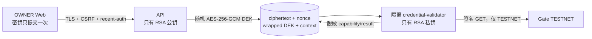

# Web 交易所凭据接入实现

状态：`Gate TESTNET 只读验证与显式执行解锁已实现；LIVE 不可用`  
基线日期：`2026-09-08`（Asia/Shanghai）

## 1. 本切片已经实现什么

OWNER 登录 Web 后可进入“交易所”页面，完成以下操作：

- 新增 `Gate.io / TESTNET / FUTURES_USDT` 账户；
- 一次性提交 API Key 与 API Secret，服务端永不回显；
- 查看脱敏账户状态、凭据版本和不可逆 SHA-256 指纹；
- 排队执行只读连接测试；
- 轮换新凭据，新版本验证成功后才替换旧版本；
- 本地停用账户，并明确提示仍须到 Gate 控制台撤销远端 Key。

验证工作负载实际调用的接口只有：

1. `GET /api/v4/account/detail`
2. `GET /api/v4/futures/usdt/accounts`

域名固定为 Gate 官方 TESTNET `fx-api-testnet.gateio.ws`，代码不接受用户提供 host，不跟随重定向，连接与读取超时有上限。429 不在 HTTP 层无限重试；worker 读取 `Retry-After` 后最多等待 300 秒，每条命令最多尝试 5 次。

## 2. 密钥边界

这不是“把 Secret 用同一把对称密钥存在 API 进程里”的实现。



- API 为每个凭据版本生成随机 256 位数据密钥，以 AES-256-GCM 加密规范化凭据 JSON；
- RSA-OAEP-SHA256 公钥只负责包裹数据密钥；RSA 最低 3072 位；
- tenant、account、credential、version、venue、environment 共同构成 AEAD 与 OAEP context，跨账户复制密文无法解密；
- API 容器只注入 `GATESCOPE_CREDENTIAL_WRAP_PUBLIC_KEY`；
- validator 容器只注入 `GATESCOPE_CREDENTIAL_WRAP_PRIVATE_KEY`；
- PostgreSQL `gatescope_api` 角色不能 `SELECT secret_credentials`；
- 数据库 trigger 拒绝 API 角色写入 `READ_VALIDATED`、active credential、capability 或 validated time，只有 executor 角色能投影验证结果；
- 日志和错误只记录安全错误码，不记录 Gate 响应体、Key、Secret、密文或签名头。

Python 无法证明请求字符串在进程内存中被彻底清除，因此生产 API 仍必须关闭请求体日志、APM body capture、debug shell 和 crash dump。当前中间件不记录 body，验证错误也不会回显 Pydantic 输入。

## 3. 为什么验证成功仍显示“不可交易”

Gate 的账户详情接口可以证明签名凭据能够读取账户详情，并可检查是否设置 IP 白名单；永续账户接口可以证明 USDT 永续读取能力。但是，这两个自查询接口不提供完整的 Key 权限声明，不能可靠证明：

- 下单权限已经开启；
- 提现/转账权限确实关闭；
- 某一币对或账户模式完全符合执行策略。

因此只读探测完成后的状态仍是 `READ_VALIDATED`，`trade_permission` 与 `withdrawal_permission` 固定为 `UNVERIFIED`。它不会自动开启执行。只有 OWNER 在 recent-auth 会话中再次输入 MFA，并确认 TESTNET-only、固定 IP、无提现和独占账户后，才可进入 `TESTNET_READY`；数据库约束规定仅这个状态的 `trading_ready=true`。

这仍是显式用户声明与安全门禁，不是 Gate 权限证明。受限下单、原生保护和对账实现见 [12_GATE_TESTNET_EXECUTION.md](./12_GATE_TESTNET_EXECUTION.md)。LIVE 不存在对应状态和 host。

## 4. 部署配置

先离线生成独立的 3072 位 RSA key pair。私钥必须直接进入云 Secret Manager，不能提交到仓库或复制到 API 环境。下面示例把临时文件创建在受控运维环境；完成 Secret Manager 导入后应安全删除临时私钥：

```bash
openssl genpkey -algorithm RSA -pkeyopt rsa_keygen_bits:3072 -out credential-wrap-private.pem
openssl pkey -in credential-wrap-private.pem -pubout -out credential-wrap-public.pem
openssl pkey -in credential-wrap-private.pem -outform DER | base64 | tr -d '\n'
openssl pkey -pubin -in credential-wrap-public.pem -outform DER | base64 | tr -d '\n'
```

标准 base64 字符也可被当前 base64url 解码器接受。实际配置：

- API：`GATESCOPE_CREDENTIAL_WRAP_PUBLIC_KEY`、`GATESCOPE_CREDENTIAL_KEY_VERSION`；
- validator：`GATESCOPE_CREDENTIAL_WRAP_PRIVATE_KEY`、相同 key version；
- validator 数据库连接：`GATESCOPE_EXECUTOR_DATABASE_URL`，登录角色只继承 `gatescope_executor`；
- API 不配置公钥时仍可启动，但 Web 会显示“未配置”，提交接口返回 503 且不会保存秘密；
- 非本机部署的 `GATESCOPE_PUBLIC_ORIGIN` 必须是 HTTPS，否则凭据提交同样返回 503；
- validator 缺少私钥或数据库连接时拒绝启动。

RSA wrapping key 轮换需要先让 validator 同时支持旧版本解密，再切换 API 写入新版本。本切片的 decryptor 一次只加载一个版本，因此生产轮换编排仍是后续任务；不能先删除旧私钥。

## 5. 数据与状态

迁移 `0009_exchange_credential_admission` 新增：

- `exchange_accounts`：可回显元数据与验证投影；
- `secret_credentials`：仅密文的版本化凭据；
- `credential_validation_commands`：有租约、崩溃接管和最多五次尝试的工作队列；
- `credential_validation_results`：禁止 UPDATE/DELETE 的验证事实。

所有表启用并强制 RLS。API 只接收固定枚举，不允许传入自定义 URL、LIVE、数量、价格或交易权限。当前事件只包含 account ID、环境、版本、安全错误码与 warning code，不含秘密。

## 6. 验证证据与未关闭项

已实现自动化检查：

- RSA/AES envelope round-trip、context 绑定、弱 RSA 拒绝；
- Gate v4 签名、固定 TESTNET URL、两次 GET、禁止重定向、429 上限；
- Pydantic 严格输入与 LIVE/额外字段拒绝；
- OpenAPI Session、CSRF、OWNER、recent-auth 元数据；
- PostgreSQL workflow/RLS/role separation 集成测试（本地无 PostgreSQL 时跳过，由 CI 执行）；
- 前端 TypeScript 与 Vite production build。

仍未实现/验证：

- Gate Key 完整权限的非破坏性远端证明；
- 订单适配器、原生 TP/SL、partial fill 与 UNKNOWN 路径在真实 Gate TESTNET 的联调（代码已实现，本机未发送订单）；
- KMS API/CloudHSM 代替本地 RSA public/private key 注入；
- wrapping key 多版本解密与自动轮换；
- LIVE 账户接入和任何真实资金操作。

所以本切片完成的是“可在 Web 安全设置 Gate TESTNET 信息并验证只读连通性”；显式 TESTNET 订单闭环属于后续文档中的独立风险边界，不能把只读验证成功等同为自动交易授权。
