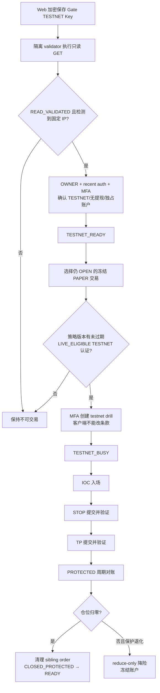

# Gate TESTNET 订单执行与保护闭环

状态：`机械执行代码与认证聚合/落库已实现；上游统计工件生产器未实现，默认无订单可入队；LIVE 硬禁用`  
更新时间：`2026-09-08`（Asia/Shanghai）

## 1. 本次实现范围

本切片把“Web 可保存 TESTNET 凭据”推进到显式、可审计的 Gate TESTNET 机械执行链；它仍被独立证据认证门禁锁住：

- 固定连接 Gate 官方 TESTNET `https://fx-api-testnet.gateio.ws/api/v4`；不接受自定义 host，不跟随重定向；
- 使用 Gate API v4 的 HMAC-SHA512 请求签名；普通订单携带短时 `X-Gate-Exptime`；
- 从合约元数据读取 `quanto_multiplier`、价格步长、最小/最大合约数、允许偏离与 mark price；BASE 数量向下规范为整数合约数；
- 入场使用带最大不利偏移上限的 IOC limit，不使用无价格保护的市价开仓；
- 入口、紧急退出使用由 drill/revision/leg 确定生成的 Gate `text`，响应丢失时先查询订单与成交事实，禁止直接重发；
- 任意部分成交后固定先提交并查询验证交易所侧 stop，再提交并验证 take-profit；两者都使用 mark-price trigger、reduce-only 与平仓方向；
- 条件单没有等价的自定义幂等键。响应不确定时只接受合约、方向、数量、触发价、规则、reduce-only 与 order type 全部一致的唯一 open order；0 个或多个匹配都立即降险；
- stop 无法在硬期限内证明有效时提交独立 reduce-only IOC exit，并冻结账户；
- 已保护仓位由 executor 周期查询。仓位归零后清理仍 open 的 sibling 条件单并释放账户；保护腿消失但仓位仍在时自动 reduce-only 平仓并冻结；
- 已安全绑定的 Telegram 私聊可用 `/testnets` 和 `/testnet testnet_…` 查询最近演练、冻结条款、保护状态、最近事件及下一次对账时点；这些命令严格只读，不触发补单、改单或重放；
- executor 在 exchange mutation 前先写入 PostgreSQL 哈希链事件。进程在不确定步骤中崩溃、租约到期后不会 replay mutation，而是把账户置为 `EXECUTION_FROZEN` 等待人工核对。
- PAPER 证据或人工 MFA 都不能提升策略等级。独立的 `LiveEligibilityGateEvaluator` 会对封存统计工件执行 19 项 fail-closed 聚合门禁；全通过的结果才可由 `gatescope_strategy` 角色落为未过期的 `LIVE_ELIGIBLE / TESTNET` 不可变认证事实。当前尚无生成 nested walk-forward/bootstrap/DSR/PBO 等上游统计量的生产任务，因此正常部署下此门禁仍默认关闭。

官方契约依据：[Gate API v4 Python SDK](https://github.com/gateio/gateapi-python)、[Futures API 文档](https://github.com/gateio/gateapi-python/blob/master/docs/FuturesApi.md)。

## 2. 用户工作流



解锁接口要求所有确认字段为字面量 `true`。演练创建接口只接受：

- `paper_public_trade_id`
- `exchange_account_id`
- `mfa_code`
- Header `Idempotency-Key`

接口 schema 不存在 `side`、`quantity`、`entry`、`stop`、`take_profit`、`host` 或 `environment` 字段；额外字段直接拒绝。数据库 admission trigger 再次比较 PAPER trade 的原始 JSON 与 SHA-256 digest，并要求来源交易仍为 `OPEN`、账户仍为 `TESTNET_READY`、策略认证仍有效。

## 3. 状态和持久化

迁移 `0010_gate_testnet_execution` 新增：

- 账户状态：`TESTNET_READY`、`TESTNET_BUSY`、`EXECUTION_FROZEN`；数据库约束规定只有 `TESTNET_READY` 的 `trading_ready=true`；
- `testnet_execution_drills`：当前执行投影、exchange order IDs、租约、下一次保护检查时间与冻结原因；
- `testnet_execution_events`：禁止 UPDATE/DELETE 的哈希链事件；
- `strategy_execution_certifications`：仅 strategy role 可写、不可修改/删除的认证事实；保存源工件摘要、工件时点、19 项门禁结果、失败原因、假设、策略/政策版本和有效期；数据库触发器要求 gate code 集合与顺序完整、`CERTIFY` 时全部为 `PASS`，且批准者仍是活跃 OWNER；
- RLS、API/executor 列级授权、API 初始事件写入限制、drill admission trigger 与 due-tenant security-definer 查询。

关键状态：

| 状态 | 含义 | 账户处理 |
| --- | --- | --- |
| `QUEUED` | 已冻结条款并占用账户，尚未触网 | `TESTNET_BUSY` |
| `PROCESSING` | 唯一 executor 持租约执行 | `TESTNET_BUSY` |
| `ENTRY_UNFILLED` | IOC 安全地未成交 | 返回 `TESTNET_READY` |
| `ENTRY_UNKNOWN` | 订单事实仍不能证明；不重发 | `EXECUTION_FROZEN` |
| `PROTECTED` | stop/TP 均已读取验证，后台持续对账 | `TESTNET_BUSY` |
| `CLOSED_PROTECTED` | 仓位为零且 sibling 已清理 | 返回 `TESTNET_READY` |
| `CLOSED_FAIL_SAFE` | 保护异常后已降险平仓 | `EXECUTION_FROZEN`，需人工复核 |
| `MANUAL_INTERVENTION_REQUIRED` | 仓位/订单事实冲突或进程租约过期 | `EXECUTION_FROZEN` |

## 4. 部署

API 只有 RSA wrapping 公钥。`credential-validator` 与 `gate-testnet-executor` 使用独立 executor 镜像和 PostgreSQL `gatescope_executor` 角色，只有这两个隔离进程取得 wrapping 私钥。正式环境建议把两类 workload 再拆成不同 KMS policy 与数据库登录。

```bash
# 先运行迁移、API 和只读 validator；检查账户状态
docker compose --profile formal up -d --build

# 只有计划进行 Gate TESTNET 演练时才显式启动
docker compose --profile testnet up -d gate-testnet-executor
```

必须保持：

```text
LIVE_TRADING_ENABLED=false
GATESCOPE_EXECUTION_ENVIRONMENT=TESTNET
GATESCOPE_EXECUTOR_WORKLOAD=gate-testnet-execution
```

第二、三个值只出现在 TESTNET executor；API 与 validator 继续使用非交易控制面配置。任何 `LIVE_TRADING_ENABLED` 非 false 值都会使 executor 启动失败。

## 5. 已验证与尚未验证

本地已验证：

- 数量/价格/触发方向规范化；
- 签名输入、固定 URL、`X-Gate-Exptime`；
- mutation timeout 单次调用与 UNKNOWN 对账；
- stop-before-TP 顺序和每次 mutation 前 journal；
- 条件单唯一指纹对账；
- stop 不可证明时 reduce-only 降险；
- 仓位关闭后的 sibling 清理，以及保护腿消失后的自动降险；
- Pydantic 禁止 LIVE/自定义交易条款，OpenAPI 标注 Session/CSRF/OWNER/recent-auth/MFA；
- 未认证 PAPER 策略无法创建 drill，失败也不会占用 TESTNET 账户；
- 19 项 LIVE eligibility 聚合门禁、临界值 fail-closed、确定性认证摘要，以及 append-only 认证落库路径；
- Python lint、类型检查、单元/故障测试和 Web production build。

尚未在当前开发机验证：

- 真实 PostgreSQL 迁移、RLS 和列级权限执行（本机没有 PostgreSQL/Docker）；
- 使用用户 Gate TESTNET 凭据发出真实订单（实现过程没有调用用户账户或创建订单）；
- Gate WebSocket 成交流、网络分区、交易所维护、跳空、低流动性与长时间压力；
- 双向持仓模式；当前明确只接受 `single` 且执行前账户必须为零仓位；
- 手工解除 `EXECUTION_FROZEN` 的安全核对向导；当前必须先在 Gate TESTNET 人工核对仓位和 open price orders；
- LIVE 凭据、LIVE host 与真实资金交易，三者均不存在于允许路径。
- `LIVE_ELIGIBLE` 所需 nested walk-forward、block bootstrap、Holm、DSR、PBO、成本压力与 sealed-holdout 的上游统计工件生产器和独立复算作业；现有聚合器只验证已封存输入，不会从 PAPER 样本推算或自动升级证据。

因此，这一阶段的准确结论是“受限 Gate TESTNET 机械执行代码闭环与认证聚合/持久化边界已实现并通过本地确定性测试，但正常产品路径仍被上游统计工件门禁锁住”，不是已经可自动下单，不是生产实盘就绪，也不是盈利保证。
