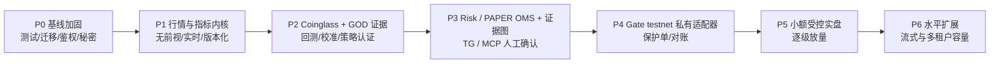

# GateScope V2 规划总览

状态：`Phase 1 核心实施中（PostgreSQL/容器 CI 门禁待执行）；非实盘就绪`  
基线日期：`2026-09-07`（Asia/Shanghai）  
目标读者：后续负责实现的 Sol 5.6、代码审阅者、运维与策略负责人

## 1. 结论先行

当前 GateScope 是一个好用的本地研究原型，但不是可安全实盘的交易系统。V2 应保留现有形态识别、行情缓存、机会扫描和 Lightweight Charts 图表能力，同时重建以下生产边界：

1. 把启发式 `shape_confidence`、经过样本外校准的障碍结果概率，以及独立定义和校准的净盈利概率严格分开。
2. 把 Web/API、策略决策、下单执行、通知投递拆成可独立故障的模块；私有交易凭据只允许执行服务解密。
3. 候选判断先固化为不可变 `signal_evidence_snapshot`；每个账户的仓位、成本和风险结论另存为 `execution_decision_snapshot`，授权通过后才生成不可变 `order_intent`，最后由唯一执行器提交。
4. 止盈止损必须尽可能托管在交易所。网络不确定时采用幂等查询与对账，绝不盲目重复下单；无法确认保护单时撤销未成交量并以 `reduce-only` 降险/平仓。
5. Telegram 是受限控制面，不是秘密存储区。它可以确认、拒绝、暂停和查询，但不能展示 API Key，也不能绕过服务端风险规则。
6. MCP 默认只读，可做数据查询、解释、回测和订单草案建议；不得直接越权成交。
7. Coinglass/LSR 通过独立适配器接入，严格执行域名白名单、业务码判断、额度缓存、数据时效门禁和 `Retry-After`。
8. 已确认交易的原始指标、K 线范围、外部数据、策略/模型版本和参数形成不可变证据。后续行情只能追加，不能用未来数据改写当时的理由。

这里“概率上能够获利”必须拆成两个不同命题：净收益为正的概率 `P(net_profit > 0)`，以及净收益期望 `E[net_profit]`；前者大并不推出后者为正。系统只能在明确的数据分布、成本和验证假设下，报告样本外校准的概率估计与策略级净期望下置信界。两者都不等于保证盈利，也不能证明未来市场持续服从历史分布。

## 2. 文档索引

- [57_STRUCTURE_PRECISION_20261004.md](./57_STRUCTURE_PRECISION_20261004.md)：波浪硬约束与目标区间、形态锚点/边界校验、同根失败留档、版本隔离与本地回归；尚未部署。
- [51_FINE_VOLUME_PROFILE.md](./51_FINE_VOLUME_PROFILE.md)：VPVR 优先分钟缓存、服务器细周期计算、覆盖/单位/修订边界与有界查询验收。
- [50_CURATED_CHART_STUDIES.md](./50_CURATED_CHART_STUDIES.md)：七项精选指标、Coinglass 精确口径与时效、VPVR 可视 OHLCV 估算及分阶段验收；浏览器与部署状态单独记录。
- [49_COMMERCIAL_READINESS_REVIEW.md](./49_COMMERCIAL_READINESS_REVIEW.md)：2026-09-15 商业化准备度、用户/计量/恢复/复盘优化建议及已授权旧备份删除记录；不是已实现功能清单。
- [48_PLATFORM_OPTIMIZATION.md](./48_PLATFORM_OPTIMIZATION.md)：MCP 1.4.0、模拟交易闭环、年度/组合研究、历史压缩及实际生产验收范围。
- [36_LISTING_HISTORY_REPAIR.md](./36_LISTING_HISTORY_REPAIR.md)：中文合约归档、上市后有效历史范围、部分缓存先回放及同步状态修复。
- [34_HISTORICAL_SAMPLE_REFERENCES.md](./34_HISTORICAL_SAMPLE_REFERENCES.md)：零样本诊断、原时刻历史参考、后台断点续算与有界分页；不改写原始预测。
- [33_TELEGRAM_PATTERN_TRADE_NOTICES.md](./33_TELEGRAM_PATTERN_TRADE_NOTICES.md)：形态做单观察通知、原始证据图及 Telegram 只读查询交互。
- [32_EVENT_REPAIRS_AND_PERFORMANCE_OBSERVATION.md](./32_EVENT_REPAIRS_AND_PERFORMANCE_OBSERVATION.md)：当前政策更新：取消四项绩效硬门槛、统一形态事件与过期规则、持续持仓对账和交互修复。
- [27_BACKGROUND_CHART_AND_FAILURE_MEMORY.md](./27_BACKGROUND_CHART_AND_FAILURE_MEMORY.md)：后台预热图表、独立实时通道、重载预览，以及实测失败样本的去重参考和原始证据。
- [23_STRATEGY_DISCOVERY_AND_ADMISSION.md](./23_STRATEGY_DISCOVERY_AND_ADMISSION.md)：历史研究与旧四项门槛记录；当前政策以32号文档为准。
- [01_PRODUCT_ARCHITECTURE.md](./01_PRODUCT_ARCHITECTURE.md)：现状审计、产品信息架构、TradingView 级交互目标、服务边界、指标框架、容量与 SLO。
- [02_QUANT_DECISION_SPEC.md](./02_QUANT_DECISION_SPEC.md)：GOD 决策核、无泄漏数据规范、概率校准、净期望、仓位、组合约束、回测与上线门禁。
- [03_EXECUTION_TG_MCP_SECURITY.md](./03_EXECUTION_TG_MCP_SECURITY.md)：云端登录、密钥、交易执行状态机、严格保护单、Telegram、MCP、Coinglass 和历史证据图。
- [04_DATA_API_IMPLEMENTATION.md](./04_DATA_API_IMPLEMENTATION.md)：目标数据模型、REST/WS/MCP 契约、目录结构、分阶段 backlog、测试矩阵与验收定义。
- [COINGLASS_CONNECTIVITY.md](./COINGLASS_CONNECTIVITY.md)：本次真实连通性验证结果和生产接入约束；不含密钥。
- [05_PHASE0_IMPLEMENTATION.md](./05_PHASE0_IMPLEMENTATION.md)：已实现代码、安全边界、测试结果、已知限制与 Phase 1 进入门禁。
- [06_PHASE1_IMPLEMENTATION.md](./06_PHASE1_IMPLEMENTATION.md)：已落地的数据/指标/形态/RLS/worker 切片、验证证据与尚未关闭的 Phase 1 gate。
- [07_MCP_IMPLEMENTATION.md](./07_MCP_IMPLEMENTATION.md)：已落地的 Codex Streamable HTTP 接入、一次性 scoped token、只读工具、审计和运维边界。
- [08_GOD_EVIDENCE_IMPLEMENTATION.md](./08_GOD_EVIDENCE_IMPLEMENTATION.md)：已落地的 Hoeffding/Bonferroni 有限样本下界、不可变摘要和 PAPER-only abstain 门禁。
- [09_OMS_PROTECTION_IMPLEMENTATION.md](./09_OMS_PROTECTION_IMPLEMENTATION.md)：已落地的 UNKNOWN 对账、幂等 client order ID、部分成交保护 deadline 与 reduce-only 降险状态机。
- [10_PAPER_TRADE_LEDGER_IMPLEMENTATION.md](./10_PAPER_TRADE_LEDGER_IMPLEMENTATION.md)：已落地的冻结信号、服务端风险定量、PAPER 提案/确认、交易事件链、TG/MCP 查询与历史走势图边界。
- [11_EXCHANGE_CREDENTIAL_ADMISSION.md](./11_EXCHANGE_CREDENTIAL_ADMISSION.md)：已落地的 Web Gate TESTNET 凭据设置、公钥封装、隔离只读验证、轮换/停用和权限边界。
- [12_GATE_TESTNET_EXECUTION.md](./12_GATE_TESTNET_EXECUTION.md)：已落地的显式 TESTNET 解锁、冻结 PAPER 条款执行、Gate 下单/原生保护、UNKNOWN 对账、降险和持续保护监控。
- [13_QUANT_VALIDATION_PRIMITIVES.md](./13_QUANT_VALIDATION_PRIMITIVES.md)：事件唯一性、设计效应、block bootstrap、Holm、功效、purged walk-forward、DSR/PBO 与 LIVE eligibility 聚合/持久化边界。
- [14_UI_FUNCTIONAL_ACCEPTANCE.md](./14_UI_FUNCTIONAL_ACCEPTANCE.md)：现有 Web 模块、分页、弹窗、角色边界与桌面/手机功能验收。
- [15_STRATEGY_CHART_REPORTING.md](./15_STRATEGY_CHART_REPORTING.md)：策略编辑/删除、回测时间维度、K 线/回撤联动、行情工具与历史概率统计口径。
- [16_COMPOSITE_AND_HISTORICAL_REPLAY.md](./16_COMPOSITE_AND_HISTORICAL_REPLAY.md)：具体形态单选/多选、趋势过滤、组合入场语义、历史补录零成交原因及显式回放模式。
- [17_WATCHLIST_MARKET_CACHE.md](./17_WATCHLIST_MARKET_CACHE.md)：自选八周期持续采集、8000 根缓存目标、缺口续采、未收盘行情隔离、增量页面刷新和原子发布验收。

## 3. 用户需求映射

| 原始目标 | 设计落点 | 最低验收条件 |
| --- | --- | --- |
| 页面配置 TG 推送 | 通知设置页、连接向导、测试投递、路由规则 | 可连接/解绑、测试、静默时段、频率限制、投递回执 |
| 云端账号密码登录 | OIDC-ready 本地账号、Argon2id、MFA、会话与 RBAC | 无默认密码；生产缺少关键秘密时拒绝启动；未登录 API 全部拒绝 |
| 交易所 API 开单及严格止盈止损 | 隔离执行器、交易所原生条件单、幂等与对账、保护单看门狗 | 不出现重复开仓；有仓位但保护单未确认超过阈值时自动降险并冻结 |
| TG 人工确认/全自动、单/多币种 | 一次性确认令牌、自动授权策略、标的白名单与组合限额 | 回调不可重放；自动模式有到期时间、范围、限额和一键急停 |
| TG 高舒适度 | 卡片、内联按钮、编辑原消息、自然语言命令、降噪 | 常用动作最多两次点击；同事件只维护一条状态消息 |
| MCP 接 Codex | 独立只读 MCP 网关和提案工具 | 默认令牌不能成交；结果含时间、来源、时效与快照 ID |
| Coinglass 标准版 + LSR | 能力发现、限额调度、时间对齐和 point-in-time 特征 | Key 只发白名单域名；200 检查业务码；429 有界重试；缺失不当作中性 |
| 交易事件图、保留与查询 | 不可变信号证据快照、账户级执行决定快照、追加式订单时间线、证据图渲染 | 能重放当时图；当前走势单独追加；失败交易也保持原始理由不变 |

## 4. 对标 TradingView 的准确含义

本计划对标的是产品能力和可扩展架构，而不是声称一开始就具备 TradingView 的全球用户量或复制其未公开的内部实现。

V2 的对标点包括：

- 快速、多窗格的 K 线和指标体验；
- 指标注册表、参数 schema、版本化与批量/增量计算一致性；
- 布局、指标模板、自选、告警和多周期联动；
- 实时流、历史补齐、数据质量和断线恢复；
- 策略回测、样本外报告、事件定位和可解释决策；
- 可水平扩展的行情扇出、任务 worker 和持久化事件流。

V2 不在首轮实现 Pine Script 兼容、社交社区、经纪商市场或 TradingView 全球容量。若未来需要运行用户自定义代码，必须另建沙箱执行边界，不能在 API/执行器进程内 `eval`。

## 5. 当前基线与立即禁令

截至基线日期：

- 代码约 5,700 行，后端为 FastAPI，前端为原生 JavaScript，持久化为单 SQLite。
- 数据库约 23 MiB，含 3,323 个标的、109,135 根 K 线、23 次机会扫描运行。
- 26 类图表形态，内部使用 ATR、枢轴、结构比例、线性拟合与突破确认。
- 已有 Wilson 区间、方向收益、MFE、MAE，但没有手续费、滑点、资金费率、真实成交或样本外门禁。
- 没有测试目录、迁移体系、登录、租户隔离、Telegram、MCP、Coinglass 或私有交易 API。
- `python3 -m py_compile` 对当前六个 Python 核心模块通过。
- 工作区中的 `.git` 目录为空，当前无法形成可靠变更历史；实施前应先备份并初始化/恢复正式版本库。

以下条件满足前，`LIVE_TRADING_ENABLED` 必须硬编码/配置为 `false` 且执行服务不得持有生产交易权限：

1. 修复历史信号可用时间和未闭合 K 线问题；
2. 加入成本、滑点、资金费率和成交模型；
3. 通过样本外、压力、影子盘和交易所沙箱门禁；
4. 完成鉴权、密钥管理、审计、幂等、对账与故障注入测试；
5. 保护单不变量通过自动化验收；
6. 用户在 Web 端通过 MFA 明确启用有限范围的实盘策略。

## 6. 建议实施顺序

每个阶段都必须独立可部署、可回滚、默认关闭新增风险能力。详细依赖、任务和验收见 `04_DATA_API_IMPLEMENTATION.md`。

## 7. 全局不可违反的不变量

- `UI / TG / MCP` 不能直接调用交易所，也不能自行创建 `order_intent`；它们只能请求 proposal、approval 或受限降险命令，`order_intent` 只能由服务端批准事务创建。MCP v1 最多创建 PAPER 或待人工授权的 MANUAL proposal。
- 只有执行服务能解密交易所密钥，且 API Key 必须禁用提现并尽量绑定子账户和出口 IP。
- 风险规则只能收紧，客户端输入不能放宽服务端硬限制。
- 同一订单意图在任何重试、进程重启和回调重放下最多形成一个逻辑订单。
- 任何非零仓位必须有已确认的交易所侧保护，或处于有时限的自动降险状态。
- 数据过期、账户状态未知、时钟偏差过大、限额不足或风险服务不可用时，禁止新开仓；退出/降险仍必须可执行。
- `signal_evidence_snapshot`、`execution_decision_snapshot`、审批、订单/成交和审计记录仅追加，不允许原地改写或级联删除。
- 图表必须明确区分“当时可见数据”和“事后追加走势”，并显示数据截止时间、策略版本和哈希校验状态。
- 日志、错误、TG 消息、MCP 响应、前端和数据库明文字段均不得包含 API Key、Bot Token、会话令牌或解密后的凭据。

## 8. Definition of Done

实现并不以“页面能点”作为完成标准。每个纵向切片至少同时具备：

- 版本化数据库迁移和回滚说明；
- OpenAPI/事件 schema 与输入约束；
- 单元、属性、集成、端到端和故障路径测试；
- 指标、结构化日志、trace、告警和操作手册；
- 默认安全配置、权限检查、秘密脱敏和审计；
- 数据时效、幂等键、重试上限和失败状态；
- 对用户可见的时间戳、来源、状态与风险说明；
- 相关文档同步更新。

## 9. 行情图表扩展

[独立工作区管理后台](52_ADMIN_CONSOLE.md) — 独立路由、用户与资源统计、成员管理、操作审计、权限边界及测试记录。

[低容量运行与写入优化](54_STORAGE_BUDGET_OPTIMIZATION.md) · [龙虾退订与定向清理](55_UNWATCHED_MARKET_RETIREMENT.md) — 保留实时服务、短事务清理与历史证据边界。

[形态、波浪与历史表现](18_CHART_PATTERNS_AND_WAVES.md) — 三阶段结构列表、原理线、分片因果回放与统计口径。

[结构识别 V2](19_STRUCTURE_ACCURACY_AND_LIFECYCLE.md) — 精确锚点、ATR 识别规则、候选失败留档、原始图/时间线、历史确认率与置信区间。

[一年历史与预测 V3](20_ANNUAL_HISTORY_AND_FORECASTS.md) — 全自选/全周期本地缓存、月档案补齐、流式断点与增量回放、首次预测/形成前目标/实际点位、覆盖率与容量边界。

[新服务器迁移记录](21_SERVER_MIGRATION_20260911.md) — 2026-09-11 的新地址、数据一致性、HTTPS 续期、内存预算、运行验证和回退注意事项。

[部署复验与性能优化](22_DEPLOYMENT_ACCEPTANCE_AND_PERFORMANCE.md) — 真实电脑/手机验收、TG 实际送达、Coinglass 检测、查询与传输性能对比、本机停用和测试边界。

[历史策略筛选与旧部署门槛](23_STRATEGY_DISCOVERY_AND_ADMISSION.md) — 保留原始回测结果；四项绩效门槛现已取消，见 [当前实施记录](32_EVENT_REPAIRS_AND_PERFORMANCE_OBSERVATION.md)。

[多年度策略挖掘与资金费率研究](24_STRATEGY_MINING_AND_CARRY.md) — 2,304 个方向组合、3 套基础成本达标对冲配置、双倍成本失败、样本偏差与只读结果页面。

[非对冲指标、形态和波浪挖掘](25_DIRECTIONAL_INDICATOR_PATTERN_WAVE_MINING.md) — 两批4,176个开发组合、56个冻结验证、0个达标；因果枢轴、波浪失效位、成本和逐笔依据。

[覆盖与绘图](26_STRUCTURE_COVERAGE_AND_GEOMETRY.md) · [后台行情与失败记忆](27_BACKGROUND_CHART_AND_FAILURE_MEMORY.md)

[Telegram 自选行情查询](28_TELEGRAM_MARKET_QUERIES.md) — 分页按钮、原始图、指标和未推送排查。

[28 类形态规则与形成置信度](29_STRUCTURE_RULES_AND_CONFIDENCE.md) — 3.2 规则矩阵、两种概率、历史样本区间和覆盖/性能对照。

[TG 高置信形态检索](30_TELEGRAM_STRUCTURE_SCREENING.md) — 推送入口、净胜率与样本区间、严格/观察分组、纯形态 K 线图。

[同源研究与通知影子账本](35_SAME_ENGINE_RESEARCH_AND_SHADOW_LEDGER.md) — 长历史后台研究、冻结 TP/SL 净结果、通知前向观察、环境对照、滚动与时间块验证；不恢复绩效门槛、不新增实盘权限。

[当前形态评分筛选与结果详情](37_CURRENT_PATTERN_SCREENING.md) — 服务端全跟踪集合评分区间筛选、类型/方向占比、单个目标及历史概率与净胜率参考；区分当前匹配与历史统计口径。

[Coinglass 与形成中形态联动](38_COINGLASS_PATTERN_CONTEXT.md) — 已确认许可，原生副图、独立研判/观察情景、用户隔离缓存和配额调度。

[MCP 行情、指标与 OpenAI 接入](39_MCP_MARKET_EXPORT.md) — 币种/周期输出、常见指标、Coinglass 快照、网页预览、GPT-6 Astra 服务端接入示例及实际协议验证边界。

[Coinglass 与 MCP 生产发布验收](40_COINGLASS_MCP_RELEASE.md) — 实际桌面/手机验收、MCP 协议与撤销验证、生产修复、回退资料和尚未执行的 OpenAI 账户实调。
